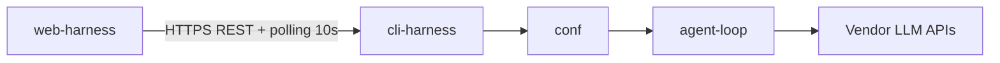

# Native Agent Harness

## What this is

Native agent harness in Rust: CLI `harness.exe`, an agent loop, HTTP agents for xAI (Grok), Google (Gemini), Claude, DeepSeek and AliBaba (Qwen), a tool registry, an HTTPS server mode, and a Leptos WASM web client (`harness.wasm`).

## Architecture

The system is a Cargo workspace of native crates plus a separate WASM crate:

| Crate | Kind | Responsibility |
|---|---|---|
| `logger` | native lib | `Logger` contract; file and null sinks |
| `interactions` | native lib | `Interaction` contract, `OutputType`, CLI interaction |
| `auth` | native lib | Bearer-token generation, constant-time comparison, axum middleware |
| `harness-api` | native lib | REST DTOs shared by the server and the web client |
| `conf` | native lib | Loading and validation of `harness.json5` and model files |
| `tools` | native lib | Tool registry: `fs`, `git`, `terminal`, `user`, `skills`, `roles` |
| `agent-loop` | native lib | Async agent loop, vendor agents, `VendorRequest` |
| `cli-harness` | native bin | CLI (`--prompt`) and HTTPS server (`--serve` / no arguments) |
| `web-harness` | WASM lib + bin | Leptos CSR client, `HarnessGateway`, `HarnessPanel` |

`web-harness` is excluded from the Cargo workspace and is built separately with Trunk.



The client and the server communicate only over HTTPS REST with polling every 10 seconds. The server does not serve the frontend and does not use SSE or WebSocket.

## Technologies

| Technology | Purpose |
|---|---|
| Rust / tokio | Async runtime for the server, the agent loop, cancellation and timeouts |
| axum + axum-server + rustls | HTTPS REST server with built-in TLS termination |
| rcgen | Automatic self-signed TLS certificate generation on first server start |
| async reqwest | Async HTTP client for vendor LLM APIs |
| Leptos CSR | Reactive client-side UI for `harness.wasm` |
| Trunk | Pure-Rust WASM build for `web-harness` without Node.js |
| gloo-net | `fetch`/HTTP calls from the WASM client |
| serde / serde_json | DTO serialization and JSON handling |
| JSON5 | Human-friendly configuration format (`harness.json5`, model files) |

## Build

Cargo workspace: `crates/conf`, `crates/logger`, `crates/tools`, `crates/harness-api`, `crates/interactions`, `crates/agent-loop`, `crates/auth`, `crates/cli-harness`. `crates/web-harness` is excluded from the workspace and is built separately with Trunk.

```bash
cargo test --workspace
cargo build --release -p cli-harness
```

Binary: `target/release/cli-harness` (`target/release/cli-harness.exe` on Windows). Release artifacts are published as `harness-<version>-linux`, `harness-<version>-macos` and `harness-<version>-windows.exe`.

## CLI

From `crates/cli-harness/help.txt`:

```text
harness.exe --help
harness.exe --help-tools
harness.exe --version
harness.exe [--serve] [--host <addr>] [--port <port>] [--conf <path>] [--cwd <path>]
            [--tls-cert <path> --tls-key <path>] [--auth-token <token>]
harness.exe [--cwd <path>] [--api-key <key>] [--conf <path>] --prompt "<user prompt>"
harness.exe [--cwd <path>] [--api-key <key>] [--conf <path>] --prompt-file <path to prompt file>
harness.exe [--api-key <key>] --dump "<path to dump file>"
harness.exe --conf-new "<path to new conf file>"
```

Rules:

- No arguments (or `--serve`) starts the HTTPS server.
- `--prompt`, `--prompt-file`, `--dump` and `--conf-new` are mutually exclusive. One of them is required for a console session.
- `--conf` is optional. Default: `<cwd>/harness.json5` in both console and server modes. A relative path is resolved against the process current directory, then normalized; after normalization the file must be inside the final CWD. Cannot be combined with `--conf-new` or `--dump`.
- `--prompt` starts a new session. `--prompt-file` starts a new session with the user prompt read from a UTF-8 file. `--dump` continues from a dump file (the prompt is taken from dump history; configuration is taken from the dump, `--conf` is forbidden). `--conf-new` writes a commented JSON5 template and exits.
- `--port`, `--host`, `--tls-cert`, `--tls-key` and `--auth-token` are valid only with `--serve`.

## Server mode

`harness.exe --serve` (or no arguments) starts the HTTPS API server. The default port is `4067`; priority: `--port`, then `server.port` from `harness.json5`, then `4067`.

Server flags:

- `--host <addr>` — bind address, default `127.0.0.1`;
- `--port <port>` — HTTPS port in range `1..=65535`;
- `--conf <path>` — path to `harness.json5` (default: `<cwd>/harness.json5`);
- `--cwd <path>` — workspace root override;
- `--auth-token <token>` — fixed Bearer token; when omitted, a random token is generated and printed to stdout;
- `--tls-cert <path>` and `--tls-key <path>` — user PEM certificate/key instead of the auto-generated self-signed certificate.

All `/api/v1/*` endpoints except `GET /api/v1/health` require the `Authorization: Bearer <token>` header. The token is printed to stdout on server start when `--auth-token` is not provided.

The server listens on `127.0.0.1` by default. For remote access pass `--host 0.0.0.0` (or a specific interface) and add the web-client origin to `server.cors-allowed-origins` in `harness.json5`.

On first start the server auto-generates a self-signed TLS certificate and stores it in the OS data directory outside `cwd`.

## Web client

`harness.wasm` is a pure Rust/Leptos CSR client built with Trunk:

```bash
cd crates/web-harness
trunk build --release
```

The build output is `crates/web-harness/dist`. CI publishes it to GitHub Pages on every push to `master`.

The client:

- connects to the server over HTTPS (for example `https://localhost:4067`);
- polls the run status URL every 10 seconds;
- shows run status, `pendingInput` prompts and the final result;
- does **not** show the session log, does **not** select an agent and does **not** manage API keys — the server asks for them as ordinary `pendingInput` requests.

Self-signed certificate: after the first server start, open `https://localhost:4067/api/v1/health` in the browser and accept the certificate exception before using `harness.wasm` from GitHub Pages.

## Basic workflows

### 1. Console session

`harness.exe --conf harness.json5 --prompt "..."` (or `--prompt-file <path to prompt file>`) starts a console session. If `agent.config` points to a folder or the selected model has no API key, the harness asks for the agent/key in the console. The session writes `log.md` and `dump.json`; `--dump "<path to dump file>"` continues an existing session.

### 2. Server + web client

`harness.exe --serve` (or no arguments) starts the HTTPS server. When `--auth-token` is not provided, the random Bearer token is printed to stdout. Open `harness.wasm`, connect to the server (for example `https://localhost:4067`) with the token, start a run with `POST /run`, then poll the returned `runUrl` every 10 seconds and answer `pendingInput` requests until the result is shown.

### 3. Embedded plugin

Add `web-harness` to a parent Leptos WASM application via Cargo/Git and render `HarnessPanel`. Optionally enable the `fs-panel` feature to get the `ConfigEditor` and `FsBrowser` components backed by the server FS API.

## web-harness integration

`web-harness` is published as a Git tag for source-level integration into other Leptos WASM applications through Cargo/Git. Enable the `fs-panel` feature to get the `ConfigEditor` and `FsBrowser` components; the standalone Pages build uses the default feature set.

In the first version `web-harness` is not published to crates.io.

## Configuration

### Loop file `harness.json5`

- CWD — agent workspace (tools and logs). It is set only through `--cwd` or, when the flag is omitted, the process current directory. A `cwd` key in `harness.json5` is rejected at load time.
- `agent.log-folder` — log folder relative to CWD.
- `agent`:
  - `config` — path to a model file or a folder of model files (you will be asked to choose). Relative paths are resolved against CWD and must stay inside CWD.
  - `mode` — `safe` (ask when a limit is exceeded) or `auto-accept` (log and continue).
  - `token-limit`, `iteration-limit`, `USD-limit` — session limits; `-1` = unlimited.
- `server` — optional HTTPS server settings:
  - `host` — bind address, default `127.0.0.1`;
  - `port` — default port `4067`;
  - `tls-cert`, `tls-key` — optional PEM certificate/key paths;
  - `cors-allowed-origins` — explicit origin allowlist, `[]` by default.
- `tools` — object of enabled tool modules.

### Model file

- `vendor`, `name`
- `api-key` — the key itself, or a path to a file that contains the key
- `limits` — required object (`tokens`, `USD`, `rpm`, `tpm`, `rpd`). Missing `limits` is an error before the cycle starts. `rpm` / `tpm` / `rpd` are integers, `-1` or `>= 1` (`-1` disables that limit). `tokens` is an integer, `-1` or `>= 1`. `USD` is a number, `-1` or `>= 0`. Session `token-limit` / `USD-limit` still come only from `harness.json5`.
- `price` — required object (`input-price`, `output-price`, `cached-price`), USD per 1_000_000 tokens. `-1` means free. Missing `price` is an error before the cycle starts.
- There is no `iteration-limit` in the model file. Session iterations are set only in `harness.json5`.

Known agents:

- `SpaceXAI` / `Grok 4.6`
- `GoogleAI` / `Gemini 3.8 Flash`, `Gemini 3.5 Flash Lite`, `Gemini 3.1 Flash Lite`
- `Claude` / `Claude Sonnet 5.5`
- `DeepSeek` / `DeepSeek-V3`, `DeepSeek-R1`, `DeepSeek-Flash`, `DeepSeek-V4-Pro`
- `AliBaba` / `Qwen-Turbo`, `Qwen-Plus`, `Qwen-Max`

## Tools

A missing key in `tools` means the module is not registered. An unknown key is a load error. There are no `search` or `meta` modules.

- **fs** — files and folders; `find_str` / `find_str_by_regex`; `find_file_by_str` / `find_files_by_regex`; `list_available_*` for dirs, files and extensions. Fields: `available-dirs`, `available-file-extensions`, `available-files` (`r:` / `w:` prefixes on the dir and file allow-lists), `deprecated-dirs`, `deprecated-files`, `deprecated-dir-patterns`.
- **git** — `executable`, `execution-limit`.
- **terminal** — `run_shell`; fields `cwd-list`, `available-commands`, timeout `command-execution-limit`.
- **user** — `ask_user`, `request_read_access_for`, `request_write_access_for`, `request_command_shell_execution`.
- **skills** / **roles** — the agent can request a skill or role by name (`get_skill_explanation` / `get_role_explanation`).

## CI

GitHub Actions on push to `master` and on tags `v*` / `harness-*`:

- builds and tests the workspace on `ubuntu-latest`, `windows-latest` and `macos-latest`;
- builds `cli-harness` in release mode and uploads `harness-<version>-windows.exe`, `harness-<version>-linux` and `harness-<version>-macos` artifacts;
- builds `web-harness` with Trunk and publishes `dist` to GitHub Pages on push to `master`;
- creates a GitHub Release only for `v*` tags, verifies that the tag matches the version from `Cargo.toml`, and publishes `.sha256` files for the three native binaries.
