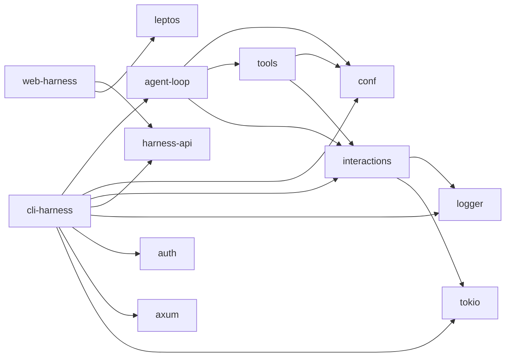
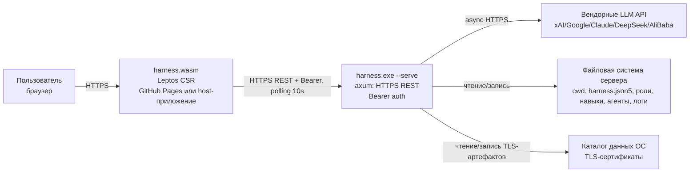
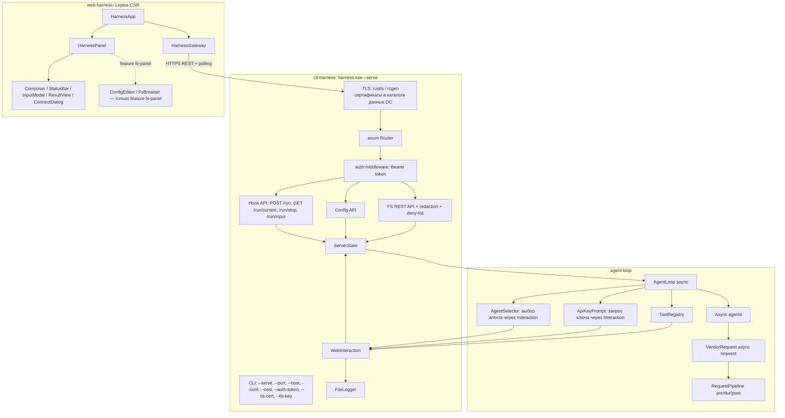
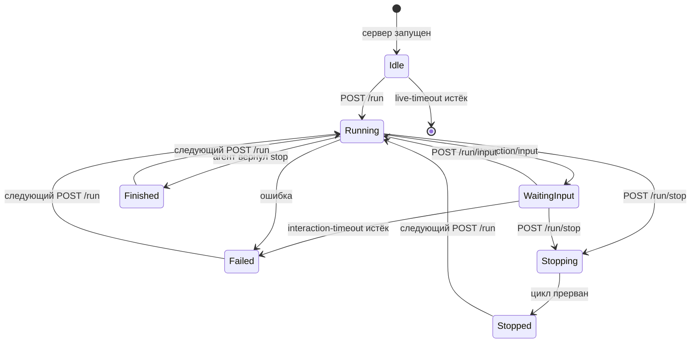
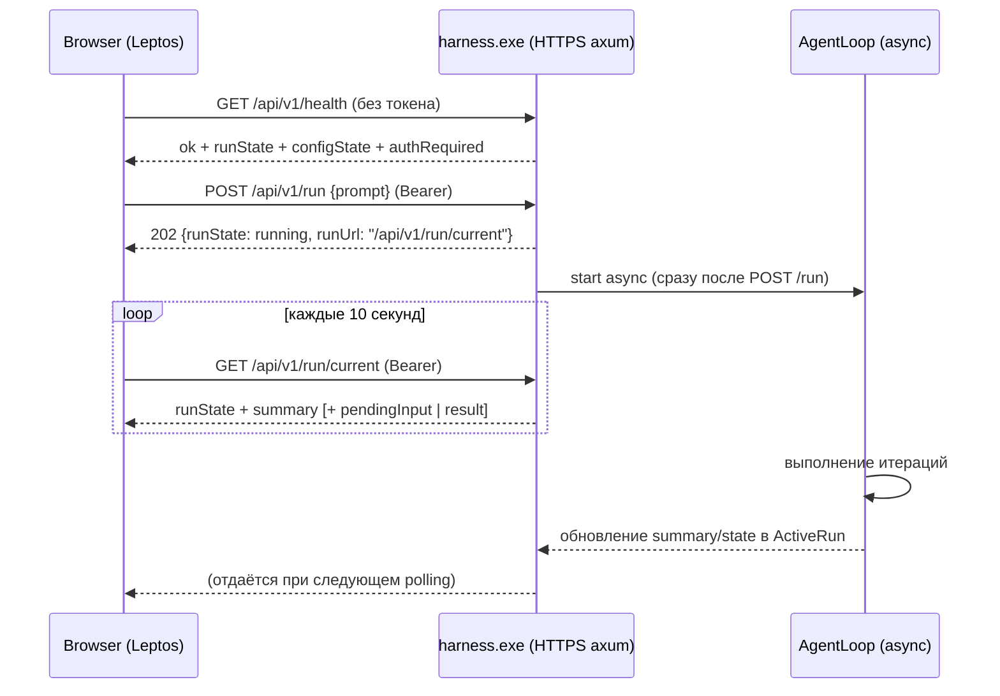
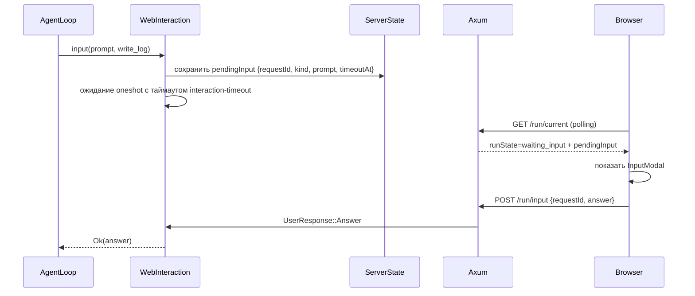
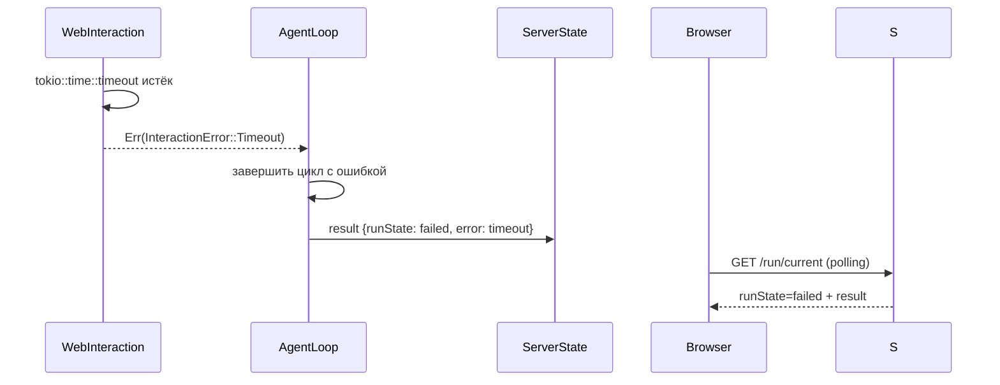
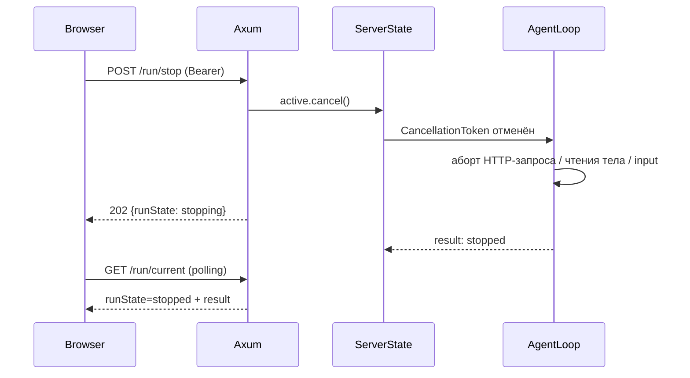

# Phase 6. Архитектура решения

> Документ описывает целевую архитектуру: декомпозицию на crate'ы, модули, связи, диаграммы и модель выполнения.
> Смежные документы: `base.md` (исходное/целевое состояние), `tech.md` (технологии), `api.md` (REST-API), `ui.md` (web-интерфейс), `auth.md` (аутентификация).

---

## 1. Архитектурные принципы

1. **Единая зона ответственности ввода/вывода.** Все операции ввода/вывода и логирования проходят через два контракта: `Logger` и `Interaction`.
2. **Полностью асинхронный сервер.** HTTP-слой, агентский цикл и запросы к вендорам работают на `tokio`; блокирующие операции изолируются через `spawn_blocking`.
3. **Сервер ничего не знает о клиенте.** Сервер предоставляет HTTPS REST; web-интерфейс — отдельное приложение.
4. **Один транспорт.** Между клиентом и сервером используется только HTTPS + REST (JSON). Никаких SSE/WebSocket/иных протоколов.
5. **Одна активная сессия.** Сервер в каждый момент выполняет не более одного агентского цикла.
6. **Безопасность по умолчанию.** HTTPS обязателен, CORS по умолчанию запрещён, все API-эндпоинты (кроме `health`) требуют Bearer-токен в заголовке `Authorization`.
7. **Клиент не знает о внутренностях сервера.** Web-клиент не знает про агентов, API-ключи и лог сессии. Выбор агента и ввод ключа сервер выполняет через `Interaction`; для клиента это обычный `pendingInput`.
8. **Секреты не покидают сервер.** API-ключи и приватные ключи никогда не возвращаются клиенту; в файловых ответах выполняется redaction.
9. **Модульность для встраивания.** Клиент разделён на транспорт (`HarnessGateway`) и UI (`HarnessPanel`); FS-возможности включаются отдельной фичей.
10. **YAGNI.** Runtime-плагины, WIT-компоненты, SSE, WebSocket, сложная многофакторная аутентификация и удалённый запуск сервера исключены из первой версии.

---

## 2. Декомпозиция на crate'ы

### 2.1. Целевая структура

```
crates/
  conf/           # существующий: загрузка конфигурации, модели, список агентов, ServerSettings
  logger/         # Logger, FileLogger, NullLogger
  interactions/   # Interaction, OutputType, CliInteraction, InteractionLoggers
  auth/           # генерация и проверка Bearer-токена, axum-middleware
  harness-api/    # общие DTO REST (сервер и клиент)
  tools/          # реестр инструментов; использует Interaction вместо stdin/logger
  agent-loop/     # асинхронный агентский цикл, агенты, VendorRequest, RequestPipeline
  cli-harness/    # CLI + режим HTTPS-сервера (axum); WebInteraction
  web-harness/    # Leptos CSR клиент + HarnessGateway + HarnessPanel (lib.rs + main.rs)
```

### 2.2. Ответственность crate'ов

| Crate | Тип | Ответственность |
|---|---|---|
| `logger` | lib | Контракт `Logger`, файловый и пустой приёмники |
| `interactions` | lib | Контракт `Interaction`, `OutputType`, `CliInteraction`, `InteractionLoggers` |
| `auth` | lib | Генерация токена, constant-time сравнение, `AuthToken`, `AuthError`, axum-middleware `require_auth` |
| `harness-api` | lib | DTO для REST: запросы, ответы, статусы сессии |
| `conf` | lib | Загрузка/валидация `harness.json5` и моделей; `ServerSettings`; список агентов-кандидатов |
| `tools` | lib | Реестр инструментов агента; `UserModule` и логирование работают через `Interaction` |
| `agent-loop` | lib | Асинхронный `AgentLoop`, вендорные агенты, `VendorRequest`, `RequestPipeline` |
| `cli-harness` | bin | CLI-режим (`--prompt`) и серверный режим (`--serve`/без параметров); TLS, `WebInteraction` |
| `web-harness` | lib + bin | Leptos-клиент, `HarnessGateway`, `HarnessPanel`; тонкий `main.rs` для standalone |

### 2.3. Граф зависимостей

В терминах Cargo (стрелка — «зависит от»):



Пояснения:

- `interactions` **использует** `logger`, поэтому в Cargo-графе `interactions → logger`; обратная зависимость создала бы цикл.
- `tools`, `agent-loop`, `cli-harness` зависят от `interactions` и не зависят от `logger` напрямую.
- `auth` — тонкий crate без бизнес-зависимостей; он используется только `cli-harness` для защиты HTTP-слоя.
- `harness-api` не зависит от axum/leptos/auth, поэтому подключается и к серверу, и к WASM-клиенту.
- `web-harness` не реализует `Interaction`; он потребляет `harness-api` и общается с сервером по HTTPS REST + polling.

---

## 3. Контекстная диаграмма (C4 Context)



Сервер не раздаёт frontend. `harness.wasm` доставляется пользователю либо с GitHub Pages, либо в составе родительского Leptos-приложения. TLS-артефакты хранятся вне `cwd`, поэтому FS API не может к ним обратиться.

---

## 4. Компонентная диаграмма



Ключевые свойства:

- нет `WebLogger`, `EventBus`, кольцевого буфера и SSE-хендлера;
- `WebInteraction` пишет лог только в файл на сервере, а запросы на ввод помещает в `ServerState` как `pendingInput`;
- клиент получает состояние сессии polling-запросом к URL-hook и не имеет компонентов для лога, выбора агента и ввода API-ключа.

---

## 5. Единая зона ответственности ввода/вывода

### 5.1. Контракт `Logger`

Трейт `Logger` упрощается до одного метода:

```rust
/// Контракт журнала сессии.
pub trait Logger: Send + Sync {
    /// Записать фрагмент `message`.
    ///
    /// `new_line = true`  — запись начинается с новой строки:
    ///                      если `message` не начинается с '\n', он добавляется.
    /// `new_line = false` — запись продолжает текущую позицию (как есть).
    fn log_str(&self, message: &str, new_line: bool);
}
```

Реализации:

| Реализация | Где живёт | Поведение |
|---|---|---|
| `FileLogger` | `crates/logger` | Дописывает данные в файл лога сессии |
| `NullLogger` | `crates/logger` | Пустой приёмник для тестов |

Отдельного web-приёмника лога нет: web-клиент лог сессии не отображает. Логирование в серверном режиме выполняется в файл сессии на машине сервера.

### 5.2. Контракт `Interaction`

Контракт ввода/вывода живёт в crate `interactions`:

```rust
#[derive(Debug, Clone, Copy, PartialEq, Eq)]
pub enum OutputType {
    /// Продолжает запись с текущей позиции.
    ContinueLine,
    /// Начинает запись с новой строки.
    NewLine,
    /// Перезаписывает текущую строку (консоль/индикатор прогресса).
    RewriteLine,
}

#[derive(Debug)]
pub enum InteractionError {
    Cancelled,
    Timeout,
    Io(String),
}

#[async_trait::async_trait]
pub trait Interaction: Send + Sync {
    /// Запросить у пользователя текстовый ввод.
    async fn input(
        &self,
        prompt: &str,
        write_log: bool,
    ) -> Result<String, InteractionError>;

    /// Вывести пользователю информацию.
    async fn output(
        &self,
        message: &str,
        write_log: bool,
        new_line: OutputType,
    ) -> Result<(), InteractionError>;
}
```

**Обоснование сигнатуры.** Метод `input` обязан передавать агенту текст запроса и возвращать ответ пользователя, поэтому принимает `prompt` и возвращает `Result<String, InteractionError>`. Методы объявлены `async`, так как в серверном режиме ожидание ответа пользователя может длиться минутами и не должно блокировать поток `tokio`; CLI-реализация выносит чтение `stdin` в `spawn_blocking`.

### 5.3. Композиция приёмников

```rust
pub struct InteractionLoggers {
    /// Файловый приёмник. Пишется только при write_log = true.
    pub file: Option<Arc<dyn Logger>>,
}
```

| Реализация | Где живёт | Состав приёмников |
|---|---|---|
| `CliInteraction` | `crates/interactions` | `file = Some(FileLogger)` |
| `WebInteraction` | `crates/cli-harness/src/server` | `file = Some(FileLogger)` |

Правила логирования:

| Флаг | Файловый приёмник |
|---|---|
| `write_log = true` | пишется |
| `write_log = false` | **не пишется** (таймеры, служебный прогресс, секретные вопросы) |

Для `WebInteraction` запросы на ввод **не** пишутся автоматически в файл. Промпт сохраняется в `ServerState` как `pendingInput`, а факт запроса и ответ логируются в файл сессии только если `write_log = true` (для ввода API-ключа используется `write_log = false`).

### 5.4. Отображение `OutputType` на приёмники

| OutputType | CLI (stdout) | FileLogger |
|---|---|---|
| `ContinueLine` | `print!("{message}")` | `log_str(message, false)` |
| `NewLine` | запись с новой строки | `log_str(message, true)` |
| `RewriteLine` | `\r{message}` (перезапись строки) | `log_str(message, false)` |

---

## 6. Сетевой слой агента: `RequestPipeline`

### 6.1. Назначение

`RequestPipeline` — контракт сетевого запроса к вендору, выносящий повторяющуюся логику (pre-логирование, периодические проверки во время ожидания, post-логирование) из конкретных HTTP-агентов.

### 6.2. Модель

```rust
#[derive(Debug, Clone)]
pub struct PipelineContext {
    pub attempt: usize,
    pub url: String,
    pub started_at: std::time::Instant,
    pub tick: Duration,
    pub cancel: CancellationToken,
}

#[derive(Debug)]
pub enum PipelineError {
    Cancelled,
    Transport(String),
    Hook(String),
}

#[async_trait::async_trait]
pub trait PreAction: Send + Sync {
    async fn execute(&self, ctx: &PipelineContext) -> Result<(), PipelineError>;
}

#[async_trait::async_trait]
pub trait DurAction: Send + Sync {
    async fn execute(&self, ctx: &PipelineContext) -> Result<(), PipelineError>;
}

#[async_trait::async_trait]
pub trait PostAction: Send + Sync {
    async fn execute(
        &self,
        ctx: &PipelineContext,
        response: &Response,
    ) -> Result<(), PipelineError>;
}

#[async_trait::async_trait]
pub trait RequestPipeline<T>: Send + Sync
where
    T: Serialize + Send + Sync,
{
    fn build(&self, client: &Client, payload: &T) -> RequestBuilder;

    fn pre_actions(&self)  -> &[Arc<dyn PreAction>];
    fn dur_actions(&self)  -> &[Arc<dyn DurAction>];
    fn post_actions(&self) -> &[Arc<dyn PostAction>];

    fn add_pre(&mut self, action: Arc<dyn PreAction>);
    fn add_dur(&mut self, action: Arc<dyn DurAction>);
    fn add_post(&mut self, action: Arc<dyn PostAction>);

    async fn execute(
        &self,
        client: &Client,
        payload: &T,
        ctx: PipelineContext,
    ) -> Result<Response, PipelineError> {
        for action in self.pre_actions() {
            action.execute(&ctx).await?;
        }

        let request = self.build(client, payload).send();
        tokio::pin!(request);

        let mut ticker = tokio::time::interval(ctx.tick);
        ticker.set_missed_tick_behavior(tokio::time::MissedTickBehavior::Skip);

        let response = loop {
            tokio::select! {
                _ = ctx.cancel.cancelled() => {
                    return Err(PipelineError::Cancelled);
                }
                _ = ticker.tick() => {
                    for action in self.dur_actions() {
                        action.execute(&ctx).await?;
                    }
                }
                result = &mut request => {
                    break result.map_err(|e| PipelineError::Transport(e.to_string()))?;
                }
            }
        };

        for action in self.post_actions() {
            action.execute(&ctx, &response).await?;
        }

        Ok(response)
    }
}
```

Конкретная JSON-реализация (`JsonPipeline<T>`) хранит URL, дополнительные заголовки и списки действий; retry/rate-limit остаются в `VendorRequest` и используют `RequestPipeline::execute` для одной попытки.

### 6.3. Чтение тела ответа с отменой

`VendorRequest` оборачивает не только отправку, но и чтение тела ответа в `tokio::select!` с `CancellationToken`. Для потоковых/«думающих» моделей длительное чтение тела прерывается так же, как и ожидание статуса:

```rust
let read_body = async { response.text().await };

tokio::select! {
    _ = cancel.cancelled() => {
        return Err("request cancelled".into());
    }
    text = read_body => {
        // классификация статуса, retry и т.д.
    }
}
```

Во время ожидания ответа `DurAction`-действия выполняются циклически раз в секунду и проверяют:

- признак отмены;
- актуальность rate-limit/секундомера;
- необходимость обновить счётчики прогресса сессии.

---

## 7. Полностью асинхронный агентский цикл

### 7.1. Что меняется

| Компонент | Текущее состояние | Целевое состояние |
|---|---|---|
| `VendorRequest` | `reqwest::blocking`, `thread::sleep`, `mpsc` + поток для stopwatch | `reqwest` async, `tokio::time::sleep`, `RequestPipeline` + `tokio::select!` |
| `Agent` | синхронные методы | `async fn` методы |
| `AgentLoop::start` | блокирующий цикл | `async fn` с `CancellationToken` |
| `ToolRegistry::call` | синхронный | `async fn`; блокирующие модули (`fs`, `git`, `terminal`) через `spawn_blocking` |
| Ввод/вывод | stdin/stdout напрямую | `Interaction` (async) |
| Логирование в `tools`/`agent-loop` | `Arc<dyn Logger>` напрямую | `Arc<dyn Interaction>`; логи через `Interaction::output` |

### 7.2. Отмена

- В `ServerState` и в `ActiveRun` хранится `tokio_util::sync::CancellationToken`.
- `AgentLoop` перед каждой итерацией и перед каждым вендорным запросом проверяет отмену.
- Активный HTTP-запрос и чтение тела ответа оборачиваются в `tokio::select!` с отменой.
- `WebInteraction::input` при отмене завершает ожидающий `oneshot` с ошибкой `Cancelled`.

---

## 8. Серверная часть

### 8.1. CLI-режимы

```text
harness.exe                                # HTTPS-сервер, порт по умолчанию
harness.exe --serve --port 4067            # HTTPS-сервер, явный порт
harness.exe --serve --host 0.0.0.0         # удалённый доступ
harness.exe --serve --tls-cert cert.pem --tls-key key.pem
harness.exe --serve --auth-token <token>   # фиксированный Bearer-токен
harness.exe --prompt "..." --conf ...      # консольный режим (как раньше)
harness.exe --dump ...                     # возобновление из dump (консольный режим)
```

Если `--cwd` не задан, используется текущая рабочая директория процесса; `--conf` по умолчанию указывает на `harness.json5` внутри `cwd`.

Приоритет порта:

1. `--port <n>` из CLI;
2. `server.port` из `harness.json5`;
3. встроенное значение по умолчанию — `4067`.

### 8.2. TLS и хранение сертификатов

Если `--tls-cert`/`--tls-key` не заданы, сервер автоматически генерирует самоподписанный сертификат и сохраняет его **в каталоге данных ОС, вне `cwd`**:

| ОС | Путь |
|---|---|
| Windows | `%LOCALAPPDATA%\harness\certs\` |
| Linux | `$XDG_DATA_HOME/harness/certs/` или `~/.local/share/harness/certs/` |
| macOS | `~/Library/Application Support/harness/certs/` |

Файлы: `cert.pem` и `key.pem`. Каталог создаётся при первом старте; повторный запуск переиспользует существующие сертификат и ключ. Это позволяет один раз пометить сертификат как доверенный в браузере.

Так как FS API ограничен `cwd`, а TLS-артефакты лежат вне `cwd`, прочитать их через FS API невозможно.

Если `server.tls-cert`/`server.tls-key` заданы в конфигурации или через CLI, сервер использует их и не выполняет автогенерацию. Значение `server.tls-key` подлежит redaction в `GET /config`.

### 8.3. `ServerState`

Все блокировки — только `tokio::sync`, чтобы guard'ы можно было удерживать через `.await`:

```rust
struct ServerState {
    config: tokio::sync::RwLock<LoadedServerConfig>,
    active: tokio::sync::Mutex<Option<ActiveRun>>,
    auth_token: AuthToken,
    live_timeout: Duration,
    live_deadline: tokio::sync::Mutex<Instant>,
}

struct ActiveRun {
    run_id: String,
    started_at: DateTime<Utc>,
    updated_at: DateTime<Utc>,
    state: RunState,                        // running | waiting_input | stopping | finished | failed | stopped
    summary: RunSummary,
    pending_input: Option<PendingInput>,
    result: Option<RunResult>,
    cancel: CancellationToken,
    input_tx: Option<oneshot::Sender<UserResponse>>,
}
```

Поля `pending_input` и `result` читаются обработчиком `GET /run/current`; `input_tx` используется `WebInteraction::input` для ожидания ответа.

`LoadedServerConfig` хранит:

- путь к `harness.json5`;
- `config_state`: `ok` | `missing` | `invalid`;
- `ServerSettings`, если конфигурация валидна;
- параметры `server` (host, port, live-timeout, interaction-timeout, cors-allowed-origins, tls);
- описание источника агентов (`agent.config = file | directory` и путь) **без выбора конкретного агента**.

### 8.4. Модель выполнения (одна активная сессия)



Правила:

- Повторный `POST /run` при активном цикле (`running`/`waiting_input`/`stopping`) возвращает `409`.
- Терминальное состояние (`finished`/`failed`/`stopped`) сохраняется в `ActiveRun` и возвращается `GET /run/current` до следующего `POST /run`, чтобы клиент гарантированно увидел результат при polling.
- `live-timeout` приостановлен во время активного цикла.
- Polling-запросы (`GET /health`, `GET /run/current`, `GET /config`, `GET /fs/*`) **не** продлевают `live-timeout`.
- Мутирующие вызовы (`POST /run`, `POST /run/stop`, `POST /run/input`, `PUT /config`, `POST /config/default`, `PUT /fs/write`, `POST /fs/mkdir`, `DELETE /fs/remove`, `POST /fs/move`) сбрасывают `live-timeout`. Это исключает остановку сервера во время длительного редактирования конфигурации/файлов во встраиваемых приложениях.
- `server.interaction-timeout` по умолчанию — 10 минут. По истечении `WebInteraction::input` возвращает `InteractionError::Timeout`, агентский цикл завершается с ошибкой, `runState` становится `failed`, в `result` возвращается ошибка таймаута.

### 8.5. Запуск сервера без конфигурации

Сервер должен запускаться, даже если `harness.json5` отсутствует или повреждён, чтобы локальный пользователь мог настроить среду вручную:

- `config_state = "missing"` — файла нет, `POST /run` возвращает `412` до появления валидной конфигурации;
- `config_state = "invalid"` — файл есть, но не прошёл валидацию; `POST /run` возвращает `412`;
- `config_state = "ok"` — конфигурация загружена, запуск возможен.

Standalone web-клиент в этих состояниях показывает инструкцию по локальной настройке сервера, а не пытается создать/исправить файлы удалённо.

### 8.6. Аутентификация и CORS

- `GET /health` — открытый; возвращает `authRequired: true`, состояние сервера и цикла.
- Все остальные `/api/v1/*` требуют заголовок `Authorization: Bearer <token>`.
- Токен генерируется при старте сервера (32 случайных байта, base64url) и печатается в stdout; при необходимости его можно зафиксировать через `--auth-token`.
- Проверка токена — constant-time сравнение, реализовано в crate `auth`; единственный механизм защиты — axum-middleware `require_auth`.
- Токен **не принимается** из query-параметров; исключений для каких-либо маршрутов нет.
- CORS по умолчанию запрещён: сервер не отправляет `Access-Control-Allow-Origin`.
- Если в конфигурации задан `server.cors-allowed-origins`, сервер отправляет CORS-заголовки только для точного совпадения `Origin` из этого списка. Значение `"*"` в первой версии не поддерживается.

Подробнее — `auth.md`.

---

## 9. Контракт загрузки конфигурации

### 9.1. Двухэтапная загрузка

`conf` расширяется двумя публичными функциями, чтобы сервер мог валидировать конфигурацию без выбора агента:

```rust
/// Этап 1: валидация конфигурации сервера без выбора агента.
pub fn load_server_config(conf_path: &Path) -> Result<ServerConfigState, ConfError>;

/// Этап 2: выбор и загрузка конкретного агента при старте цикла.
pub fn resolve_agent_for_run(
    settings: &ServerSettings,
    agent_choice: Option<&str>,
    api_key_override: Option<&str>,
) -> Result<ResolvedAgent, ConfError>;
```

Правила:

1. `load_server_config` валидирует `cwd`, блок `server`, блок `tools`, структуру и лимиты блока `agent`, а также наличие источника агентов (`agent.config`). Для `agent.config = directory` функция сканирует каталог и возвращает список `AgentCandidate` **без выбора**; для `agent.config = file` — проверяет существование файла, но не требует наличия API-ключа.
2. `configState = ok` **не зависит** от выбора агента и от наличия API-ключа. Отсутствующий/пустой `api-key` в модели не делает конфигурацию невалидной.
3. `resolve_agent_for_run` выполняется только при `POST /run`:
   - `agent.config = file` — загружает указанный файл агента;
   - `agent.config = directory` и ровно один кандидат — выбирает его автоматически;
   - `agent.config = directory` и несколько кандидатов — возвращает запрос на выбор; `agent_choice` передаётся как ответ пользователя.
4. Загрузка модели допускает отсутствующий/пустой `api-key`, если передан `api_key_override`, полученный через `Interaction` в процессе запуска.

### 9.2. Выбор агента и API-ключ через `Interaction`

При `POST /run` сервер запускает агентский цикл в фоновой задаче. Если в начале цикла требуется выбор агента или API-ключ, `AgentLoop` вызывает `Interaction::input`:

- **Выбор агента.** Промпт вида:
  `"Доступно несколько агентов. Выберите номер:\n1) DeepSeek — DeepSeek-V3\n2) Google — Gemini-Pro\nВаш выбор:"`.
- **API-ключ.** Промпт вида:
  `"Для агента DeepSeek-V3 не задан API-ключ. Введите ключ:"`.
  Вызов выполняется с `write_log = false`, чтобы значение ключа не попало в файл лога.

Для web-клиента оба случая выглядят как обычный `pendingInput`: клиент показывает модальное окно с текстом запроса и отправляет ответ через `POST /run/input`. Никакой отдельной логики агентов/ключей на клиенте нет.

---

## 10. Потоки данных

### 10.1. Запуск цикла и polling



Цикл стартует сразу после `POST /run`. Если агентский цикл успевает запросить ввод до первого polling-запроса, сервер сохраняет `pendingInput` в `ActiveRun`; клиент получит его при ближайшем опросе.

### 10.2. Вопрос пользователю



### 10.3. Таймаут ожидания ввода



### 10.4. Остановка



---

## 11. Файловое API и защита секретов

FS API сохраняется на сервере, но используется только встраиваемыми web-приложениями (плагинами). Standalone-клиент его не вызывает.

### 11.1. Deny-list

FS API всегда отклоняет (код `403 FORBIDDEN_PATH`) следующие пути относительно `cwd`:

- `.harness/**` — полностью недоступно;
- `harness.json5` — конфигурация редактируется только через `GET/PUT /api/v1/config`;
- активные файлы цикла (`log.md`, `dump.json`) во время `running`/`waiting_input`/`stopping` — чтение и запись запрещены;
- файлы, похожие на секретные: `.env`, `*.pem`, `*.key`, `*.p12`, `*.pfx`, `id_rsa`, `id_ed25519`.

Проверка deny-list выполняется после нормализации пути и до обращения к файловой системе.

### 11.2. Redaction и merge-правило

Гарантированная redaction и merge-правило применяются **только** к файлам JSON5/JSON, которые сервер успешно разобрал:

1. Точный список секретных ключей: `api-key`, `apikey`, `token`, `secret`, `private-key`, `tls-key`.
2. `GET /api/v1/fs/read` и `GET /api/v1/config` **никогда** не возвращают значения этих полей; вместо значения возвращается `"***"`.
3. `PUT /api/v1/fs/write` и `PUT /api/v1/config` поддерживают merge-правило: если во входном тексте значение секретного поля равно `"***"` (или `"<redacted>"`), сервер сохраняет прежнее значение из существующего файла, а не затирает его.
4. Merge-правило применяется, только если существующий файл успешно разобран как JSON5/JSON. Если существующий файл не разобран или отсутствует, значение `"***"` для секретного поля считается ошибкой `400`.
5. Ключи сравниваются по точному имени, без substring-поиска. Произвольные текстовые файлы (Markdown, YAML, код) redaction и merge-правилу не подвергаются и возвращаются/сохраняются как есть, кроме попадающих под deny-list.
6. Новое фактическое значение секретного поля через FS/Config API записать можно; обратно оно никогда не возвращается. Ввод API-ключа в web-клиенте выполняется как обычный `pendingInput` через `POST /run/input`.

Пути по-прежнему ограничены `cwd`; запрещены `..`, абсолютные пути и symlink-выходы за пределы `cwd`.

---

## 12. Встраивание в другие Leptos-приложения

### 12.1. Модель интеграции

Используется **source-level интеграция**: родительское приложение подключает `web-harness` как обычный Cargo-крейт через Git.

```toml
[dependencies]
web-harness = { git = "https://github.com/<org>/Harness.git", tag = "v1.5.0", features = ["fs-panel"] }
```

`trunk build` родительского приложения компилирует `web-harness` непосредственно в его WASM-бандл.

### 12.2. Отображение UI модуля

`web-harness` экспортирует компоненту:

```rust
use web_harness::HarnessPanel;

#[component]
pub fn HostApp() -> impl IntoView {
    view! {
        <main>
            <h1>"Моя IDE"</h1>
            <aside class="side-panel">
                <HarnessPanel
                    base_url="https://localhost:4067".to_string()
                    compact=true
                />
            </aside>
        </main>
    }
}
```

- Без фичи `fs-panel` `HarnessPanel` показывает только цикл: промпт, состояние, модальные окна взаимодействия и результат.
- С фичей `fs-panel` дополнительно доступны вкладки «Конфигурация» и «Файлы», работающие через FS API.
- Токен аутентификации родительское приложение может передать через prop `auth_token` либо через `HarnessGateway`.

### 12.3. Программное взаимодействие

```rust
let gateway = HarnessGateway::new("https://localhost:4067", Some(auth_token));

let start = gateway.start_run(StartRunRequest { prompt }).await?;
let run_url = start.run_url;

loop {
    let status = gateway.get_run_status(&run_url).await?;
    match status.run_state {
        RunState::WaitingInput => {
            if let Some(pending) = &status.pending_input {
                gateway.send_input(pending.request_id.clone(), answer).await?;
            }
        }
        RunState::Finished | RunState::Failed | RunState::Stopped => break,
        _ => sleep(Duration::from_secs(10)).await,
    }
}
```

`HarnessGateway::new` принимает `base_url: impl Into<String>` и `auth_token: Option<String>`; сигнатура зафиксирована и используется во всех примерах.

---

## 13. Риски и ограничения

| Риск | Влияние | Митигация |
|---|---|---|
| Самоподписанный HTTPS-сертификат требует ручного доверия в браузере | Среднее | Автоматическая генерация сертификата в каталоге данных ОС, инструкция в UI, возможность подставить собственный сертификат |
| Polling с интервалом 10 с даёт задержку отображения вопросов и результата | Среднее | Приемлемо для первой версии; интервал зафиксирован константой клиента и может быть уменьшен позже |
| Миграция агентов на async может внести регрессии в retry/rate-limit | Высокое | Сохранить логику `VendorRequest`, заменив только транспортный слой; покрыть тестами |
| Блокирующие инструменты в async-цикле | Среднее | Всегда вызывать `fs`/`git`/`terminal` через `spawn_blocking` |
| Утечка секретов через FS/Config API | Критичное | Redaction на чтении, merge-правило на записи, deny-list, тесты на отсутствие `api-key`/`tls-key` в ответах |
| API-ключ, введённый через `pendingInput`, может попасть в файл лога | Критичное | Запрос ключа выполняется с `write_log = false`; файл лога сессии не отдаётся через API |
| Cross-site-доступ к локальному серверу | Критичное | CORS запрещён по умолчанию + Bearer-токен + bind `127.0.0.1` по умолчанию |
| Конкурентный доступ к файлам из UI и агентского цикла | Среднее | Во время активного цикла UI показывает предупреждение; standalone-клиент FS не использует |
