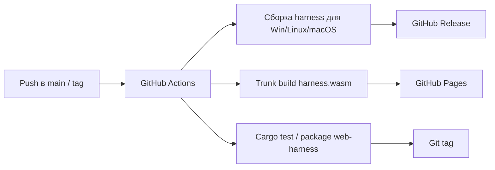

# Phase 6. Технологический стек

> Документ описывает используемые технологии, обоснование выбора и ключевые примеры применения.
> Смежные документы: `base.md`, `arch.md`, `api.md`, `ui.md`, `auth.md`.

---

## 1. Сводный перечень

| Технология | Назначение | Обоснование |
|---|---|---|
| **axum** | HTTP-фреймворк сервера | Нативный tokio, зрелый REST, хорошая документация |
| **axum-server + rustls** | HTTPS/TLS-терминация | Поддержка TLS без внешнего reverse-proxy |
| **rcgen** | Генерация самоподписанного сертификата | Pure Rust, автоматический первый запуск |
| **tokio** | Асинхронный runtime | Единый рантайм для HTTP, отмены, таймаутов, каналов |
| **async reqwest** | HTTP-клиент к вендорным LLM API | Полностью асинхронный стек, отменяемые запросы |
| **REST + polling** | Единственный транспорт клиент-сервер | Простота, предсказуемость, отсутствие двунаправленных каналов |
| **Leptos** | Реактивный UI-фреймворк | Зафиксирован задачей; CSR-режим подходит для WASM |
| **Trunk** | Сборка Leptos CSR | Стандарт для pure-Rust WASM без Node |
| **serde/serde_json** | DTO и JSON | Стандарт Rust |
| **gloo-net/web-sys** | Сетевые вызовы из WASM | Лёгкий доступ к `fetch` |
| **crate `auth`** | Bearer-аутентификация | Отдельный слой защиты API |

Следующие технологии **не используются** в первой версии:

- **SSE/EventSource** — статус сессии получается polling-запросом к URL-hook;
- **WebSocket** — двунаправленный канал не требуется;
- **Web Crypto API / RustCrypto `rsa` на клиенте** — клиент не работает с API-ключами; ключ вводится как обычный ответ `pendingInput` и передаётся по HTTPS.

---

## 2. Сервер: axum + tokio + TLS

### 2.1. Почему axum

- Нативная интеграция с `tokio` и `tower`.
- Простая модель роутинга: `Router`, `State`, `extractors`.
- Не приносит собственный акторный рантайм (в отличие от actix-web), что упрощает запуск асинхронного агентского цикла.

### 2.2. Почему TLS встроен в сервер

- Требование HTTPS закрывает проблему mixed-content для `harness.wasm` на GitHub Pages.
- Для локального режима используется самоподписанный сертификат; для удалённого — пользовательский сертификат.
- TLS-терминация выполняется через **axum-server** с фичей `tls-rustls`; сертификат и ключ загружаются из конфигурации или генерируются через **rcgen**.

### 2.3. Пример запуска TLS

```rust
use axum_server::tls_rustls::RustlsConfig;

let config = RustlsConfig::from_pem(
    cert_path.as_ref(),
    key_path.as_ref(),
).await?;

axum_server::bind_rustls(addr, config)
    .serve(router.into_make_service())
    .await?;
```

Автогенерация сертификата с сохранением в каталоге данных ОС:

```rust
use rcgen::{generate_simple_self_signed, CertifiedKey};

let subject_alt_names = vec![
    "localhost".to_string(),
    "127.0.0.1".to_string(),
];

let CertifiedKey { cert, signing_key } =
    generate_simple_self_signed(subject_alt_names)?;

let certs_dir = data_dir().join("harness").join("certs");
std::fs::create_dir_all(&certs_dir)?;
std::fs::write(certs_dir.join("cert.pem"), cert.pem())?;
std::fs::write(certs_dir.join("key.pem"), signing_key.serialize_pem())?;
```

`data_dir()`:

- Windows: `%LOCALAPPDATA%`;
- Linux: `$XDG_DATA_HOME` или `~/.local/share`;
- macOS: `~/Library/Application Support`.

Каталог данных ОС находится вне `cwd`, поэтому FS API не может прочитать `key.pem`.

### 2.4. Пример роутера

```rust
let public = Router::new()
    .route("/api/v1/health", get(handlers::health))
    .with_state(state.clone());

let protected = Router::new()
    .route("/api/v1/run", post(handlers::start_run))
    .route("/api/v1/run/current", get(handlers::run_status))
    .route("/api/v1/run/stop", post(handlers::stop_run))
    .route("/api/v1/run/input", post(handlers::submit_input))
    .route("/api/v1/config", get(handlers::get_config).put(handlers::put_config))
    .route("/api/v1/config/default", post(handlers::config_default))
    .route("/api/v1/fs/list", get(handlers::fs_list))
    .route("/api/v1/fs/read", get(handlers::fs_read))
    .route("/api/v1/fs/write", axum::routing::put(handlers::fs_write))
    .route("/api/v1/fs/mkdir", post(handlers::fs_mkdir))
    .route("/api/v1/fs/remove", axum::routing::delete(handlers::fs_remove))
    .route("/api/v1/fs/move", post(handlers::fs_move))
    .layer(middleware::from_fn_with_state(state.clone(), auth::require_auth))
    .with_state(state);

Router::new().merge(public).merge(protected)
```

Маршруты `/agents`, `/crypto/*`, `/run/events`, `/run/log`, `/run/dump` отсутствуют: web-клиент не знает про агентов, API-ключи и лог сессии.

---

## 3. HTTP-клиент к вендорам: async reqwest + `RequestPipeline`

### 3.1. Что меняется относительно текущего кода

Текущий `VendorRequest` использует `reqwest::blocking`, `thread::sleep` и `mpsc`-поток для секундомера. В целевой архитектуре:

- `Client` — асинхронный `reqwest::Client`.
- rate-limit-ожидания — `tokio::time::sleep`.
- секундомер — `tokio::time::Interval`.
- retry-классификация (429/503/transport) сохраняется без изменений.
- активный запрос и чтение тела ответа оборачиваются в `tokio::select!` с `CancellationToken`.

### 3.2. `RequestPipeline`

Контракт описан в `arch.md` §6. Ниже — конкретная JSON-реализация.

```rust
pub struct JsonPipeline<T>
where
    T: Serialize + Send + Sync,
{
    url: String,
    extra_headers: Vec<(String, String)>,
    pre: Vec<Arc<dyn PreAction>>,
    dur: Vec<Arc<dyn DurAction>>,
    post: Vec<Arc<dyn PostAction>>,
    _marker: std::marker::PhantomData<T>,
}

impl<T> JsonPipeline<T>
where
    T: Serialize + Send + Sync,
{
    pub fn new(url: impl Into<String>) -> Self { /* ... */ }

    pub fn header(mut self, key: &str, value: &str) -> Self {
        self.extra_headers.push((key.into(), value.into()));
        self
    }
}

#[async_trait::async_trait]
impl<T> RequestPipeline<T> for JsonPipeline<T>
where
    T: Serialize + Send + Sync,
{
    fn build(&self, client: &Client, payload: &T) -> RequestBuilder {
        let mut req = client.post(&self.url).json(payload);
        for (key, value) in &self.extra_headers {
            req = req.header(key, value);
        }
        req
    }

    fn pre_actions(&self)  -> &[Arc<dyn PreAction>]  { &self.pre }
    fn dur_actions(&self)  -> &[Arc<dyn DurAction>]  { &self.dur }
    fn post_actions(&self) -> &[Arc<dyn PostAction>] { &self.post }

    fn add_pre(&mut self, action: Arc<dyn PreAction>)   { self.pre.push(action); }
    fn add_dur(&mut self, action: Arc<dyn DurAction>)   { self.dur.push(action); }
    fn add_post(&mut self, action: Arc<dyn PostAction>) { self.post.push(action); }
}
```

Пример встраивания в `VendorRequest`:

```rust
let mut pipeline = JsonPipeline::<Value>::new(url)
    .header("Authorization", &auth_header)
    .header("Content-Type", "application/json");

pipeline.add_pre(Arc::new(LogPreAction { interaction: self.interaction.clone() }));
pipeline.add_dur(Arc::new(TickProgressAction { interaction: self.interaction.clone() }));
pipeline.add_post(Arc::new(LogPostAction { interaction: self.interaction.clone() }));

let ctx = PipelineContext {
    attempt,
    url: url.to_string(),
    started_at: Instant::now(),
    tick: Duration::from_secs(1),
    cancel: cancel.clone(),
};

let response = pipeline.execute(&client, &body, ctx).await?;
let read_body = async { response.text().await };

tokio::select! {
    _ = cancel.cancelled() => return Err("request cancelled".into()),
    text = read_body => {
        // прежняя retry-логика для 429/503/2xx
    }
}
```

---

## 4. Транспорт: HTTPS REST + polling

### 4.1. Почему polling, а не SSE/WebSocket

| Критерий | Polling по URL-hook | SSE/WebSocket |
|---|---|---|
| Направление | клиент → сервер → клиент по расписанию | сервер → клиент (SSE) / двунаправленный (WS) |
| API браузера | обычный `fetch` | `EventSource`/`WebSocket` |
| Сложность клиента | низкая | выше: reconnect, состояния соединения |
| Прокси/HTTP | обычный HTTPS-запрос | SSE ок, WS требует upgrade |
| Наша задача | статус, `pendingInput`, результат сессии | избыточен: команды идут через REST |

Решение: **только HTTPS REST + polling**. Интервал опроса зафиксирован константой клиента — **10 секунд**.

### 4.2. Контракт polling-статуса

Клиент опрашивает URL, полученный в ответе `POST /api/v1/run`:

```json
{
  "runState": "waiting_input",
  "startedAt": "2026-01-01T12:00:00Z",
  "updatedAt": "2026-01-01T12:05:00Z",
  "summary": {
    "iteration": 3,
    "tokens": 12345,
    "usdApprox": 0.12,
    "usdReal": 0.11
  },
  "pendingInput": {
    "requestId": "req_01J...",
    "kind": "text",
    "prompt": "Введите API-ключ для DeepSeek-V3:",
    "timeoutAt": "2026-01-01T12:15:00Z"
  }
}
```

Клиент не получает ни строк лога, ни информации об агентах. Подробный контракт — `api.md` §3.

### 4.3. Обновление статуса на сервере

`AgentLoop` обновляет `ActiveRun` через `tokio::sync::Mutex<Option<ActiveRun>>`:

- при смене состояния (`running`/`waiting_input`/`stopping`/терминальные);
- при изменении `summary` (номер итерации, токены, USD) не реже одного раза за итерацию;
- при появлении `pendingInput` — с `requestId`, `kind`, `prompt` и `timeoutAt`;
- при завершении — `result`.

Обработчик `GET /run/current` просто читает `ActiveRun` и сериализует DTO. Никаких накопленных очередей событий и replay не требуется.

---

## 5. Клиент: Leptos + Trunk

### 5.1. Режим

Используется **CSR**: весь рендеринг происходит в браузере после загрузки WASM. SSR/hydration не требуется.

### 5.2. Структура клиента

```
crates/web-harness/
  src/
    lib.rs            # экспорт HarnessGateway, HarnessClient, HarnessPanel
    main.rs           # тонкая standalone-точка входа: mount HarnessApp
    gateway.rs        # REST + polling
    state.rs          # HarnessClient: реактивное состояние
    components/
      harness_app.rs
      harness_panel.rs
      connect_dialog.rs
      status_bar.rs
      prompt_composer.rs
      input_modal.rs
      result_view.rs
      config_editor.rs   # только feature fs-panel
      fs_browser.rs      # только feature fs-panel
  Cargo.toml
  Trunk.toml
  index.html
```

Правила dual-layout:

- `lib.rs` экспортирует библиотечный API: `HarnessGateway`, `HarnessClient`, `HarnessPanel`, компоненты.
- `main.rs` — тонкий бинарный таргет, который монтирует `HarnessApp` в DOM для standalone-сборки Trunk:

```rust
fn main() {
    mount_to_body(|| view! { <HarnessApp/> });
}
```

- `Cargo.toml` объявляет и `[lib]`, и `[[bin]]`; `trunk build --release` собирает `main.rs`.
- Родительское приложение использует только библиотечную часть.

### 5.3. Cargo-фичи

```toml
[features]
default = []
fs-panel = []
```

| Фича | Назначение |
|---|---|
| отсутствует (standalone) | ConnectDialog, StatusBar, PromptComposer, InputModal, ResultView |
| `fs-panel` | дополнительно ConfigEditor и FsBrowser для встраиваемых приложений |

### 5.4. `HarnessGateway`: REST + polling

```rust
use gloo_net::http::Request;
use std::time::Duration;

const POLL_INTERVAL: Duration = Duration::from_secs(10);

pub struct HarnessGateway {
    base_url: String,
    auth_token: Option<String>,
}

impl HarnessGateway {
    pub fn new(base_url: impl Into<String>, auth_token: Option<String>) -> Self { /* ... */ }

    pub async fn get_run_status(&self, run_url: &str) -> Result<RunStatus, GatewayError> {
        let url = format!("{}{}", self.base_url, run_url);
        let mut req = Request::get(&url);
        if let Some(token) = &self.auth_token {
            req = req.header("Authorization", &format!("Bearer {token}"));
        }
        let resp = req.send().await?;
        Ok(resp.json().await?)
    }
}
```

`EventSource` и `web_sys::EventSource` **не используются**. Reconnect-логика не нужна: при сетевой ошибке polling-запроса клиент сохраняет последнее известное состояние, показывает индикатор «нет соединения» и продолжает опрос по расписанию.

### 5.5. Почему Trunk

- Стандартный инструмент для Leptos CSR.
- Не требует Node.js: собирает WASM, JS-обвязку и статику.
- Простая команда: `trunk build --release`.
- Артефакт `dist/` пригоден для публикации на GitHub Pages.

---

## 6. Конфигурация сервера

### 6.1. Блок `server` в `harness.json5`

```json5
{
    "cwd": "C:/MyLife/Harness",
    "server": {
        "host": "127.0.0.1",
        "port": 4067,
        "live-timeout": 5,
        "interaction-timeout": 10,
        "cors-allowed-origins": [],
        "tls-cert": null,
        "tls-key": null,
    },
    "agent": {},
    "tools": {},
}
```

| Поле | Тип | По умолчанию | Назначение |
|---|---|---|---|
| `server.host` | string | `127.0.0.1` | Адрес bind |
| `server.port` | number | `4067` | Порт (если не задан `--port`) |
| `server.live-timeout` | number (минут) | `5` | Время простоя до завершения сервера |
| `server.interaction-timeout` | number (минут) | `10` | Таймаут ожидания ответа пользователя на `pendingInput` |
| `server.cors-allowed-origins` | string[] | `[]` | Разрешённые CORS-origin; `[]` = CORS запрещён; `"*"` не поддерживается |
| `server.tls-cert` | string/null | `null` | Путь к PEM-сертификату; `null` = автогенерация |
| `server.tls-key` | string/null | `null` | Путь к PEM-ключу; `null` = автогенерация |

Поле `sse-buffer-size` отсутствует: SSE не используется.

### 6.2. `live-timeout`

- Таймер стартует при запуске сервера.
- На время активного цикла таймер останавливается.
- Мутирующие API-вызовы (`POST /run`, `POST /run/stop`, `POST /run/input`, `PUT /config`, `POST /config/default`, мутирующие FS-операции) сбрасывают таймер.
- Polling-запросы (`GET /health`, `GET /run/current`, `GET /config`, `GET /fs/*`) не продлевают жизнь сервера.
- По истечении сервер закрывает соединения и завершает процесс с кодом 0.

### 6.3. `interaction-timeout`

- Отсчитывается от момента сохранения `pendingInput` в `ActiveRun`.
- По истечении ожидающий `oneshot` завершается с ошибкой `Timeout`.
- Агентский цикл обрабатывает `InteractionError::Timeout` как ошибку сессии: `runState = failed`, в `result` попадает ошибка таймаута.
- Значение по умолчанию — 10 минут. Поскольку интервал polling — 10 секунд, у клиента всегда есть запас для получения и отображения запроса.

---

## 7. Безопасность

1. **HTTPS обязателен.** Сервер не принимает plain-HTTP. Самоподписанный сертификат генерируется автоматически и хранится в каталоге данных ОС вне `cwd`; пользователь может задать собственный.
2. **Bind по умолчанию `127.0.0.1`.** Удалённый доступ — только явным `--host 0.0.0.0` или конкретным интерфейсом.
3. **Bearer-аутентификация.** Все `/api/v1/*`, кроме `health`, требуют токен; токен принимается только в заголовке `Authorization`.
4. **CORS по умолчанию запрещён.** Допускается только явный allowlist конкретных origin; `"*"` не поддерживается.
5. **Секреты не покидают сервер.** `GET /config`, `GET /fs/read` возвращают секретные поля только как `"***"`; TLS-приватный ключ хранится вне `cwd`; лог и dump сессии не отдаются через API.
6. **API-ключ не логируется.** Запрос API-ключа выполняется через `Interaction::input` с `write_log = false`.
7. **FS API ограничен `cwd` и deny-list.** Запрещены `..`, абсолютные пути, переходы по symlink за пределы `cwd`, а также защищённые и секретоподобные файлы.
8. **Аутентификация и CORS — разные слои защиты.** Даже при явно разрешённом origin доступ без токена невозможен.

---

## 8. Сборка и CI/CD

| Артефакт | Сборка | Публикация |
|---|---|---|
| `harness.exe` (Windows) | `cargo build --release -p cli-harness` на `windows-latest` | GitHub Release |
| `harness` (Linux) | `cargo build --release -p cli-harness` на `ubuntu-latest` | GitHub Release |
| `harness` (macOS) | `cargo build --release -p cli-harness` на `macos-latest` | GitHub Release |
| `harness.wasm` + `dist` | `trunk build --release` | GitHub Pages |
| Крейт `web-harness` | `cargo package`/git tag | Только Git-тег (source-level плагин); публикация на crates.io в первой версии не выполняется |



---

## 9. Тесты контрактов и безопасности

1. **`harness-api`**: сериализация/десериализация всех DTO статусов сессии, `pendingInput`, `result`.
2. **`conf`**: `load_server_config` валидирует конфигурацию без выбора агента; `resolve_agent_for_run` выбирает агента по `agent.config = file`/`directory`; отсутствующий `api-key` допускается при наличии `api_key_override`.
3. **FS API**: нормализация путей, отклонение `..`, absolute path, symlink-выходов за `cwd`.
4. **Deny-list FS API**: `.harness/**`, `harness.json5`, активные `log.md`/`dump.json`, `.env`, `*.pem`, `*.key` недоступны для чтения/записи/удаления.
5. **Redaction**: `GET /fs/read` файла агента не содержит `api-key`; `GET /config` не содержит `tls-key`; `PUT` с `"***"` сохраняет старое значение для разобранных JSON5/JSON; произвольный текстовый файл не подвергается substring-редкации.
6. **Polling-контракт**: `POST /run` возвращает `runUrl`; `GET /run/current` возвращает `pendingInput` и `result`; после терминального состояния результат доступен до следующего запуска.
7. **Auth**: корректные/некорректные токены, отсутствие заголовка, constant-time сравнение; токен в query-параметре не принимается.
8. **CORS**: при пустом `cors-allowed-origins` ответ не содержит `Access-Control-Allow-Origin`; preflight допускает только `Authorization, Content-Type`.
9. **Таймауты**: `interaction-timeout` переводит сессию в `failed`; `live-timeout` сбрасывается мутирующими вызовами и не сбрасывается polling-запросами.
