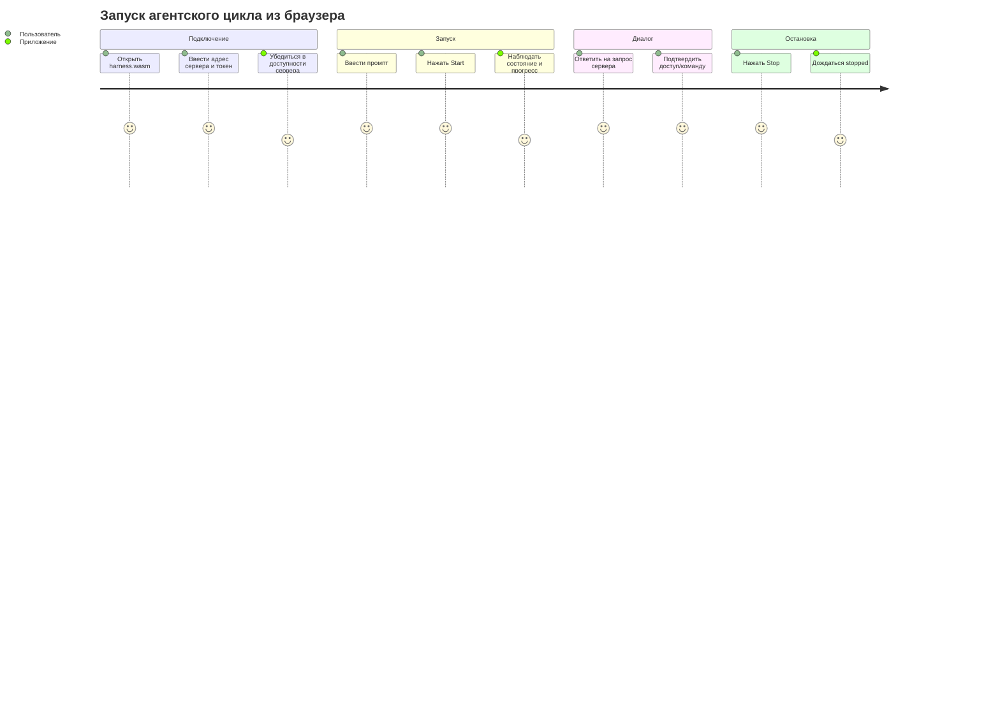

# Phase 6. Web-интерфейс (`harness.wasm`)

> Документ описывает пользовательский интерфейс клиента, экраны, сценарии и требования к адаптивности.
> Смежные документы: `base.md`, `arch.md`, `tech.md`, `api.md`, `auth.md`.

---

## 1. Роли интерфейса

`harness.wasm` работает в двух режимах:

1. **Самостоятельное приложение** — открывается с GitHub Pages, пользователь вводит адрес сервера и токен.
2. **Встраиваемая панель** — компонента `HarnessPanel` внутри родительского Leptos-приложения.

Общие задачи:

- подключение к HTTPS-серверу;
- аутентификация по Bearer-токену;
- формирование промпта;
- запуск и остановка агентского цикла;
- опрос URL-hook сессии каждые 10 секунд и отображение состояния;
- ответы на запросы взаимодействия (вопросы агента, выбор агента, ввод API-ключа, подтверждения);
- отображение итогового результата сессии.

Клиент **не** отображает лог сессии, **не** выбирает агента и **не** управляет API-ключами. Всё, что связано с агентами и ключами, приходит от сервера как обычный `pendingInput` и показывается в модальном окне ввода.

Standalone-клиент **не** работает с файловой системой и **не** редактирует `harness.json5`. Эти возможности доступны только встраиваемым приложениям при включении Cargo-фичи `fs-panel`.

---

## 2. Компонентная модель

```
HarnessApp (main.rs)
└── HarnessPanel
    ├── ConnectDialog          # адрес сервера + токен + инструкция
    ├── StatusBar              # runState, итерация, токены, USD, время ожидания
    ├── PromptComposer         # textarea промпта, кнопки Start/Stop
    ├── InputModal             # модальный ответ на pendingInput
    ├── ResultView             # итог сессии: успех/ошибка/статистика
    ├── ConfigEditor           # только feature fs-panel
    └── FsBrowser              # только feature fs-panel
```

Транспортный слой `HarnessGateway` не является UI-компонентом; он инкапсулирует REST + polling и используется `HarnessPanel`.

`HarnessPanel` — экспортируемая компонента для встраивания:

```rust
#[component]
pub fn HarnessPanel(
    base_url: String,
    #[prop(optional)] auth_token: Option<String>,
    #[prop(optional)] compact: bool,
    #[prop(optional)] theme: Option<HarnessTheme>,
) -> impl IntoView
```

---

## 3. Экраны

### 3.1. Подключение

`ConnectDialog` запрашивает:

1. адрес сервера, например `https://localhost:4067`;
2. Bearer-токен, напечатанный в stdout сервера.

Поведение:

- клиент выполняет `GET /health` без токена;
- при успехе и `authRequired: true` открывает поле ввода токена;
- после ввода токена выполняет `GET /api/v1/run/current` с токеном;
- при успехе переходит к основному экрану;
- при `401` показывает сообщение «неверный токен».

Адрес сервера можно задать query-параметром:

```text
https://<pages-origin>/?server=https://localhost:4067
```

Токен через query-параметры не передаётся.

### 3.2. Модальное окно «Сервер не найден / CORS запрещён»

Если сервер недоступен, TLS-сертификат не принят браузером или запрос заблокирован CORS, показывается модальное окно с инструкцией:

1. **Скачать** исполняемый файл с GitHub Releases (ссылка).
2. **Запустить** его без параметров: `harness.exe`.
3. **Принять самоподписанный сертификат** в браузере (открыть `https://localhost:4067/api/v1/health` и подтвердить исключение).
4. **Убедиться**, что клиентский origin добавлен в `server.cors-allowed-origins` в `harness.json5`, если сервер запущен не из-под того же origin.

В окне есть кнопки «Повторить подключение» и «Скопировать команду запуска».

### 3.3. Основной экран

Раскладка standalone-режима:

```
┌──────────────────────────────────────────────────────────┐
│ StatusBar: running · iter 3 · 12 345 tok · $0.12        │
├────────────────────────────┬─────────────────────────────┤
│ PromptComposer             │ ResultView                  │
│                            │                             │
│ ┌────────────────────────┐ │ Итог сессии:                │
│ │ промпт...              │ │ успех / ошибка / статистика │
│ └────────────────────────┘ │                             │
│ [Start]  [Stop]           │                             │
└──────────────────────────┴──────────────────────────────┘
```

При сборке с фичей `fs-panel` в `HarnessPanel` добавляются вкладки «Конфигурация» и «Файлы».

Лог сессии в интерфейсе отсутствует: web-клиент не знает о серверном логе. Вместо этого StatusBar показывает сводку прогресса, а ResultView — итог.

### 3.4. Композер промпта

- textarea для промпта;
- кнопка **Start** — отправляет `POST /run` и запоминает `runUrl`;
- кнопка **Stop** — отправляет `POST /run/stop`;
- во время активного цикла Start недоступна, Stop доступна;
- выпадающий список агентов отсутствует: выбор агента выполняет сервер или запрашивает его через `pendingInput`.

### 3.5. Опрос состояния

После получения `runUrl` клиент запускает polling:

1. каждые **10 секунд** выполняется `GET {runUrl}`;
2. `runState` отображается в StatusBar;
3. если пришёл `pendingInput` — открывается `InputModal`;
4. если пришёл `result` — отображается `ResultView`, polling останавливается;
5. при сетевой ошибке показывается индикатор «нет соединения», polling продолжается по расписанию;
6. после нескольких последовательных неудач (например, 6 попыток — ~1 минута) показывается модальное окно «Сервер не найден».

### 3.6. Модальный ввод

При получении `pendingInput` в polling-ответе открывается модальное окно:

- текст запроса (`prompt`);
- для `kind = text` — textarea для произвольного ответа;
- для `kind = confirm` — кнопки **Yes**/**No** (Allow/Deny);
- кнопка **Ответить** отправляет `POST /run/input`.

После отправки модальное окно закрывается. Если сервер после Deny задаёт уточняющий вопрос (например, «Укажите причину отказа»), он приходит как новый `pendingInput` в следующем polling-цикле, и UI просто открывает следующее модальное окно.

**Замечание по `tools.user`.** Двухшаговый отказ (Deny → причина) не требует специального UI: сервер формирует второй `pendingInput` после получения первого ответа. Клиент обрабатывает любой `pendingInput` одинаково.

### 3.7. Модальный ввод API-ключа

Отдельного модального окна `ApiKeyModal` нет. Если серверу нужен API-ключ, он присылает `pendingInput` с `kind = "text"` и промптом вида `"Введите API-ключ для DeepSeek-V3:"`. UI показывает его в обычном `InputModal`.

Поле ввода в этом случае отображается как password-подобное (`input type=password`) — решение принимается по наличию подстроки `"API-ключ"`/`"api-key"`/`"API key"` в `prompt`, без специального API.

### 3.8. Результат

`ResultView` показывает:

- итоговое состояние: `finished` / `failed` / `stopped`;
- статистику: итерации, токены, USD (приблизительно и real, если доступно);
- текст ошибки из `result.error`, если `ok = false`;
- кнопку «Новый запуск», которая очищает результат и активирует Start.

### 3.9. Редактор конфигурации (только `fs-panel`)

- Загружает `GET /config`.
- Показывает `harness.json5` в textarea с моноширинным шрифтом.
- Кнопка **Сохранить** отправляет `PUT /config`.
- При ошибке валидации показывает сообщение и не даёт запустить цикл, пока конфигурация не исправлена.
- Если файл отсутствует, предлагает **Создать по умолчанию** (`POST /config/default`).
- Значения секретных полей отображаются как `"***"`; сохранение `"***"` не затирает реальное значение.
- Мутирующие операции сбрасывают `live-timeout` на сервере, поэтому длительное редактирование не приводит к остановке сервера.

### 3.10. Браузер файлов (только `fs-panel`)

- Работает через FS API.
- Отображает дерево/список каталогов и файлов внутри `cwd`.
- Операции:
  - открыть файл (чтение);
  - создать/изменить файл;
  - создать каталог;
  - удалить файл/пустой каталог;
  - переименовать/переместить.
- Основные сценарии:
  - добавить файл роли;
  - добавить файл умения;
  - добавить файл агента;
  - изменить любой другой файл внутри `cwd`.
- Перед удалением/перезаписью показывается подтверждение.
- Файлы агентов отображаются с редкацией секретов; запись `"***"` сохраняет прежнее значение ключа.
- Защищённые deny-list'ом пути (`.harness/**`, `harness.json5`, секретоподобные файлы) либо не отображаются, либо помечаются как недоступные; сервер возвращает `403`.

---

## 4. Пользовательские сценарии

### 4.1. Первый запуск

1. Пользователь скачивает `harness.exe` с GitHub Releases.
2. Запускает его без параметров.
3. Сервер генерирует TLS-сертификат (в каталоге данных ОС) и Bearer-токен, печатает токен в stdout.
4. Пользователь открывает `harness.wasm` на GitHub Pages.
5. Вводит адрес `https://localhost:4067` и токен.
6. Если `configState = missing` или `invalid`, UI показывает инструкцию: настроить `harness.json5` локально на машине сервера.
7. Пользователь вводит промпт и запускает цикл.

### 4.2. Запуск цикла



### 4.3. Ответ на запрос взаимодействия

1. Агентский цикл (или сервер на этапе выбора агента/ключа) вызывает `Interaction::input`.
2. Сервер сохраняет `pendingInput` в `ActiveRun`.
3. Клиент при очередном polling-запросе получает `runState = waiting_input` и `pendingInput`.
4. UI открывает модальное окно.
5. Пользователь вводит ответ/нажимает Yes/No.
6. UI отправляет `POST /run/input`.
7. Сервер передаёт ответ агенту, цикл продолжается.

### 4.4. Таймаут ожидания ввода

1. Агент ожидает ответ пользователя.
2. Если ответ не получен за `server.interaction-timeout` (по умолчанию 10 минут), сервер завершает сессию с ошибкой.
3. При следующем polling-запросе клиент получает `result` с `runState: failed`, закрывает модальное окно и показывает ошибку.

---

## 5. Адаптивность и компактный режим

### 5.1. Полный режим (`compact = false`)

- Двухколоночная раскладка: композер, результат.
- При `fs-panel` добавляются вкладки конфигурации/файлов.

### 5.2. Компактный режим (`compact = true`)

Для встраивания в боковые панели родительских приложений:

- ширина ~320–420 px;
- одна колонка;
- композер и результат располагаются вертикально;
- конфигурация и файлы (при `fs-panel`) открываются как overlay/вкладки;
- модальные окна поверх панели;
- уменьшенные отступы и шрифты.

### 5.3. Стили

- CSS Grid/Flexbox.
- Plain CSS с префиксом `hw-` для изоляции стилей в родительском приложении.
- Tailwind не используется в первой версии, чтобы не увеличивать размер WASM.

---

## 6. Состояния и индикация

| Состояние | UI |
|---|---|
| `idle` | Start доступна, Stop недоступна |
| `running` | Start недоступна, Stop доступна, StatusBar обновляется |
| `waiting_input` | Открыто модальное окно ввода, Stop доступна |
| `stopping` | Индикатор остановки, Start недоступна |
| `finished`/`failed`/`stopped` | ResultView с итогом, Start снова доступна |
| Сервер недоступен | Модальное окно с инструкцией |
| `401 Unauthorized` | ConnectDialog с сообщением «неверный токен» |

StatusBar показывает:

- состояние цикла;
- номер итерации;
- потреблённые токены;
- USD (приблизительно и real, если доступно);
- время с момента последнего ответа сервера.

---

## 7. Поведение при обрыве соединения

1. При сетевой ошибке polling-запроса клиент сохраняет последнее известное состояние и показывает индикатор «нет соединения».
2. Polling продолжается по расписанию; при восстановлении связи состояние обновляется автоматически.
3. После нескольких последовательных неудач (6 попыток подряд) показывается модальное окно «Сервер не найден» с кнопкой «Повторить подключение».
4. Если сервер завершился по `live-timeout`, polling-запросы начнут получать ошибку соединения; UI показывает «Сервер не найден».

`EventSource` и SSE-переподключение не используются: вся логика восстановления сводится к повторным polling-запросам.

---

## 8. Требования к доступности

- Все кнопки и поля имеют текстовые подписи.
- Цвета статусов не являются единственным способом индикации.
- Модальные окна закрываются по `Escape` (кроме окна ввода с несохранённым ответом — с подтверждением).
- Поле результата поддерживает прокрутку и выделение текста.
- Ошибки TLS/CORS/mixed-content показываются пользователю отдельными понятными сообщениями.
