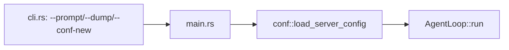
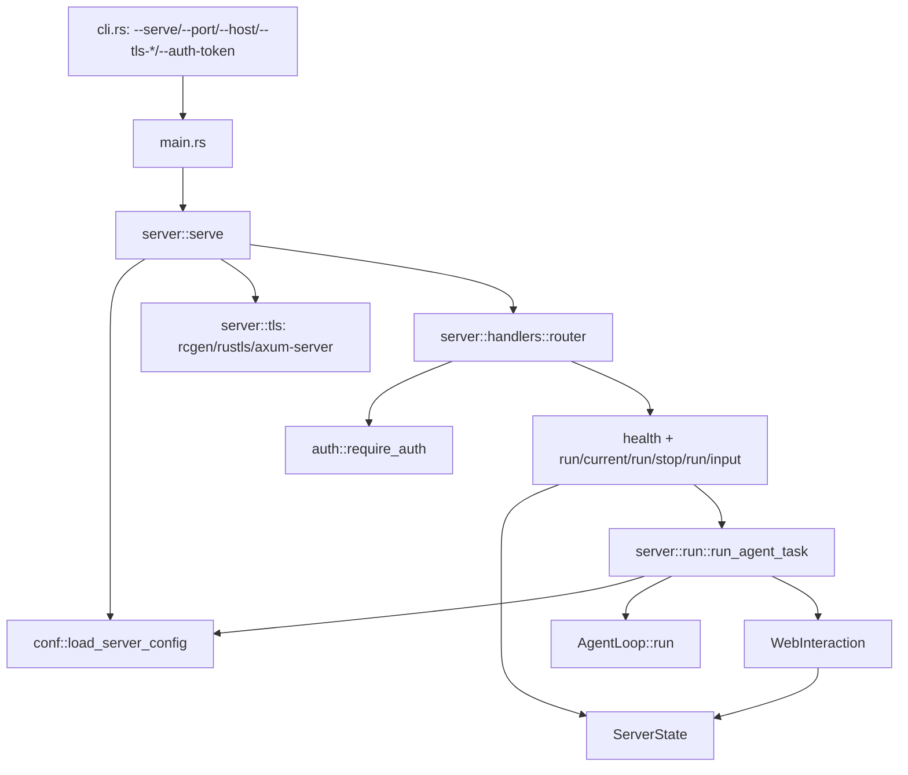

# Результат: HTTPS-сервер `cli-harness` (`--serve`)

Задача: `WiKi/todo/phase-6/4-server-run-api/todo.md`.

Результат: `cargo build --workspace` и `cargo test -p cli-harness` проходят. Реализован серверный режим с TLS, Bearer-аутентификацией, CORS, состоянием единственной активной сессии и endpoint'ами `/api/v1/run*`.

## 1. Общая схема изменений

### Было



`cli-harness` умел только консольный запуск одной сессии. Серверного режима, TLS, HTTP API и WebInteraction не было.

### Стало



Почему: серверный режим — это отдельный слой поверх уже существующего `agent-loop`; `ServerState` координирует HTTP-обработчики и фоновую задачу цикла, а `WebInteraction` превращает запросы агента к пользователю в `pendingInput` + oneshot-ответ.

## 2. Изменения по файлам

### `crates/cli-harness/Cargo.toml`

Было: только зависимости консольного режима (`conf`, `logger`, `interactions`, `tools`, `agent-loop`, `serde_json`, `tokio`, `tokio-util`).

Стало: добавлены:

- `harness-api` — общие DTO REST;
- `auth` — Bearer-токен и middleware;
- `axum` / `axum-server` (`tls-rustls-no-provider`) — HTTPS REST сервер;
- `rcgen` — самоподписанный TLS-сертификат;
- `ulid` — идентификаторы `req_` + 26 символов;
- `chrono` — ISO-8601 время;
- `async-trait` — реализации `Interaction` и `RunObserver`;
- dev-dependency `tower` (`util`) — тесты роутера.

Почему: серверный режим вводит HTTP/TLS/auth/типизированные DTO, которых раньше не было в бинарнике.

### `crates/cli-harness/src/cli.rs`

Было: парсились только `--help`, `--help-tools`, `--version`, `--conf`, `--prompt`, `--prompt-file`, `--dump`, `--conf-new`, `--cwd`, `--api-key`.

Стало:

- добавлен `CliAction::Serve { conf, cwd, port, host, tls_cert, tls_key, auth_token }`;
- добавлены флаги `--serve`, `--port`, `--host`, `--tls-cert`, `--tls-key`, `--auth-token`;
- `parse_args(&[])` теперь возвращает `Serve` (без аргументов — сервер);
- `--port`, `--host`, `--tls-*`, `--auth-token` разрешены только с `--serve`;
- `--tls-cert` и `--tls-key` обязательны вместе;
- `--serve` несовместим с `--prompt`, `--prompt-file`, `--dump`, `--conf-new`, `--api-key`;
- для серверного режима `--conf` по умолчанию — `<cwd>/harness.json5`.

Почему: контракт CLI из `api.md`/`arch.md` требует серверный режим и строгие правила сочетаемости.

### `crates/cli-harness/help.txt`

Было: описание только консольного режима.

Стало: добавлены `--serve` и серверные флаги; описано поведение без аргументов.

Почему: `--help` должен отражать актуальный CLI.

### `crates/cli-harness/src/main.rs`

Было: `match parse_args` обрабатывал только консольные действия.

Стало: добавлен `mod server;` и ветка `CliAction::Serve`, передающая опции в `server::serve`.

Почему: отделение серверного режима от консольного, сохранение прежнего консольного поведения без изменений.

### `crates/cli-harness/src/server/mod.rs` (новый)

Содержит `ServeOptions` и `serve()`:

- загружает `conf::load_server_config`; `Missing`/`Invalid` не роняют старт;
- применяет CLI-переопределения `--host`, `--port`, `--tls-cert`, `--tls-key`, `--cwd`;
- генерирует/парсит Bearer-токен и печатает его в stdout;
- строит `ServerState`, роутер, резолвит адрес bind;
- запускает фоновую задачу `live-timeout`;
- стартует `axum_server::bind_rustls`.

Почему: это корневой wiring серверного режима.

### `crates/cli-harness/src/server/state.rs` (новый)

Реализованы:

```rust
struct ServerState {
    config: tokio::sync::RwLock<LoadedServerConfig>,
    active: tokio::sync::Mutex<Option<ActiveRun>>,
    auth_token: AuthToken,
    live_timeout: Duration,
    live_deadline: tokio::sync::Mutex<Instant>,
}

struct ActiveRun {
    run_id, started_at, updated_at, state, summary,
    pending_input, result, cancel, input_tx,
}
```

`LoadedServerConfig` хранит путь к `harness.json5`, `config_state`, `Option<ServerSettings>` и эффективные параметры `server`.

Почему: все блокировки — только `tokio::sync`, чтобы guard'ы можно было удерживать через `.await`; `ActiveRun` — единый слот активной/последней сессии.

### `crates/cli-harness/src/server/web_interaction.rs` (новый)

`WebInteraction` реализует `Interaction`:

- `output` пишет только в файл сессии и только при `write_log = true`; stdout не используется;
- `input` создаёт `PendingInput` с `requestId = "req_" + ULID`, `kind`, `prompt`, `timeoutAt`, `sensitive`;
- сохраняет `pending_input` в `ActiveRun` и переводит состояние в `waiting_input`;
- ожидает oneshot-ответ с таймаутом `server.interaction-timeout`;
- по таймауту возвращает `InteractionError::Timeout`, по отмене — `InteractionError::Cancelled`;
- при `write_log = true` факт запроса и ответ пишутся в файл.

Почему: это мост между синхронной по смыслу логикой `Interaction` и polling-клиентом.

### `crates/cli-harness/src/server/tls.rs` (новый)

- `resolve_tls_paths`: CLI/конфиг TLS-файлы → использовать их; иначе автогенерация;
- каталог данных ОС:
  - Windows — `%LOCALAPPDATA%\harness\certs`;
  - Linux — `$XDG_DATA_HOME/harness/certs` или `~/.local/share/harness/certs`;
  - macOS — `~/Library/Application Support/harness/certs`;
- генерация `cert.pem`/`key.pem` только при первом старте; повторно используется;
- на Unix каталог получает `0700`, `key.pem` — `0600`.

Почему: TLS-артефакты физически вне `cwd`, как требует `arch.md` §8.2.

### `crates/cli-harness/src/server/handlers.rs` (новый)

Роутер:

```text
GET  /api/v1/health          открытый
POST /api/v1/run             защищён
GET  /api/v1/run/current     защищён
POST /api/v1/run/stop        защищён
POST /api/v1/run/input       защищён
```

Поведение:

- `health` возвращает `status`, `version`, `serverTime`, `authRequired`, `runState`, `configState` и не раскрывает `cwd`/`port`/`liveTimeoutMinutes`;
- `POST /run` проверяет пустой промпт (`400 INVALID_PROMPT`), `missing`/`invalid` конфигурацию (`412`), активный цикл (`409`), создаёт `ActiveRun`, спавнит фоновую задачу и возвращает `202` с `runUrl`;
- `GET /run/current` отдаёт `idle`, активное или терминальное состояние; `pendingInput` — только для `waiting_input`, `result` — только для терминальных состояний;
- `POST /run/stop` идемпотентен: активный → отмена токена и `202 { runState: "stopping" }`; `stopping`/`stopped` → `202`; нет активного → `200 { runState: "idle" }`;
- `POST /run/input` валидирует `text`/`confirm` (`400`), ищет `requestId` (`404`), проверяет актуальность (`409`) и передаёт ответ в oneshot (`202 { accepted: true }`);
- CORS-middleware: пустой allowlist — без `Access-Control-Allow-Origin`; непустой — только точное совпадение `Origin`; preflight возвращает `Access-Control-Allow-Methods: GET, POST, PUT, DELETE, OPTIONS` и `Access-Control-Allow-Headers: Authorization, Content-Type`;
- формат ошибок — `{ "error": { "code", "message" } }`.

Почему: контракт `api.md` §1–§3 реализован в одном месте; авторизация подключена одним слоем.

### `crates/cli-harness/src/server/run.rs` (новый)

Фоновая задача `POST /run`:

1. читает `LoadedServerConfig`/`ServerSettings` из `ServerState`;
2. вызывает `conf::resolve_agent_for_run`:
   - `AgentChoiceRequired` → промпт выбора через `WebInteraction` (`kind = text`, `sensitive = false`), до 3 попыток, затем `failed`;
   - пустой `api-key` → запрос через `WebInteraction` (`kind = text`, `sensitive = true`, `write_log = false`) и повторный `resolve_agent_for_run` с `api_key_override`;
3. создаёт каталог сессии, `log.md`, `dump.json`;
4. собирает `AgentLoop` с `WebInteraction` и запускает `run` с `CancellationToken`;
5. `RunObserver` обновляет `ActiveRun.summary`/`state`/`updated_at`;
6. по завершении заполняет `result` (`finished`/`failed`/`stopped`).

Отмена на этапе выбора агента/ключа завершает цикл как `stopped`, таймаут/ошибка — как `failed`.

Почему: сервер не знает заранее агента и ключ; выбор и секрет проходят через тот же `pendingInput`, что и для web-клиента.

## 3. Таймауты

- `live-timeout`:
  - стартует при запуске сервера;
  - `POST /run`, `POST /run/stop`, `POST /run/input` сбрасывают `live_deadline`;
  - `GET /health` и `GET /run/current` не продлевают;
  - на время `running`/`waiting_input`/`stopping` отсчёт приостановлен;
  - по истечении сервер завершается с кодом 0.
- `interaction-timeout`:
  - отсчитывается от сохранения `pending_input`;
  - `WebInteraction::input` возвращает `Timeout`;
  - цикл завершается `failed`, в `result` — ошибка таймаута.

## 4. Тесты

Добавлены/проходят:

- парсинг CLI серверных флагов и запрет `--port` без `--serve`;
- `WebInteraction` публикует `pending_input` с корректными `kind`/`sensitive`/`timeoutAt` и `requestId`;
- валидация `POST /run/input`: пустой `text`, некорректный `confirm`, `404`, `409`;
- `health` не раскрывает `cwd`/`port`/`liveTimeoutMinutes`;
- генерация и переиспользование TLS-артефактов; на Unix права `0700`/`0600`;
- router: `GET /run/current` без токена → `401`, с токеном → `200`; `health` без токена → `200`.

Проверено:

- `cargo build --workspace` — успех;
- `cargo test -p cli-harness` — 16 тестов успешно.

## 5. Исправление ошибки rustls CryptoProvider

При ручной проверке `cargo run -p cli-harness -- --serve --port 4067` сервер падал при первом TLS-рукопожатии:

```text
Could not automatically determine the process-level CryptoProvider from Rustls crate features.
Call CryptoProvider::install_default() before this point to select a provider manually,
or make sure exactly one of the 'aws-lc-rs' and 'ring' features is enabled.
```

### Было

- `cli-harness/Cargo.toml`: `axum-server = { version = "0.7", features = ["tls-rustls"] }`.
- `agent-loop/Cargo.toml`: `reqwest = { ..., features = ["json", "rustls-tls"] }`.
- `axum-server/tls-rustls` включал у `rustls` feature `aws-lc-rs`.
- `reqwest/rustls-tls` включал у `rustls` feature `ring`.

В результате у `rustls` были включены одновременно обе фичи провайдера, и `rustls` не мог автоматически выбрать process-level `CryptoProvider`.

### Стало

- `cli-harness/Cargo.toml`: `axum-server = { version = "0.7", features = ["tls-rustls-no-provider"] }`.

`tls-rustls-no-provider` даёт тот же модуль `axum_server::tls_rustls::RustlsConfig`, но не форсирует `aws-lc-rs`. Единственный провайдер `ring` остаётся включённым через `agent-loop → reqwest → rustls/ring`.

### Почему

Теперь выполнено требование `rustls`: включена ровно одна фича провайдера (`ring`), поэтому `CryptoProvider` определяется автоматически, и `CryptoProvider::install_default()` в коде не требуется. Это подтверждается `cargo tree -p cli-harness -e features -i rustls`: у `rustls` присутствует только feature `ring` и отсутствует `aws-lc-rs`.
