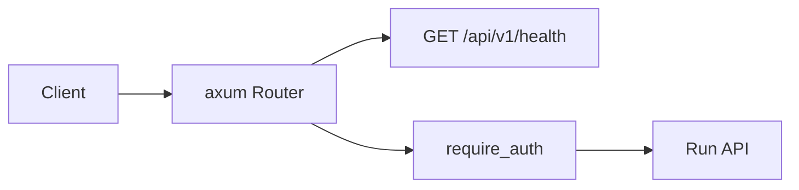
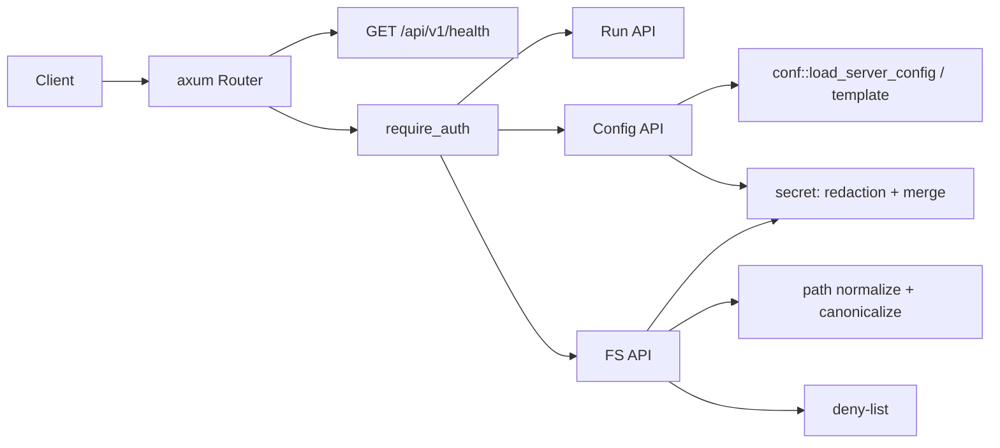

# Результаты: Config API и FS API сервера (`/api/v1/config`, `/api/v1/fs/*`)

## Итог

Реализованы защищённые Bearer-токеном эндпоинты управления конфигурацией и файловой системой в `crates/cli-harness`:

- `GET /api/v1/config`
- `PUT /api/v1/config`
- `POST /api/v1/config/default`
- `GET /api/v1/fs/list`
- `GET /api/v1/fs/read`
- `PUT /api/v1/fs/write`
- `POST /api/v1/fs/mkdir`
- `DELETE /api/v1/fs/remove`
- `POST /api/v1/fs/move`

`cargo build --workspace` и `cargo test -p cli-harness` проходят успешно (31 тест).

---

## Изменения

### 1. `crates/cli-harness/src/server/secret.rs` — новый модуль

**Было:** redaction и merge-правило отсутствовали.

**Стало:** общие помощники для Config API и FS API:

- `SECRET_KEYS`: `api-key`, `apikey`, `token`, `secret`, `private-key`, `tls-key`.
- `redact` — рекурсивная замена значений секретных ключей на `"***"`.
- `has_redacted_secret` — поиск маркеров `"***"` / `"<redacted>"` в секретных полях.
- `merge_redacted_secrets` — восстановление прежних значений секретов из существующего разобранного документа.

**Почему:** redaction и merge используются обоими API; общий модуль исключает дублирование и гарантирует одинаковое сравнение ключей (точное имя, без substring-поиска).

### 2. `crates/cli-harness/src/server/config.rs` — новый модуль

**Было:** эндпоинтов Config API не было.

**Стало:**

- `GET /api/v1/config`:
  - валидный файл → `200 { path, exists: true, text: <redacted>, valid: true, validationError: null }`;
  - невалидный → `text: null`, `validationError` из `conf::load_server_config`;
  - отсутствующий → `exists: false`, `text: conf::template_text()`, `valid: false`.
- `PUT /api/v1/config`:
  - принимает `{ text }`;
  - валидирует текст той же валидацией `conf` (через временный файл в каталоге целевого `harness.json5`, чтобы относительные пути резолвились так же);
  - невалидный → `400 { ok: false, error: { code: "CONFIG_INVALID", message } }`, файл не сохраняется;
  - валидный → merge-правило для секретов, сохранение, `200 { ok: true, path, valid: true }`.
- `POST /api/v1/config/default`:
  - отсутствует → создаёт файл из `conf::template_text()`, возвращает `200` с `exists: true`, `text`, `valid: true`;
  - существует → идемпотентно возвращает текущую конфигурацию с redaction.
- Merge-правило:
  - применяется, если входящий текст разобран и содержит маркер в секретном поле;
  - существующий файл разобран → старое значение сохраняется;
  - существующий файл отсутствует/не разобран + маркер → `400 CONFIG_INVALID`;
  - merge сработал → сохраняется канонический JSON; не сработал → сохраняется исходный текст запроса.

**Почему:** Config API — единственный способ редактировать `harness.json5`; секреты не покидают сервер, а невалидная конфигурация не сохраняется.

### 3. `crates/cli-harness/src/server/fs_api.rs` — новый модуль

**Было:** FS API отсутствовал.

**Стало:**

- Общий резолвер `resolve_fs_path`:
  - принимает относительный путь от `cwd`;
  - лексически нормализует и отклоняет абсолютные пути, `..`, пустые пути;
  - канонизирует через `canonicalize_inside`: для несуществующих хвостов ищется ближайший существующий предок, затем проверяется, что результат остаётся внутри канонического `cwd`;
  - deny-list проверяется до обращения к ФС и повторно после канонизации (защита от symlink-обхода).
- Deny-list:
  - `.harness/**`;
  - `harness.json5`;
  - `<log-folder>/**` (по умолчанию `.log/**`) — полностью, независимо от состояния сессии;
  - `.env`, `*.pem`, `*.key`, `*.p12`, `*.pfx`, `id_rsa`, `id_ed25519`.
- Redaction на чтении:
  - применяется только к файлам, разобранным как JSON5/JSON;
  - прочие текстовые файлы возвращаются как есть.
- Merge-правило на записи:
  - применяется только к разобранным JSON5/JSON;
  - `"***"` / `"<redacted>"` в секретном поле сохраняет прежнее значение;
  - новый файл с маркером → `400 REDACTED_SECRET`;
  - прочие файлы перезаписываются как есть.
- Все мутирующие FS-обработчики сбрасывают `live-timeout` через `ServerState::touch_live_deadline`.

**Почему:** FS API изолирован внутри `cwd`, не отдаёт секреты и не позволяет обойти deny-list через `..` или symlink.

### 4. `crates/cli-harness/src/server/handlers.rs`

**Было:** роутер содержал только `/api/v1/health` и run-эндпоинты.

**Стало:** в защищённую группу добавлены маршруты Config API и FS API. `ApiError` получил тестовые аксессоры `status()` / `code()`.

**Почему:** все новые эндпоинты должны быть за слоем `auth::require_auth`.

### 5. `crates/cli-harness/src/server/mod.rs`

**Было:** `LoadedServerConfig.path` хранил `options.conf` как есть; модули `config`/`fs_api`/`secret` отсутствовали.

**Стало:**

- объявлены `config`, `fs_api`, `secret`;
- путь конфигурации приводится к абсолютному лексически нормализованному виду до загрузки и сохраняется в состоянии.

**Почему:** Config API должен отдавать абсолютный `path`, а `PUT`/`default` — писать в тот же файл, который сервер реально загружает.

### 6. `crates/cli-harness/Cargo.toml`

**Было:** зависимость `json5` отсутствовала.

**Стало:** добавлена `json5 = "0.4"` с комментарием.

**Почему:** FS API разбирает JSON5/JSON для redaction и merge-правила.

---

## Архитектура

### До



### После



### Почему

Добавление `secret` как отдельного слоя позволяет гарантировать одинаковую redaction/merge-логику для Config API и FS API, а `fs_api` изолирует всю работу с путями и deny-list до обращения к ФС.

---

## Тесты

Добавлены/обновлены unit-тесты:

- `server::secret::tests` — redaction, merge, ошибки merge.
- `server::config::tests` — `GET /config` с redaction `tls-key`; `PUT` невалидной конфигурации не сохраняет файл; `POST /config/default` создаёт файл и идемпотентен.
- `server::fs_api::tests`:
  - нормализация путей: `..`, absolute path, symlink-выход за `cwd`;
  - deny-list: `.harness/**`, `harness.json5`, `.log/**`, `.env`, `*.pem`, `*.key`, `*.p12`, `*.pfx`, `id_rsa`, `id_ed25519`;
  - redaction: чтение JSON5-файла агента не содержит `api-key`; Markdown-файл не подвергается substring-редкации;
  - merge: `PUT` с `"***"` сохраняет старое значение; создание нового файла с `"***"` → `400`.

Проверка выполнена:

```text
cargo build --workspace
cargo test -p cli-harness
```

Результат: успех, 31 тест пройден.
