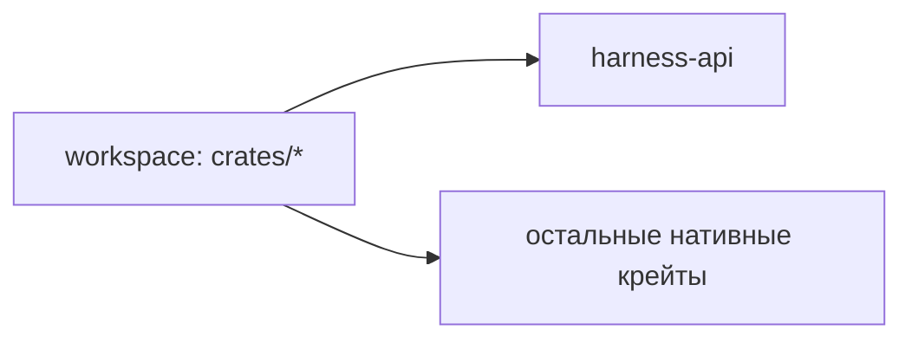
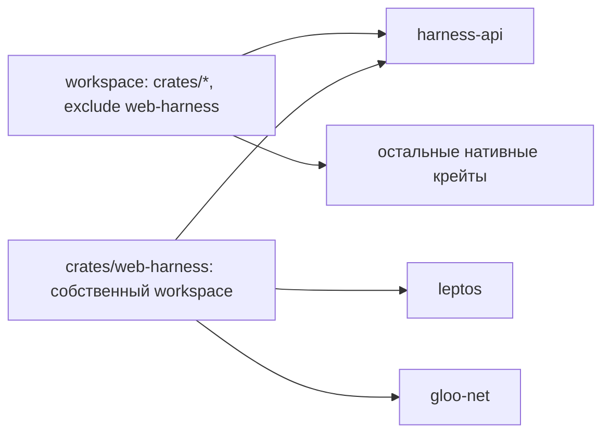

# Результат: Web-клиент `web-harness` (Leptos CSR)

## 1. Что сделано

Создан новый крейт `crates/web-harness` — чистое Rust/Leptos CSR-приложение, собираемое Trunk. Крейт работает в двух режимах:

- standalone: `trunk build --release` собирает `dist` из `src/main.rs`;
- library: экспортирует `HarnessGateway`, `HarnessClient` и `HarnessPanel` для встраивания в родительские Leptos WASM-приложения.

Крейт исключён из нативного workspace-билда: в корневой `Cargo.toml` добавлено `exclude = ["crates/web-harness"]`, а сам крейт содержит собственную пустую секцию `[workspace]`.

## 2. Изменения: было/стало/почему

### 2.1. Корневой `Cargo.toml`

- **Было:** `members = ["crates/*"]` — workspace пытался бы собрать wasm-only крейт нативно.
- **Стало:** `members = ["crates/*"]` + `exclude = ["crates/web-harness"]`.
- **Почему:** `web-harness` должен собираться только Trunk/`wasm32-unknown-unknown` и не должен попадать в нативный `cargo build --workspace`.

### 2.2. `crates/web-harness/Cargo.toml`

- **Было:** каталог пуст.
- **Стало:** самодостаточный манифест: `[lib]` + `[[bin]]`, `version = "1.5.0"`, пустая `[workspace]`, фичи `default = []` и `fs-panel = []`.
- **Почему:** этого требует task: крейт отделён от workspace, `fs-panel` добавляет `ConfigEditor`/`FsBrowser` и методы Config/FS API, не раздувая standalone-сборку.

### 2.3. `src/gateway.rs`

- **Было:** отсутствовало.
- **Стало:** `HarnessGateway` с `new(base_url, auth_token)`, `health`, `start_run`, `get_run_status`, `stop_run`, `submit_input`; при `fs-panel` — `get_config`, `put_config`, `config_default`, `fs_list`, `fs_read`, `fs_write`, `fs_mkdir`, `fs_remove`, `fs_move`.
- **Почему:** транспортный слой изолирован от UI и полностью соответствует REST-контракту из `api.md`.

Ключевые решения:
- `join_url`/`normalize_base_url` — `runUrl` всегда относительный, base URL без trailing `/`, конкатенация без повторного экранирования.
- Каждый `fetch` гоняется с таймером 10 секунд через `futures::future::select` + `gloo_timers::future::TimeoutFuture`.
- Защищённые запросы добавляют `Authorization: Bearer <token>`; `GET /health` — без токена.
- Ошибки не-2xx разбираются в `GatewayError::Http { status, code, message }` из JSON-конверта `{ error: { code, message } }`.

### 2.4. `src/state.rs`

- **Было:** отсутствовало.
- **Стало:** `HarnessClient` — сигнальный контейнер (`RwSignal`): `base_url`, `auth_token`, `run_url`, `status`, `connected`, `consecutive_errors`, `modal_open`, `config_valid`.
- **Почему:** единый реактивный источник истины для всех компонентов; логика polling/UI вынесена из состояния.

### 2.5. Компоненты `src/components/*`

Реализованы все базовые компоненты:
- `HarnessApp` — standalone-обёртка, читает `?server=`.
- `HarnessPanel` — владеет подключением, polling-циклом 10 с, раскладкой и (с `fs-panel`) вкладками.
- `ConnectDialog` — двухшаговый вход: `GET /health` без токена → поле токена → проверка `GET /api/v1/run/current`; 401 сбрасывает токен и показывает «неверный токен»; токен хранится только в `localStorage` текущего origin.
- `StatusBar` — `runState`, итерация, токены, USD (прибл./real), время с последнего ответа; лог сессии не отображается.
- `PromptComposer` — textarea + Start/Stop; Start сохраняет `runUrl`, Stop вызывает `POST /run/stop`; доступность кнопок по `runState`.
- `InputModal` — единый обработчик `pendingInput`: `confirm` → Yes/No, `text` → textarea/input, `sensitive: true` → `type=password`; эвристики по подстроке нет; Escape закрывает модальное окно с подтверждением при несохранённом ответе.
- `ResultView` — `finished`/`failed`/`stopped`, статистика, ошибка из `result.error`, кнопка «Новый запуск».
- `ConfigEditor` (только `fs-panel`) — `GET/PUT /config`, `POST /config/default`, отображение `"***"` и блокировка Start при невалидной конфигурации.
- `FsBrowser` (только `fs-panel`) — список/чтение/создание/запись/удаление/перемещение через FS API, подтверждения перед удалением/перезаписью, отображение `403` deny-list.

### 2.6. Стили и Trunk

- `style.css` — plain CSS с префиксом `hw-`, двухколоночная раскладка и компактный режим (`hw-compact`, ~320–420 px).
- `index.html` + `Trunk.toml` — точка входа Trunk и цель `dist`.

## 3. Проверки

| Проверка | Результат |
|---|---|
| `cargo build --workspace` (нативно) | ✅ успех; `web-harness` исключён |
| `cargo check --manifest-path crates/web-harness/Cargo.toml --lib --target wasm32-unknown-unknown` | ✅ успех |
| `cargo check --manifest-path crates/web-harness/Cargo.toml --target wasm32-unknown-unknown --features fs-panel` | ✅ успех |
| `cargo test --manifest-path crates/web-harness/Cargo.toml --lib` | ✅ 7 тестов passed |
| `trunk build --release` | ⚠️ в текущем окружении утилита `trunk` недоступна; компиляция wasm-таргета проверена через `cargo check --target wasm32-unknown-unknown`. Команда для ручного запуска — в `manual.md`. |

Покрытые unit-тесты:
- `HarnessGateway::join_url` / нормализация `base_url` + `runUrl`;
- разбор `RunStatusResponse` с `pendingInput` (`sensitive: false` по умолчанию и `true` при наличии);
- классификация переходов polling-цикла (`idle` → `running` → `waiting_input` → `finished`);
- парсинг ISO-8601 UTC.

## 4. Архитектура

### Было

### Стало

`web-harness` общается с сервером только по HTTPS REST + polling, использует `harness-api` как общие DTO и не имеет обратных зависимостей от нативных крейтов.

## 5. Замечание

Единственное предупреждение при сборке относится к транзитивной зависимости `proc-macro-error2 v2.0.1` (future-incompat report Cargo) и не относится к коду `web-harness`; собственные warnings компиляции в крейте отсутствуют.
