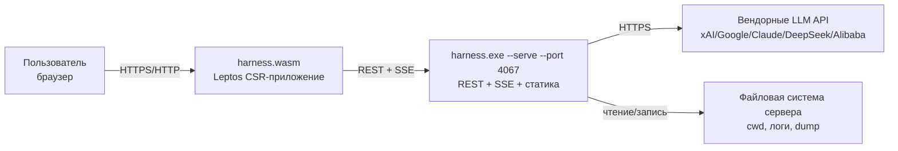
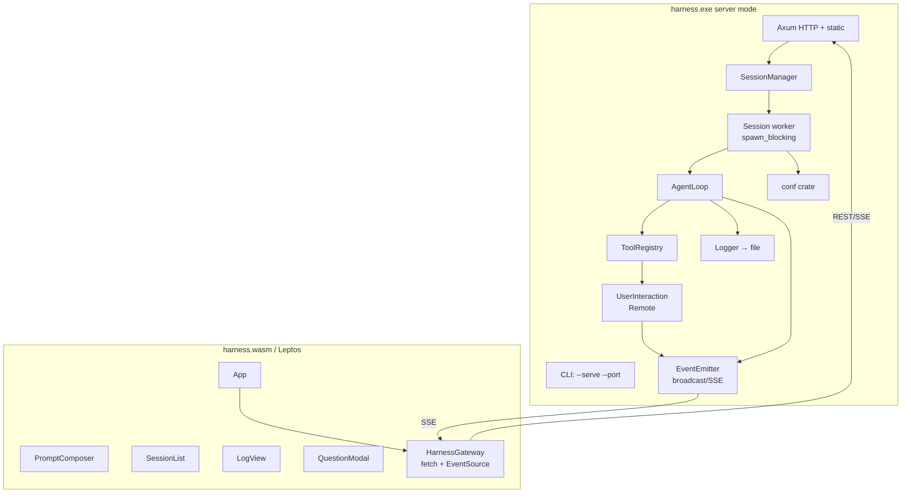
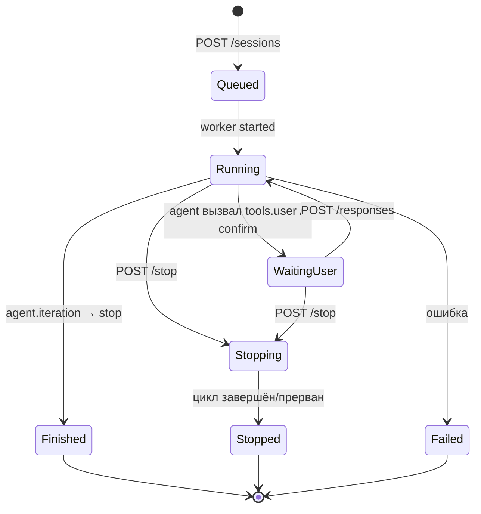
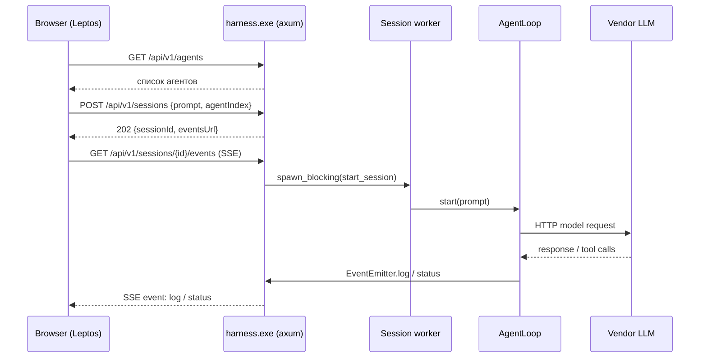
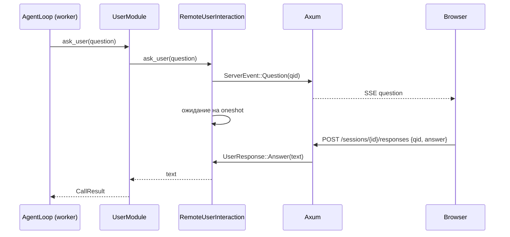
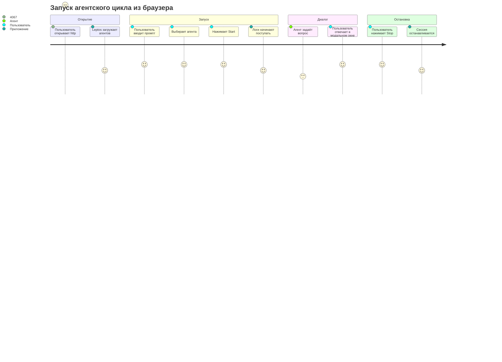

# Консультационный отчёт — Phase 6: Client/Server implementation

> Статус: первая итерация планирования.
> Документ содержит анализ, варианты реализации и архитектурное предложение. Задачи не формируются.

---

## 1. Резюме (Executive Summary)

Задача состоит из двух частей:

1. **Серверная часть** — `harness.exe` в режиме `--serve --port <port>` становится HTTP-сервером, который запускает агентские циклы на машине сервера.
2. **Клиентская часть** — `harness.wasm`, чистое Rust/Leptos web-приложение (CSR), которое подключается к серверу, запускает сессии, показывает логи, позволяет останавливать сессии и отвечать на вопросы агента (`tools.user`).

Текущая архитектура `harness.exe` — синхронное консольное приложение: блокирующий `reqwest`, синхронный цикл агента, прямое чтение `stdin` в `tools.user`, логирование в stdout + файл. Это значит, что серверный режим нельзя «прикрутить» только добавлением HTTP-эндпоинтов: требуется **выделить интерактивные поверхности** (выбор агента, подтверждение лимитов, `user`-инструменты) за абстракции и добавить **шину событий** для потоковой доставки логов и вопросов пользователю.

Рекомендация для первой реализации — **гибридный вариант**:

- HTTP-слой на **axum + tokio**;
- агентский цикл продолжает работать в **блокирующем режиме**, но запускается в `tokio::task::spawn_blocking`;
- события доставляются клиенту через **SSE** (`text/event-stream`);
- команды от клиента — через **REST** (`POST /stop`, `POST /responses`);
- `tools.user` и подтверждение лимитов переводятся на трейт **`UserInteraction`**, который в консольном режиме читает stdin, а в серверном — блокирует поток цикла до ответа браузера.

Такой подход позволяет сохранить текущий агентский код и вендорные HTTP-агенты, а асинхронность использовать только на границе сервера.

---

## 2. Анализ текущей кодовой базы

### 2.1. Что уже есть

| Компонент | Файлы | Роль |
|---|---|---|
| CLI | `crates/harness/src/cli.rs`, `main.rs`, `help.txt` | Ручной парсинг аргументов, запуск сессии |
| Агентский цикл | `crates/harness/src/agent_loop.rs` | Итерации, лимиты, логирование, dump |
| Агенты | `crates/harness/src/agents/*` | HTTP-агенты xAI/Google/Claude/DeepSeek/Alibaba |
| HTTP-клиент | `crates/harness/src/vendor_request.rs` | Блокирующий `reqwest`, rate-limit, retry |
| Конфигурация | `crates/conf/src/*` | Загрузка `harness.json5` и моделей, сканирование каталога агентов |
| Инструменты | `crates/tools/src/*` | `fs`, `git`, `terminal`, `user`, `skills`, `roles` |
| Логгер | `crates/logger/src/*` | Трейт `Logger`, `DoubleLogger` (stdout + `log.md`) |

### 2.2. Ключевые ограничения для серверного режима

1. **Синхронный цикл агента**
   `AgentLoop::start` выполняется в одном потоке от `main`. Внутри — блокирующие HTTP-запросы к вендорам (`VendorRequest::send_json`), блокирующие вызовы инструментов.

2. **Прямой stdin/stdout**
   - `tools/user.rs`: `ask_user`, `request_read_access_for`, `request_write_access_for`, `request_command_shell_execution` читают `stdin`.
   - `agent_loop.rs::confirm`: подтверждение превышения лимита читает `stdin`.
   - `agent_select.rs::choose`: выбор агента из каталога читает `stdin`.

3. **Логирование не является событийной шиной**
   `Logger` умеет писать в stdout и файл. Для web-клиента нужен поток событий (логи, статус, вопросы), то есть ещё один sink или отдельный `EventEmitter`.

4. **Нет примитива отмены**
   Цикл останавливается только по завершении, ошибке или лимиту. Для кнопки Stop нужен флаг/токен отмены. Блокирующий `reqwest` не прерывается снаружи — это главный риск.

5. **Выбор агента зашит в конфигурацию**
   `conf::load` требует выбора агента, если `agent.config` — каталог. Список кандидатов умеет строить `scan_agent_dir`, но это приватная функция. Серверу нужен публичный способ получить список агентов и выбрать один без stdin.

6. **API-ключ**
   При отсутствии ключа CLI спрашивает его в консоли. В серверном режиме это неприемлемо: ключ должен приходить из конфигурации или из стартового запроса.

7. **Один процесс — одна сессия**
   Сейчас `main` запускает один `AgentLoop`. Для сервера нужен менеджер сессий, способный держать несколько сессий одновременно.

---

## 3. Оценка реализуемости

**Реализуемо.** Задача не требует смены языка или переписывания агентского ядра. Основной объём работ — инфраструктурный:

- введение HTTP-сервера;
- менеджер сессий;
- событийная шина;
- абстракция пользовательского взаимодействия;
- новый Leptos-клиент.

**Критические риски:**

| Риск | Вероятность | Влияние | Митигация |
|---|---|---|---|
| Невозможность мгновенно прервать блокирующий HTTP-запрос к вендору | Высокая | Среднее | Честно ограничить MVP: остановка применяется между итерациями/инструментами; полное прерывание — отдельная итерация с async/процессами |
| Синхронные stdin-вызовы в серверном потоке | Высокая (без рефакторинга) | Высокое | Трейт `UserInteraction`; серверная реализация блокирует поток до ответа клиента |
| Утечка API-ключей через API | Средняя | Высокое | Никогда не возвращать ключ в ответах; `GET /agents` отдаёт только метаданные |
| Несколько сессий в одном `cwd` конфликтуют за файлы | Средняя | Среднее | MVP: допускаем; в будущем — блокировка `cwd` или изоляция рабочих каталогов |
| Незрелость WIT/component-model для Leptos UI | Высокая | Среднее | Сначала Rust-level API модуля; WIT-обёртка позже |

---

## 4. Варианты реализации

### 4.1. Сравнение вариантов серверной части

| Критерий | A. Минимальный blocking-сервер (rouille/tiny_http) | B. Полностью асинхронный (axum + async reqwest) | C. Гибрид: axum + spawn_blocking (рекомендуется) |
|---|---|---|---|
| Повторное использование текущего кода | Максимальное | Низкое (переписывание HTTP-агентов) | Высокое |
| SSE/WebSocket | Сложно/нет | Нативно | Нативно |
| Потоковая доставка логов | Через polling | Полная | SSE |
| Отмена запроса к вендору | Нет | Да (abortable future) | Нет (только между итерациями) |
| Сложность внедрения | Низкая | Высокая | Средняя |
| Масштабируемость | Низкая | Высокая | Средняя |
| Риски для стабильности | Низкие | Высокие | Средние |

**Вывод:** вариант **C** оптимален для первой итерации. Он сохраняет проверенный агентский код, даёт полноценный HTTP/SSE и оставляет путь миграции к варианту B.

### 4.2. Выбор HTTP-фреймворка

| Фреймворк | Плюсы | Минусы | Оценка |
|---|---|---|---|
| **axum** | Зрелый, tokio, нативные SSE/WebSocket, хорошая документация | Вводит async runtime | **Рекомендован** |
| actix-web | Производительный, зрелый | Свой акторный рантайм, сложнее встраивать блокирующий код | Альтернатива |
| warp | Лёгкий, фильтры | Кривая обучения, меньше документации | Альтернатива |
| rouille/tiny_http | Без async | Нет нормальных SSE, вручную делать многопоточность | Только для MVP-фолбэка |

### 4.3. Выбор транспорта клиент-сервер

| Транспорт | Плюсы | Минусы | Вывод |
|---|---|---|---|
| **SSE + REST** | Просто, нативно в браузере (`EventSource`), переподключение, поток логов | Однонаправленный; POST-команды отдельно | **Рекомендован для MVP** |
| WebSocket | Двунаправленный, бинарные данные | Сложнее сервер и клиент, нужен keepalive/reconnect | Будущая альтернатива |
| Long-polling | Простой fallback | Задержки, нагрузка | Только fallback |

### 4.4. Выбор Leptos-клиента

Leptos зафиксирован задачей. Уточняем режим:

- **CSR (client-side rendering)** — единственный режим для `harness.wasm` как pure-Rust WASM без серверного рендеринга. Рекомендуется.
- **SSR/hydration** — потребовал бы Node/Deno или серверный рендер на стороне `harness.exe`, что избыточно для задачи.

Инструменты сборки: **Trunk** (`trunk build --release`) как стандарт для Leptos CSR. Альтернатива — `cargo-leptos`, но для чистого WASM Trunk проще.

---

## 5. Рекомендуемая архитектура

### 5.1. C4 Context



### 5.2. Component diagram



### 5.3. Разбиение на crate'ы

Рекомендуемая структура workspace:

```
crates/
  conf/            # без изменений в логике, добавить публичное API списка агентов
  logger/          # базовый Logger + возможно EventSink
  tools/           # UserInteraction-трейт, UserModule использует трейт
  harness/         # бинарник: CLI + server + session manager
  harness-api/     # (новый) общие DTO: REST-контракты, ServerEvent
  harness-web/     # (новый) Leptos CSR-приложение + API встраиваемого модуля
```

Зачем `harness-api`:

- единый источник истины для JSON-контрактов;
- сервер и клиент зависят от него;
- меньше расхождений между REST/SSE и Leptos.

Альтернатива — дублировать DTO в `harness-web` и `harness`. Это быстрее, но хуже сопровождается. Рекомендуем `harness-api`.

---

## 6. Модель сессий и жизненный цикл

### 6.1. Состояния сессии



### 6.2. Объект сессии

```rust
struct Session {
    id: String,                        // uuid v4
    state: SessionState,
    agent: AgentInfo,                  // vendor, name, путь модели
    started_at: DateTime<Utc>,
    updated_at: DateTime<Utc>,
    log_file: PathBuf,
    dump_file: PathBuf,
    cancel: Arc<AtomicBool>,
    events_tx: broadcast::Sender<ServerEvent>,
    pending_questions: Arc<Mutex<HashMap<QuestionId, oneshot::Sender<UserResponse>>>>,
    stats: Arc<Mutex<SessionStats>>,   // итерации, токены, USD
}
```

### 6.3. Поток запуска сессии



---

## 7. REST API (предложение)

Базовый путь: `/api/v1`.

### 7.1. Общие правила

- Формат: JSON.
- Ошибки: HTTP-статус + тело `{"error":{"code":"...","message":"..."}}`.
- Все URL относительные; хост/порт подставляет клиент.
- CORS: в dev-режиме разрешаем `http://localhost:<trunk-port>`; в prod — same-origin или настраиваемый origin.

### 7.2. Эндпоинты

#### 1. `GET /api/v1/health`

Проверка доступности.

**Ответ 200:**

```json
{
  "status": "ok",
  "version": "1.5.0",
  "serverTime": "2026-...",
  "sessionCount": 1
}
```

#### 2. `GET /api/v1/agents`

Список доступных агентов для запуска. Источник — `agent.config` из конфигурации сервера.

**Ответ 200:**

```json
{
  "source": {
    "kind": "directory",
    "path": "C:/MyLife/Harness/harness/agents"
  },
  "agents": [
    {
      "index": 0,
      "vendor": "DeepSeek",
      "name": "DeepSeek-V3",
      "path": "C:/MyLife/Harness/harness/agents/deepseek-v3.json5",
      "tokenLimit": -1,
      "rpm": 60,
      "tpm": 100000,
      "rpd": 1000,
      "inputPrice": 0.27,
      "outputPrice": 1.10,
      "cachedPrice": 0.07
    }
  ]
}
```

Правила:

- не возвращать `api-key` и любые секреты;
- если `agent.config` — файл, возвращается массив из одного элемента;
- если каталог пуст/нет валидных кандидатов — `409` с сообщением.

Для этого в `conf` нужен публичный API, оборачивающий `scan_agent_dir` (сейчас он приватный).

#### 3. `POST /api/v1/sessions`

Запуск новой сессии.

**Запрос:**

```json
{
  "prompt": "Текст промпта",
  "agentIndex": 0,
  "apiKey": "optional-literal-or-path",
  "cwd": "optional-workspace-override",
  "limits": {
    "tokenLimit": 256000,
    "iterationLimit": 40,
    "usdLimit": 2.0
  }
}
```

Поля:

| Поле | Обязательность | Назначение |
|---|---|---|
| `prompt` | да | Промпт новой сессии |
| `agentIndex` | да, если источник — каталог | Выбранный агент |
| `apiKey` | нет | Переопределение ключа (как `--api-key`) |
| `cwd` | нет | Переопределение `settings.cwd` |
| `limits` | нет | Переопределение лимитов сессии |

**Ответ 202:**

```json
{
  "sessionId": "8f1c...",
  "state": "running",
  "eventsUrl": "/api/v1/sessions/8f1c.../events"
}
```

**Ошибки:**

- `400` — пустой промпт, неверный `agentIndex`;
- `409` — не удалось выбрать агента;
- `503` — сервер занят/не может создать сессию.

Замечание: в MVP конфигурация (`harness.json5`) загружается при старте сервера. Поддержка произвольного conf-файла на каждую сессию — будущая возможность.

#### 4. `GET /api/v1/sessions`

Список сессий.

**Ответ 200:**

```json
{
  "sessions": [
    {
      "id": "8f1c...",
      "state": "running",
      "agent": {"vendor": "DeepSeek", "name": "DeepSeek-V3"},
      "startedAt": "2026-...",
      "updatedAt": "2026-...",
      "summary": {
        "iteration": 3,
        "tokens": 12345,
        "usdApprox": 0.12,
        "usdReal": 0.11
      }
    }
  ]
}
```

#### 5. `GET /api/v1/sessions/{id}`

Статус одной сессии.

**Ответ 200:**

```json
{
  "id": "8f1c...",
  "state": "waiting_user",
  "agent": {"vendor": "DeepSeek", "name": "DeepSeek-V3"},
  "startedAt": "2026-...",
  "updatedAt": "2026-...",
  "summary": {
    "iteration": 3,
    "tokens": 12345,
    "usdApprox": 0.12,
    "usdReal": 0.11
  },
  "pendingQuestions": [
    {
      "questionId": "q_...",
      "kind": "ask_user",
      "title": "Уточнение",
      "body": "Какое имя проекта использовать?",
      "fields": {}
    }
  ],
  "logFile": "path-or-null",
  "dumpFile": "path-or-null"
}
```

`pendingQuestions` критичен для переподключения: если клиент отвалился во время вопроса, при повторном открытии он увидит неотвеченные вопросы.

#### 6. `GET /api/v1/sessions/{id}/events` (SSE)

Поток событий сессии. См. раздел 8.

#### 7. `POST /api/v1/sessions/{id}/stop`

Запрос остановки.

**Ответ 202:**

```json
{
  "sessionId": "8f1c...",
  "state": "stopping"
}
```

Поведение:

- выставляется `cancel = true`;
- если сессия в `waiting_user` — все ожидающие вопросы завершаются ошибкой отмены, цикл выходит;
- если сессия в активном HTTP-запросе к вендору — остановка применится после возврата ответа (ограничение MVP).

#### 8. `POST /api/v1/sessions/{id}/responses`

Ответ на вопрос агента.

Для `ask_user`:

```json
{
  "questionId": "q_...",
  "answer": "Текст ответа"
}
```

Для запросов доступа/команды:

```json
{
  "questionId": "q_...",
  "decision": "allow",
  "reason": "опциональная причина"
}
```

или

```json
{
  "questionId": "q_...",
  "decision": "deny",
  "reason": "почему отказ"
}
```

**Ответ 202:**

```json
{
  "accepted": true
}
```

#### 9. `GET /api/v1/sessions/{id}/log`

Лог сессии (для восстановления после переподключения).

Параметры:

- `offset` — смещение в байтах/строках (опционально);
- `tail` — последние N строк (опционально).

**Ответ 200:** `text/plain; charset=utf-8`.

#### 10. `GET /api/v1/sessions/{id}/dump`

Скачать текущий dump-файл (`dump.json`), если он уже существует.

**Ответ 200:** `application/json`.

#### 11. `DELETE /api/v1/sessions/{id}`

Удалить завершённую/остановленную сессию из списка (файлы логов не удаляются).

**Ответ 204.**

---

## 8. Поток событий SSE

### 8.1. Формат

`Content-Type: text/event-stream; charset=utf-8`.

Каждое событие:

```
event: <type>
data: <json>

```

Типы событий:

| Тип | Назначение | Пример `data` |
|---|---|---|
| `status` | Изменение статуса сессии | `{"state":"running","iteration":2}` |
| `log` | Строка лога | `{"line":"## Iteration №2"}` |
| `question` | Агент ожидает пользователя | `{"questionId":"q_1","kind":"ask_user","title":"Вопрос","body":"...","fields":{}}` |
| `result` | Сессия завершена/остановлена/ошибка | `{"ok":true,"state":"finished","stats":{...}}` |

### 8.2. Структура `question`

```json
{
  "questionId": "q_01J...",
  "kind": "ask_user",
  "title": "Агент задаёт вопрос",
  "body": "Какое имя пакета использовать?",
  "fields": {
    "question": "Какое имя пакета использовать?"
  }
}
```

`kind`:

- `ask_user` — текстовый вопрос;
- `read_access` — запрос read-доступа (`path`, `reason`);
- `write_access` — запрос write-доступа (`path`, `reason`);
- `command_execution` — запрос исполнения команды (`command`, `cwd`, `reason`);
- `limit_confirm` — подтверждение продолжения после превышения лимита (safe-mode).

`fields` содержит исходные параметры, чтобы UI мог их показать, не парся `body`.

### 8.3. Переподключение

- Клиент использует `Last-Event-ID` (номер последнего события) или offset.
- Сервер хранит кольцевой буфер последних N событий (например, 512) на сессию, чтобы при reconnect не терялись события.
- Для длительного офлайна клиент запрашивает `GET /sessions/{id}/log` и `GET /sessions/{id}` (включая `pendingQuestions`).

### 8.4. Реализация на сервере

- `broadcast::Sender<ServerEvent>` из tokio на сессию.
- `Logger`-обёртка `EventLogger` пишет: файл + stdout + `broadcast`.
- SSE-хендлер подписывается на broadcast и пишет в `EventStream`.

---

## 9. Удалённая коммуникация с пользователем (`tools.user`)

### 9.1. Проблема

Сейчас `UserModule` напрямую читает `stdin`:

```rust
fn ask_user(&self, question: &str) -> Result<String, String> {
    prompt_line(&format!("{question}\n"))
}
```

В серверном режиме поток агента не имеет консоли. Нужно, чтобы вызов блокировался до ответа из браузера.

### 9.2. Предлагаемая абстракция

Ввести в `tools` трейт:

```rust
pub trait UserInteraction: Send + Sync {
    fn ask_user(&self, question: &str) -> Result<String, String>;
    fn confirm(&self, prompt: &str) -> Result<ConfirmOutcome, String>;
    fn request_read_access(&self, path: &str, reason: &str) -> Result<GrantOutcome, String>;
    fn request_write_access(&self, path: &str, reason: &str) -> Result<GrantOutcome, String>;
    fn request_command_execution(&self, command: &str, cwd: &str, reason: &str) -> Result<GrantOutcome, String>;
}
```

Две реализации:

1. **ConsoleUserInteraction** — текущее поведение через stdin/stdout. Используется CLI-режимом.
2. **RemoteUserInteraction** — для серверного режима:
   - создаёт `QuestionId`;
   - отправляет `ServerEvent::Question` в broadcast;
   - сохраняет `oneshot::Sender<UserResponse>` в `pending_questions`;
   - блокирует поток (с периодической проверкой `cancel` и таймаутом);
   - когда приходит `POST /responses`, сервер достаёт sender и отдаёт ответ.

`ToolsContext` и `ToolRegistry::build` должны принимать `Arc<dyn UserInteraction>`. `UserModule` хранит этот trait-object вместо прямого stdin.

### 9.3. Sequence: вопрос пользователю



### 9.4. Таймауты и отмена

- `RemoteUserInteraction` ждёт с таймаутом (например, 30 минут или настройка). При таймауте возвращает ошибку `user interaction timeout`.
- При `POST /stop` сервер завершает pending-вопросы ошибкой `session was stopped`.
- При отключении SSE вопрос остаётся в `pending_questions`; после reconnect клиент снова видит его через `GET /sessions/{id}` и отвечает.

---

## 10. WAI-API и встраиваемость в другие Leptos-приложения

### 10.1. Уточнение термина

В экосистеме Rust «WAI (WebAssembly Interface)» неоднозначен:

- исторически существовал крейт `wai` (позже перерос в WIT);
- современный стандарт — **WIT + `wit-bindgen` / WebAssembly Component Model**;
- на практике для встраивания UI-модулей в Leptos обычно используется **Rust-level API** (крейт-модуль, который хост компилирует в свой WASM-бандл), что ближе к «плагинам VSCode на уровне API», чем к WIT.

Для первой итерации рекомендуется **Rust-level модульный API**, спроектированный так, чтобы позже его можно было обернуть в WIT-компонент.

### 10.2. Рекомендуемый API модуля `harness-web`

Крейт `harness-web` должен предоставлять два слоя:

#### A. Низкий уровень: `HarnessGateway`

Изолирует транспорт от UI:

```rust
pub struct HarnessGateway {
    base_url: String,
}

impl HarnessGateway {
    pub fn new(base_url: impl Into<String>) -> Self;
    pub fn list_agents(&self) -> ...;
    pub fn start_session(&self, request: StartSessionRequest) -> ...;
    pub fn stop_session(&self, id: &str) -> ...;
    pub fn send_response(&self, id: &str, response: UserResponse) -> ...;
    pub fn events(&self, id: &str) -> impl Stream<Item = ServerEvent>;
}
```

Использует `gloo-net`/`web-sys` + `EventSource`. Не зависит от Leptos, поэтому его можно тестировать и переиспользовать.

#### B. Высокий уровень: компонент `HarnessPanel`

Экспортируемая Leptos-компонента:

```rust
#[component]
pub fn HarnessPanel(
    base_url: String,
    compact: bool,
    #[prop(optional)] theme: Option<HarnessTheme>,
) -> impl IntoView
```

Поведение:

- если `compact = true`, рендерится узкая колонка/панель, пригодная для встраивания в боковую панель IDE;
- если `compact = false`, полный интерфейс (композер + лог + список сессий);
- не читает глобальное состояние хоста; всё состояние изолировано внутри `HarnessClient`.

Дополнительно экспортируются:

```rust
pub fn mount_harness(base_url: &str, target: web_sys::Element) -> Result<(), ...>
pub struct HarnessClient { ... }
```

### 10.3. Как это выглядит для host-приложения

```rust
use harness_web::HarnessPanel;

#[component]
pub fn HostApp() -> impl IntoView {
    view! {
        <main>
            <h1>"Моя IDE"</h1>
            <aside class="side-panel">
                <HarnessPanel base_url="http://localhost:4067".to_string() compact=true />
            </aside>
        </main>
    }
}
```

Хост просто добавляет крейт в `Cargo.toml` и использует компоненту. Это и есть аналог «подключения плагина через API».

### 10.4. WIT / Component Model — целевая, но не первая итерация

Полноценный WIT-интерфейс имел бы вид:

```wit
world harness-module {
    export view: func(root: string) -> result<_, string>;
    export set-theme: func(theme: string);
    import http-request: func(req: HttpRequest) -> HttpResponse;
    import subscribe-events: func(url: string) -> stream<ServerEvent>;
}
```

Проблемы:

- Leptos/DOM-рендеринг в компонентной модели WASI ещё не стандартизирован;
- `wit-bindgen` для UI-компонентов — экспериментально;
- хост должен предоставлять WIT-импорты (HTTP, события), что дублирует браузерные API.

Рекомендация: спроектировать `HarnessGateway` как границу с чёткими DTO, а WIT-обёртку ввести позже, когда появится реальный потребитель, требующий компонентную модель. Это соответствует принципу YAGNI.

---

## 11. UI/UX концепция

### 11.1. Экраны

1. **Главный экран** — слева список сессий, справа лог.
2. **Композер промпта** — textarea, выбор агента, кнопка Start.
3. **Лог** — прокрутка, tail-режим, markdown-подсветка (хотя бы заголовки и блоки кода).
4. **Модальные вопросы** — по типам:
   - `ask_user` — textarea + Ответить;
   - `read_access` / `write_access` — путь + причина + Allow / Deny (+ причина отказа);
   - `command_execution` — команда + cwd + причина + Allow / Deny;
   - `limit_confirm` — Resume / Stop.
5. **Status bar** — состояние, итерация, токены, USD (приблизительно и real).

### 11.2. Адаптивность

- CSS Grid/Flexbox.
- Компактный режим (`compact=true`): ширина ~320–420 px, урезанные отступы, лог в одну колонку, модальные вопросы поверх.
- Tailwind или plain CSS. Для минимизации WASM-размера рекомендуется plain CSS/Leptos `style` или лёгкий `tailwind` только при необходимости.

### 11.3. UX-сценарий



---

## 12. CLI-изменения

### 12.1. Новые параметры

| Параметр | Назначение | Правила |
|---|---|---|
| `--serve` | Запуск в режиме сервера | Взаимоисключает `--prompt`, `--prompt-file`, `--dump`, `--conf-new` |
| `--port <n>` | Порт сервера | Только с `--serve`. Диапазон 1–65535. По умолчанию предлагается `4067` |
| `--host <addr>` | Адрес bind | Опционально, по умолчанию `127.0.0.1`. `0.0.0.0` — для удалённого доступа |
| `--cors <origin|*>` | Разрешённый origin | Опционально, для dev-сборки |

### 12.2. Примеры

```text
harness.exe --serve --port 4067
harness.exe --serve --port 4067 --conf C:\work\harness.json5
harness.exe --serve --host 0.0.0.0 --port 4067
```

### 12.3. Загрузка конфигурации в server-режиме

- `--conf` по умолчанию `<process-cwd>/harness.json5`, как сейчас.
- `agent.config` может быть файлом или каталогом; в server-режиме каталог не вызывает интерактивный выбор, а порождает `GET /api/v1/agents`.
- API-ключ не запрашивается через stdin. Если ключа нет в модели — сессия может быть создана только с `apiKey` в запросе; иначе `400`.

### 12.4. Раздача статики

Чтобы `http://localhost:4067` был полноценным приложением, сервер должен отдавать frontend:

- **Вариант 1 (рекомендуется):** встроить собранный `dist` (`index.html`, `wasm`, `js`, `css`) в бинарник через `rust-embed` или `include_bytes!`. Тогда `harness.exe --serve` полностью самодостаточен.
- **Вариант 2:** раздавать `./web-dist` с диска, если каталог существует. Проще для разработки.

Можно совместить: искать локальный `web-dist` (для dev), иначе отдавать встроенный prod-бандл.

Роутинг статики:

- `/` → `index.html`;
- `/assets/*`, `/*.wasm`, `/*.js`, `/*.css` → статика;
- `/api/v1/*` → API;
- fallback на `index.html` для SPA-роутов (если появятся).

---

## 13. Безопасность

1. **Bind по умолчанию `127.0.0.1`.** Удалённый доступ — только явным `--host 0.0.0.0`.
2. **Никогда не возвращать `api-key`.** В `GET /agents` и статусах секретов нет.
3. **Аутентификация (MVP опционально):**
   - статический bearer-токен: `--token <secret>`, клиент хранит в `localStorage`, шлёт в заголовке `Authorization`;
   - при использовании `EventSource` (который не умеет кастомные заголовки) — токен в query-параметре `?token=...` (с оговоркой о логах) или кука. Для первой версии допустимо; для enterprise — WebSocket или fetch-stream.
4. **CORS.** В prod same-origin; в dev — `http://localhost:<trunk-port>`.
5. **Права агента.** Серверный режим не отменяет `tools.fs`/`tools.terminal` allow-list'ы. Но открытие сервера наружу с правами на `cwd` — критично. Требуется предупреждение в `--help` и, желательно, отказ стартовать `0.0.0.0` без явного `--token` в будущем.
6. **TLS.** В первой версии не внедряем; для удалённого доступа рекомендуем обратный прокси (nginx/Caddy) с TLS.

---

## 14. Риски и ограничения

### 14.1. Остановка длинного запроса к LLM

Текущий `reqwest::blocking` специально работает без таймаута, чтобы дожидаться «думающих» моделей. Из другого потока безопасно прервать его нельзя.

Варианты:

| Подход | Плюсы | Минусы |
|---|---|---|
| **Кооперативная отмена** (проверка флага между итерациями и перед запросом) | Просто, безопасно | Stop может ждать ответа вендора |
| **Async reqwest + abort** | Мгновенная отмена | Переписывание `VendorRequest` и агентов |
| **Сессия в отдельном OS-процессе** | Kill процесса = мгновенная отмена, изоляция | Сложный IPC, управление процессами |
| **`connect_timeout` + ограниченный `read_timeout` в server-режиме** | Быстрее реакция Stop | Может обрывать легитимные долгие ответы |

Рекомендация: MVP — кооперативная отмена. В отчёте фиксируем это как осознанное ограничение. Следующая итерация — async reqwest или процессная изоляция.

### 14.2. Долгие запросы и alive-проверка

См. `WiKi/todo/notes.md` — пункт «Check alive in very long requests». Для server-режима это становится важнее, так как пользователь смотрит в браузер. Рекомендуется:

- SSE-событие `status` с `lastActivityAt`;
- в UI — индикатор «ожидание ответа модели, прошло N сек»;
- на сервере — периодический keepalive SSE.

### 14.3. Конкурентные сессии и один `cwd`

Несколько сессий с одним `cwd` могут конфликтовать (одни и те же файлы, git). MVP допускает параллельные сессии, но UI должен предупреждать. Будущее: сериализация по `cwd` или уникальные рабочие каталоги на сессию.

### 14.4. Рост логов

SSE + файл лога могут быть большими. Решения: кольцевой буфер событий, ротация лог-файла, в UI — виртуализированный список (для MVP достаточно обычного, но с автопрокруткой).

---

## 15. Открытые вопросы для заказчика

1. **Дефолтный порт.** Зафиксировать `4067` как порт по умолчанию или требовать `--port` явно?
2. **Авторизация.** Достаточен ли для первой версии необязательный bearer-токен, или MVP без авторизации при `127.0.0.1`?
3. **Конфигурация на сессию.** Допустимо ли в MVP загружать один `harness.json5` при старте сервера? Или уже в первой версии нужен выбор conf-файла на каждую сессию?
4. **Остановка.** Приемлемо ли, что Stop срабатывает после завершения текущего HTTP-запроса к LLM (кооперативная отмена)?
5. **Статика.** Собирать и встраивать `harness.wasm` в `harness.exe` или распространять отдельно (`web-dist`)?
6. **Термин WAI.** Подтвердите, что под WAI понимается Rust-level API встраивания в Leptos, а не строго WIT/Component Model.
7. **Совместимость с существующим CLI.** Сохранять ли консольный режим без изменений (рекомендуется) или серверный режим может менять поведение?

---

## 16. Рекомендуемая последовательность реализации

> Это этапы, а не готовый бэклог задач. Декомпозиция на задачи — следующая итерация.

1. **Рефакторинг без изменения поведения:**
   - `UserInteraction` в `tools`;
   - `EventEmitter`/расширение `Logger`;
   - `LoopControl` (`AtomicBool` cancel) в `AgentLoop`;
   - публичное API списка агентов в `conf`.

2. **Серверный скелет:**
   - `--serve`, `--port`, `--host`;
   - axum router: `health`, `agents`, статика-заглушка;
   - `SessionManager`.

3. **Запуск сессий через REST:**
   - `POST /sessions`, `GET /sessions`, `GET /sessions/{id}`;
   - worker на `spawn_blocking`;
   - SSE `log` + `status`;
   - `POST /stop` с кооперативной отменой.

4. **Удалённый `tools.user`:**
   - `RemoteUserInteraction`;
   - SSE `question`;
   - `POST /responses`;
   - восстановление pending-вопросов при reconnect.

5. **Leptos-клиент:**
   - `harness-web` с `HarnessGateway` и компонентами;
   - композер, список сессий, лог, модальные вопросы;
   - адаптивный компактный режим.

6. **Самодостаточная поставка:**
   - встраивание/раздача `dist`;
   - CORS для dev;
   - документирование `HarnessPanel` для host-приложений.

7. **Улучшения (после первой рабочей версии):**
   - async reqwest / процессная изоляция для мгновенной отмены;
   - аутентификация и TLS;
   - WIT-обёртка;
   - конфигурация на сессию;
   - изоляция `cwd` на сессию.

---

## 17. Итоговое видение

После реализации пользователь получает:

- `harness.exe --serve --port 4067` — самодостаточный сервер: REST API + SSE + встроенный `harness.wasm`.
- `harness.wasm` — адаптивное Leptos CSR-приложение, позволяющее запускать агентские циклы, наблюдать логи, останавливать сессии и отвечать на вопросы агента.
- `harness-web` — переиспользуемый крейт-модуль с компонентой `HarnessPanel`, который можно встроить в другое Leptos-приложение аналогично плагину.
- Консольный режим `harness.exe --prompt ...` остаётся рабочим.

Рекомендуемый стек:

- сервер: **axum + tokio**, `spawn_blocking` для агентского цикла;
- транспорт: **REST + SSE**;
- клиент: **Leptos CSR + Trunk**;
- контракты: общий крейт **`harness-api`**;
- встраивание: **Rust-level API** `HarnessGateway` + `HarnessPanel` (WIT — позже).
