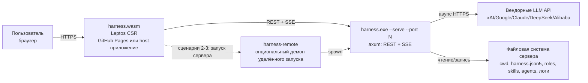
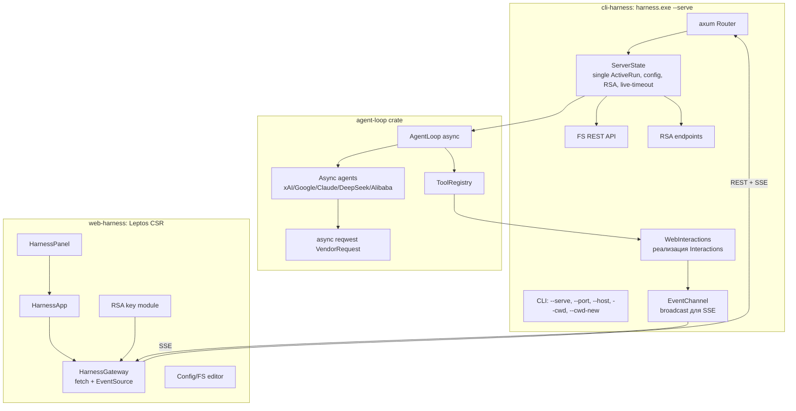
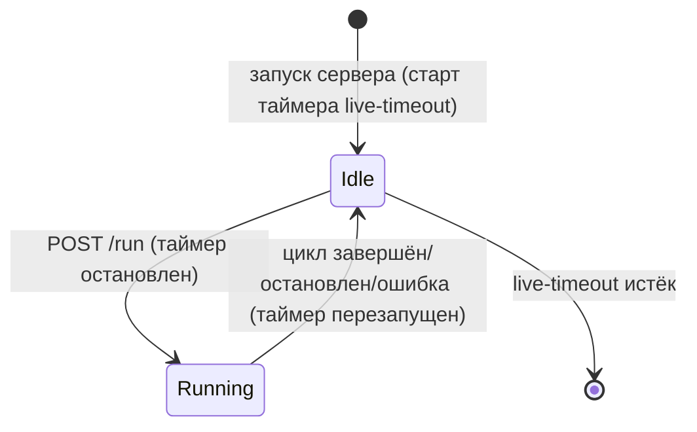
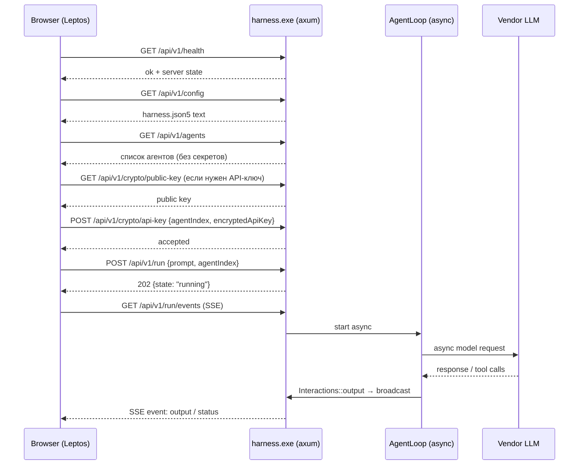
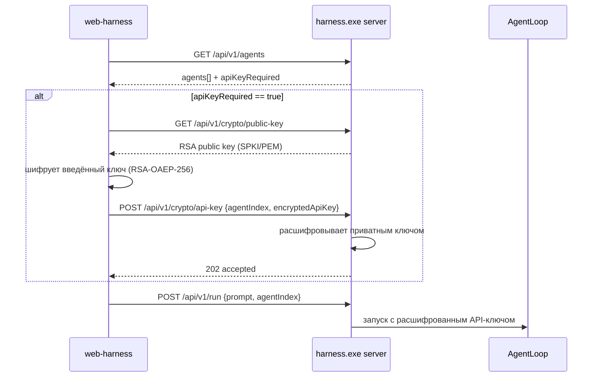
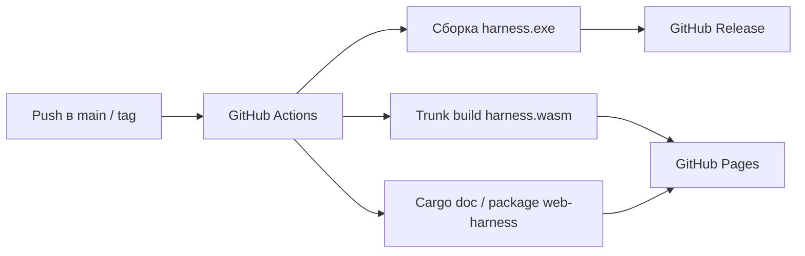

# Консультационный отчёт — Phase 6: Client/Server implementation (итерация 2)

> Статус: вторая итерация планирования.
> Документ учитывает решения и корректировки Project Owner по итогам ревью отчёта №1.
> Задачи не формируются — фиксируется уточнённое архитектурное видение.

---

## 1. Резюме (Executive Summary)

По итогам ревью отчёта №1 зафиксированы следующие ключевые решения:

1. **Серверная часть** — `harness.exe` в режиме `--serve`, реализованный на **чистом axum + tokio**, полностью асинхронный: HTTP-слой и запросы к вендорным LLM API выполняются на `async reqwest`.
2. **Клиентская часть** — `harness.wasm`, чистое Rust/Leptos **CSR**-приложение, собираемое **Trunk**.
3. **Транспорт** — **REST + SSE**.
4. **Одна активная сессия** — сервер одновременно выполняет не более одного агентского цикла. `SessionManager` не вводится.
5. **Новая декомпозиция crate'ов**:
   - `agent-loop` — функциональность агентского цикла (сейчас это `crates/harness`);
   - `cli-harness` — CLI и режим сервера;
   - `web-harness` — web-клиент;
   - `interactions` — единый интерфейс `Interactions` (`input` / `output`) и его CLI-реализация + общие DTO.
6. **Вместо `UserInteraction`** — простой интерфейс `Interactions` с двумя методами: `input` (ввод текста) и `output` (вывод текста). Реализации: `CliInteractions` и `WebInteractions`.
7. **API-ключ передаётся через Web с RSA-шифрованием**:
   - сервер генерирует пару ключей и отдаёт публичный ключ клиенту;
   - клиент шифрует API-ключ публичным ключом;
   - сервер расшифровывает и использует ключ в агенте.
8. **Сервер не содержит web-интерфейса** и ничего не знает о клиенте. Frontend распространяется отдельно (GitHub Pages или встраивание в host-приложение).
9. **`live-timeout`** — сервер сам завершается после простоя, заданного в `harness.json5` (по умолчанию 5 минут).
10. **Поддержаны 3 сценария подключения клиента**, включая удалённый запуск сервера и первичную настройку метаданных агентского цикла.

Целевая картина:

- `harness.exe --serve --port 4067` — «чистый» сервер: REST + SSE, без раздачи frontend.
- `harness.wasm` — самодостаточный Leptos-клиент (GitHub Pages), который умеет подключаться к серверу, запускать один агентский цикл, показывать логи, отвечать на вопросы агента и редактировать конфигурацию/файлы внутри `cwd`.
- `web-harness` — переиспользуемый Rust-крейт с `HarnessPanel`, который можно встроить в другое Leptos WASM-приложение как модуль-плагин.

---

## 2. Сводка принятых решений по ревью

| Вопрос из отчёта №1 | Решение Project Owner | Что меняется в отчёте №2 |
|---|---|---|
| Технология серверной части | Вариант B: полностью асинхронный (axum + async reqwest) | Гибрид `spawn_blocking` отклонён; агентский цикл и vendor-запросы переводятся на async |
| HTTP-фреймворк | Чистый Axum | actix-web, warp, rouille не рассматриваются |
| Транспорт | SSE + REST | WebSocket не используется в первой версии |
| Leptos-клиент | CSR, сборка Trunk | SSR/hydration не используется |
| Сессии | Без множества сессий: одна активная | Убирается `SessionManager`, API переходит от `/sessions` к `/run` |
| Декомпозиция crate'ов | `web-harness`, `cli-harness`, `agent-loop`, `interactions` | Перераспределение текущего `crates/harness` |
| Интерактивность | Нет `UserInteraction`; один интерфейс `Interactions` с `input`/`output` | Рефакторинг `tools.user` и `agent_loop.confirm` на `Interactions` |
| API-ключ | RSA-шифрование при передаче из Web; отдельный модуль в `web-harness` | Новые crypto-эндпоинты и клиентский модуль шифрования |
| Сервер и клиент | Сервер не содержит web-интерфейса; `live-timeout`; три сценария подключения | Убирается раздача статики; добавляется блок `server` в `harness.json5`; описываются сценарии №1–№3 |
| Файловая система | UI должен управлять файлами внутри `cwd` | Добавляется минимальное REST-API файловой системы |
| Артефакты | `harness.exe` + `harness.wasm` на GitHub-CI; клиент на GitHub Pages; уточнить третий артефакт плагина | CI/CD-схема; ответ на вопрос о третьем артефакте |

---

## 3. Анализ текущей кодовой базы

### 3.1. Что уже есть

| Компонент | Файлы | Роль |
|---|---|---|
| CLI | `crates/harness/src/cli.rs`, `main.rs`, `help.txt` | Ручной парсинг аргументов, запуск сессии |
| Агентский цикл | `crates/harness/src/agent_loop.rs` | Итерации, лимиты, логирование, dump |
| Агенты | `crates/harness/src/agents/*` | HTTP-агенты xAI/Google/Claude/DeepSeek/Alibaba |
| HTTP-клиент | `crates/harness/src/vendor_request.rs` | **Блокирующий** `reqwest`, rate-limit, retry |
| Конфигурация | `crates/conf/src/*` | Загрузка `harness.json5` и моделей, сканирование каталога агентов |
| Инструменты | `crates/tools/src/*` | `fs`, `git`, `terminal`, `user`, `skills`, `roles` |
| Логгер | `crates/logger/src/*` | Трейт `Logger`, `DoubleLogger` (stdout + `log.md`) |

### 3.2. Ограничения, существенные для выбранного варианта B

1. **Синхронный агентский цикл.** `AgentLoop::start` и `VendorRequest::send_json` блокирующие. Для полностью асинхронного сервера их нужно перевести на `async` (`async reqwest`).
2. **Прямой stdin/stdout.**
   - `tools/user.rs`: все запросы читают `stdin`.
   - `agent_loop.rs::confirm`: подтверждение лимита читает `stdin`.
   - `main.rs::prompt_api_key`: запрос API-ключа читает `stdin`.
   - Эти точки заменяются на `Interactions`.
3. **Логирование не является событийной шиной.** Для SSE нужен дополнительный sink (broadcast-канал), а не только файл/stdout.
4. **Нет примитива отмены.** В async-варианте отмена решается штатно: `CancellationToken` + abort/`tokio::select!` для `async reqwest`.
5. **Выбор агента зашит в конфигурацию.** `conf::scan_agent_dir` приватный; серверу нужен публичный способ получить список агентов и выбрать агента без stdin.
6. **API-ключ.** В CLI ключ запрашивается в консоли. В server-режиме ключ либо уже есть в модели, либо передаётся клиентом через RSA.
7. **Один процесс — один запуск.** Это сохраняется и в server-режиме: одновременно выполняется не более одного агентского цикла.

### 3.3. Целевое распределение по crate'ам

```
crates/
  conf/            # + ServerSettings, публичный список агентов
  logger/          # + FileEventLogger / broadcast sink
  tools/           # рефакторинг: вместо stdin использует interactions::Interactions
  interactions/    # НОВЫЙ: trait Interactions, CliInteractions, DTO для input/output
  agent-loop/      # НОВЫЙ: выделяется из crates/harness
  cli-harness/     # НОВЫЙ: CLI + server mode (axum) + WebInteractions
  web-harness/     # НОВЫЙ: Leptos CSR клиент + RSA-модуль + HarnessPanel
```

Соответствие текущих файлов:

| Текущий файл | Куда переезжает |
|---|---|
| `crates/harness/src/agent_loop.rs` | `crates/agent-loop/src/agent_loop.rs` |
| `crates/harness/src/agents/*` | `crates/agent-loop/src/agents/*` |
| `crates/harness/src/vendor_request.rs` | `crates/agent-loop/src/vendor_request.rs` (async) |
| `crates/harness/src/dump_settings.rs` | `crates/agent-loop/src/dump_settings.rs` |
| `crates/harness/src/agent_select.rs` | `crates/cli-harness/src/agent_select.rs` (только CLI) |
| `crates/harness/src/cli.rs`, `main.rs`, `help.txt` | `crates/cli-harness/src/*` |
| `crates/tools/src/user.rs` | `crates/tools/src/user.rs` (использует `Interactions`) |
| — | `crates/interactions/*`, `crates/web-harness/*` |

Бинарный крейт — `cli-harness` (имя пакета/артефакта остаётся `harness.exe`). `agent-loop`, `interactions`, `tools`, `conf`, `logger` — библиотеки. `web-harness` — библиотека + отдельный Leptos-таргет для `harness.wasm`.

---

## 4. Архитектура

### 4.1. C4 Context



### 4.2. Component diagram



### 4.3. Полностью асинхронный агентский цикл (вариант B)

Переход на async затрагивает:

- `VendorRequest::send_json` → `async fn` на `reqwest::Client` (async).
- `Agent` trait → async-методы (`iteration`, `reload_session`, `dump_session`, `finish`).
- `AgentLoop::start` → `async fn` с `CancellationToken`.
- `ToolRegistry::call` → async-обёртка; блокирующие модули (`fs`, `git`, `terminal`) вызываются через `tokio::task::spawn_blocking`, чтобы не блокировать runtime.
- `Interactions` → async-методы `input`/`output`.

Преимущества, ради которых выбран вариант B:

- мгновенная отмена активного HTTP-запроса к вендору (`abort`/`tokio::select!`);
- нативные axum SSE без прослойки `spawn_blocking`;
- единый async-runtime и предсказуемая модель конкурентности.

Цена: миграция синхронного `VendorRequest` и пяти агентов на async. Это контролируемый механический рефакторинг, не меняющий протоколы вендоров.

---

## 5. Серверная часть

### 5.1. CLI

Новые параметры:

| Параметр | Назначение | Правила |
|---|---|---|
| `--serve` | Запуск в режиме сервера | Несовместим с `--prompt`, `--prompt-file`, `--dump`, `--conf-new` |
| `--port <n>` | Порт сервера | Только с `--serve`; приоритет над `server.port` |
| `--host <addr>` | Адрес bind | Опционально; по умолчанию `127.0.0.1`; для удалённого доступа `0.0.0.0` или конкретный интерфейс |
| `--cwd <path>` | Рабочий каталог сервера (сценарий №2) | Внутри должен быть `harness.json5`; приоритет над `cwd` из конфигурации |
| `--cwd-new <path>` | Создать/использовать временный рабочий каталог (сценарий №3) | Если `harness.json5` отсутствует — создаётся шаблон по умолчанию |

Примеры:

```text
harness.exe --serve --port 4067
harness.exe --serve --port 4067 --conf C:\work\harness.json5
harness.exe --serve --host 0.0.0.0 --port 4067
harness.exe --serve --port 4067 --cwd C:\work
harness.exe --serve --port 4067 --cwd-new C:\temp\session-123
```

### 5.2. Конфигурация сервера (`harness.json5`)

```json5
{
    "cwd": "C:/MyLife/Harness",
    "server": {
        "host": "127.0.0.1",   // если --host не задан
        "port": 4343,          // если --port не задан
        "live-timeout": 5,     // минуты простоя
        "cors-origin": "*",    // или конкретный origin GitHub Pages
    },
    "agent": {},
    "tools": {},
}
```

Правила:

- `--port` CLI имеет приоритет над `server.port`, `server.port` — над значением по умолчанию (предлагается `4067`, если порт нигде не задан).
- `live-timeout` — минуты. Отсчёт начинается при старте сервера и перезапускается после завершения каждого агентского цикла. Во время активного цикла таймер не работает.
- На одной машине может быть запущено несколько экземпляров `harness.exe --serve` на разных портах; это независимые процессы без общего состояния.

### 5.3. `live-timeout`

Логика:



- Если за время `live-timeout` от момента старта (или от момента завершения последнего цикла) не был запущен новый агентский цикл, сервер корректно завершает работу: закрывает SSE-подключения, освобождает порт и выходит.
- Обычные polling-запросы (`GET /health`, `GET /agents`, `GET /config`) **не** продлевают жизнь сервера. «Подключение» в терминах заказчика трактуется как запуск агентского цикла.
- Перед завершением сервер может отправить финальное SSE-событие `status: {state:"server_stopping"}`.

### 5.4. Удалённый запуск сервера (сценарии №2 и №3)

Браузерное WASM-приложение не может напрямую выполнить `harness.exe` на удалённой машине. Для сценариев №2 и №3 предлагаются два варианта.

#### Вариант A. Пользовательский bootstrap (MVP, без нового демона)

Клиент формирует готовую команду запуска и показывает её пользователю:

```text
ssh user@host "harness.exe --serve --host 0.0.0.0 --port 4067 --cwd C:\work"
```

или PowerShell/WinRM-аналог. После выполнения пользователем клиент подключается к серверу. Это просто и безопасно, но требует ручного шага.

#### Вариант B. Опциональный демон `harness-remote` (полная автоматизация)

На удалённой машине работает тонкий демон `harness-remote` (рекомендуется реализовать как отдельный режим/артефакт, а не как часть `harness.exe`):

- `GET /health` — проверка доступности демона;
- `POST /launch` — запуск `harness.exe --serve --port <port> --cwd <dir>` или `--cwd-new <dir>`;
- если `harness.exe` отсутствует в системе — демон скачивает последний релиз с GitHub, распаковывает и запускает;
- ответ: `{ "baseUrl": "http://host:port", "pid": ..., "port": ... }`.

Ограничения и безопасность:

- демон должен быть защищён (bind на интерфейс, доступный клиенту, но с токеном/TLS или SSH-туннелем);
- в MVP можно разрешить запуск только на `127.0.0.1` и использовать SSH-туннель до удалённой машины;
- демон **не** должен быть доступен из интернета без аутентификации.

Рекомендация: **MVP — вариант A**; полная автоматизация сценариев №2/№3 — вариант B. Вопрос к заказчику — см. раздел 17.

---

## 6. Модель выполнения (single active run)

### 6.1. Состояния

```mermaid
stateDiagram-v2
    [*] --> Idle: сервер запущен
    Idle --> Running: POST /run
    Running --> WaitingInput: Interactions::input вызван
    WaitingInput --> Running: POST /run/input
    Running --> Stopping: POST /run/stop
    WaitingInput --> Stopping: POST /run/stop
    Stopping --> Stopped: цикл прерван
    Running --> Finished: агент вернул stop
    Running --> Failed: ошибка
    Finished --> Idle
    Failed --> Idle
    Stopped --> Idle
```

- В любой момент времени существует **не более одного** активного цикла.
- Повторный `POST /run` при активном цикле возвращает `409`.
- После завершения цикла сервер возвращается в `Idle`, и `live-timeout` начинает новый отсчёт.

### 6.2. Объект состояния сервера

```rust
struct ServerState {
    config: Arc<RwLock<LoadedServerConfig>>,   // текущий conf + cwd
    active: tokio::sync::Mutex<Option<ActiveRun>>,
    events: tokio::sync::broadcast::Sender<ServerEvent>,
    rsa_private: Arc<RsaPrivateKey>,           // только в памяти
    pending_api_key: Arc<Mutex<Option<DecryptedApiKey>>>,
    live_timeout: Duration,
}
```

`ActiveRun` хранит: `state`, `agent`, `started_at`, `updated_at`, `log_file`, `dump_file`, `cancel: CancellationToken`, `stats`.

### 6.3. Последовательность запуска



---

## 7. REST API (предложение)

Базовый путь: `/api/v1`.

Общие правила:

- JSON, ошибки — `{"error":{"code":"...","message":"..."}}`.
- Никакие секреты (`api-key`, приватный RSA-ключ) не возвращаются.
- CORS: настраивается через `server.cors-origin` (для GitHub Pages — явный origin или `*`).
- Все пути файловой системы ограничены `cwd`.

### 7.1. Health

#### `GET /api/v1/health`

```json
{
  "status": "ok",
  "version": "1.5.0",
  "serverTime": "2026-...",
  "runState": "idle",
  "cwd": "C:/MyLife/Harness",
  "liveTimeoutMinutes": 5
}
```

### 7.2. Агенты

#### `GET /api/v1/agents`

Список доступных агентов без секретов.

```json
{
  "source": {"kind": "directory", "path": "C:/MyLife/Harness/harness/agents"},
  "agents": [
    {
      "index": 0,
      "vendor": "DeepSeek",
      "name": "DeepSeek-V3",
      "path": "C:/MyLife/Harness/harness/agents/deepseek-v3.json5",
      "tokenLimit": -1,
      "rpm": 60,
      "tpm": 100000,
      "rpd": 1000,
      "inputPrice": 0.27,
      "outputPrice": 1.10,
      "cachedPrice": 0.07,
      "apiKeyRequired": true
    }
  ]
}
```

- `apiKeyRequired: true`, если в модели нет API-ключа (или он пустой/недоступен). Тогда клиент должен пройти RSA-флоу.
- Если `agent.config` — файл, массив содержит один элемент с `index: 0`.
- Если кандидатов нет — `409`.

Для этого `conf` должен предоставить публичную функцию списка кандидатов (обёртку над приватным `scan_agent_dir`).

### 7.3. Конфигурация

#### `GET /api/v1/config`

Возвращает текущий `harness.json5` как текст:

```json
{
  "path": "C:/MyLife/Harness/harness.json5",
  "text": "{\n  \"cwd\": ...\n}\n"
}
```

#### `PUT /api/v1/config`

Тело:

```json
{
  "text": "{\n  \"cwd\": ...\n}\n"
}
```

Сервер:

1. валидирует JSON5/структуру через `conf`;
2. при успехе сохраняет файл;
3. применяет конфигурацию при следующем `POST /run` (перечитывает файл);
4. при ошибке возвращает `400` с деталями валидации и **не** сохраняет файл.

#### `POST /api/v1/config/default`

Создаёт `harness.json5` по умолчанию, если файл отсутствует (используется в сценарии №3). Возвращает тот же формат, что и `GET /api/v1/config`.

### 7.4. RSA / API-ключ

#### `GET /api/v1/crypto/public-key`

```json
{
  "algorithm": "RSA-OAEP-256",
  "publicKey": "-----BEGIN PUBLIC KEY-----\n...\n-----END PUBLIC KEY-----"
}
```

Пара ключей генерируется при старте сервера. Приватный ключ хранится только в памяти и никогда не отдаётся/не логируется.

#### `POST /api/v1/crypto/api-key`

```json
{
  "agentIndex": 0,
  "encryptedApiKey": "base64(...)"
}
```

Сервер расшифровывает ключ приватным ключом и сохраняет расшифрованное значение в памяти для следующего запуска агента. Ответ `202`.

Правила:

- расшифрованный ключ используется только в `POST /run` для выбранного `agentIndex`;
- после использования/завершения цикла ключ может быть очищен из памяти (вопрос политики — см. раздел 17);
- при рестарте сервера старый `encryptedApiKey` недействителен (новая пара ключей).

### 7.5. Запуск и управление циклом

#### `POST /api/v1/run`

```json
{
  "prompt": "Текст промпта",
  "agentIndex": 0,
  "limits": {
    "tokenLimit": 256000,
    "iterationLimit": 40,
    "usdLimit": 2.0
  }
}
```

Ответ `202`:

```json
{
  "state": "running",
  "eventsUrl": "/api/v1/run/events"
}
```

Ошибки:

- `400` — пустой промпт/неверный индекс/нет API-ключа;
- `409` — уже выполняется активный цикл;
- `503` — сервер не может запустить цикл.

#### `GET /api/v1/run`

```json
{
  "state": "waiting_input",
  "agent": {"vendor": "DeepSeek", "name": "DeepSeek-V3"},
  "startedAt": "2026-...",
  "updatedAt": "2026-...",
  "summary": {
    "iteration": 3,
    "tokens": 12345,
    "usdApprox": 0.12,
    "usdReal": 0.11
  },
  "pendingInput": {
    "requestId": "req_...",
    "prompt": "Какое имя проекта использовать?\n"
  },
  "logFile": "path-or-null",
  "dumpFile": "path-or-null"
}
```

Если цикл не запущен — `{"state":"idle"}`.

#### `POST /api/v1/run/stop`

```json
{"reason": "optional"}
```

Ответ `202`:

```json
{"state":"stopping"}
```

Поведение:

- отменяет `CancellationToken` агентского цикла;
- если агент ждёт `Interactions::input` — ожидание завершается ошибкой отмены;
- активный async HTTP-запрос к вендору абортируется;
- после остановки состояние переходит в `stopped`, затем в `idle`.

#### `POST /api/v1/run/input`

Ответ на ожидающий `Interactions::input`.

```json
{
  "requestId": "req_...",
  "answer": "Текст ответа"
}
```

Ответ `202`:

```json
{"accepted":true}
```

#### `GET /api/v1/run/events` (SSE)

Поток событий текущего цикла. Если цикл не активен, сервер может сразу закрыть поток или слать `status: idle`.

#### `GET /api/v1/run/log`

Лог текущего/последнего цикла. Параметры: `offset`, `tail`. Ответ `text/plain; charset=utf-8`.

#### `GET /api/v1/run/dump`

Текущий `dump.json`, если он уже существует. Ответ `application/json`.

### 7.6. Файловая система внутри `cwd`

Минимальное REST-API для управления файлами ролей, умений, агентов и другими файлами внутри `cwd`.

| Метод | Путь | Назначение |
|---|---|---|
| `GET` | `/api/v1/fs/list?path=<rel>` | Содержимое каталога |
| `GET` | `/api/v1/fs/read?path=<rel>` | Чтение текстового файла |
| `PUT` | `/api/v1/fs/write?path=<rel>` | Создание/перезапись текстового файла |
| `POST` | `/api/v1/fs/mkdir?path=<rel>` | Создание каталога |
| `DELETE` | `/api/v1/fs/remove?path=<rel>` | Удаление файла/пустого каталога |
| `POST` | `/api/v1/fs/move?src=<rel>&dst=<rel>` | Переименование/перемещение |

Правила:

- `path` всегда относительный; сервер нормализует его относительно `cwd` и отклоняет `..`, абсолютные пути и символьные ссылки, выходящие за пределы `cwd`.
- В MVP API работает внутри всего дерева `cwd`; отдельная политика ограничений (`server.fs`) может быть добавлена позже.
- Клиентские «процессы» (добавить роль, умение, агента) — это последовательности вызовов FS API + `PUT /api/v1/config`. Сервер не реализует доменные операции `add-role` и т.п.; доменная логика остаётся на клиенте.

---

## 8. Поток событий SSE

Формат: `text/event-stream; charset=utf-8`.

Типы событий:

| Тип | Назначение | Пример `data` |
|---|---|---|
| `output` | Текст от `Interactions::output` | `{"line":"## Iteration №2"}` |
| `input_request` | Сервер ожидает ввод пользователя | `{"requestId":"req_1","prompt":"...","structured":null}` |
| `status` | Смена состояния цикла/сервера | `{"runState":"running","iteration":2}` |
| `result` | Цикл завершён/остановлен/ошибка | `{"ok":true,"runState":"finished","stats":{...}}` |
| `keepalive` | Поддержание соединения | `{"at":"2026-..."}` |

Переподключение:

- сервер держит кольцевой буфер последних N событий (например, 512);
- клиент использует `Last-Event-ID` (номер события);
- при длительном офлайне клиент восстанавливает состояние через `GET /run` и `GET /run/log`.

Реализация:

- `tokio::sync::broadcast::Sender<ServerEvent>` в `ServerState`;
- `WebInteractions::output` пишет в этот broadcast;
- SSE-хендлер подписывается на broadcast и пишет в `EventStream`.

---

## 9. Интерфейс `Interactions`

### 9.1. Контракт

В отдельном крейте `crates/interactions`:

```rust
pub trait Interactions: Send + Sync {
    /// Запросить у пользователя текстовый ввод.
    fn input(&self, prompt: &str) -> impl Future<Output = Result<String, String>> + Send;
    /// Вывести пользователю текстовую информацию.
    fn output(&self, text: &str) -> impl Future<Output = Result<(), String>> + Send;
}
```

> Для совместимости с текущими типами можно использовать `async_trait`; в отчёте принципиальна сигнатура: **один метод ввода, один метод вывода**.

Методы покрывают:

- `tools.user.ask_user` → `input(prompt)`;
- `tools.user.request_*` и `request_command_shell_execution` → `input(prompt)` с текстом запроса и ожиданием ответа `y/n` (+ опциональная причина отказа вторым `input`);
- подтверждение лимита в `AgentLoop::check_limit` → `input(prompt)`;
- весь пользовательский лог/статус → `output(line)`.

### 9.2. Реализации

| Реализация | Где живёт | Поведение |
|---|---|---|
| `CliInteractions` | `crates/interactions` | `input` читает `stdin`, `output` пишет в `stdout` (текущее поведение CLI) |
| `WebInteractions` | `crates/cli-harness/src/server/` | `output` отправляет SSE-событие `output`; `input` отправляет SSE `input_request` и ждёт ответа от `POST /run/input` через `oneshot`/`broadcast` |

Клиентская сторона (`web-harness`) не реализует trait `Interactions`; она является **удалённой поверхностью** для `WebInteractions`: рендерит `output`, показывает модальный `input`, отправляет ответ на сервер.

### 9.3. Простые текстовые вопросы и структурированные запросы

MVP остаётся текстовым: `input` получает отформатированную строку вида:

```text
Запрос write-доступа к 'harness/roles/architect.md'
Причина: ...
Разрешить? [y/n]
```

Клиент показывает эту строку в модальном окне с textarea и, если в тексте есть маркер `[y/n]`, — кнопки Yes/No. Это осознанное упрощение.

В будущем, **не меняя** trait, можно ввести соглашение: `prompt` начинается с JSON-конверта `{"kind":"...","title":"...","fields":{...}}`, который `CliInteractions` разворачивает в текст, а `WebInteractions` пробрасывает в UI как структурированный объект. В первой версии это необязательно.

### 9.4. Таймауты и отмена

- `WebInteractions::input` ожидает ответ с таймаутом (по умолчанию 30 минут; можно вынести в `server.input-timeout`).
- `POST /run/stop` отменяет ожидание: pending-input завершается ошибкой `session was stopped`.
- При обрыве SSE вопрос не теряется: он остаётся в `pendingInput` и виден через `GET /run` после переподключения.

---

## 10. Передача API-ключа через RSA

### 10.1. Поток



### 10.2. Криптографические параметры

- Алгоритм: **RSA-OAEP** с SHA-256 (метка пустая), ключ **2048 бит** (или 3072 для запаса).
- Сервер: RustCrypto `rsa` + `sha2`; ключи генерируются при старте сервера.
- Клиент: в `web-harness` создаётся отдельный модуль `crypto` (или `api_key`), который:
  1. получает публичный ключ;
  2. импортирует его;
  3. шифрует API-ключ;
  4. возвращает base64.

Два варианта клиентского шифрования:

| Вариант | Плюсы | Минусы | Оценка |
|---|---|---|---|
| **Web Crypto API** (`web_sys::SubtleCrypto`, RSA-OAEP) | Нативно, быстро, не тянет RSA в WASM | Требует secure context (HTTPS или localhost) | **Рекомендуется** |
| RustCrypto `rsa` в WASM | Полностью pure Rust, работает без Web Crypto | Увеличивает размер wasm, медленнее генерация/шифрование | Альтернатива |

Рекомендация: **Web Crypto API** как основной путь; RustCrypto — как fallback, если окружение host-приложения не даёт доступа к Web Crypto.

### 10.3. Правила безопасности

- Приватный ключ — только в памяти, не попадает в логи, dump, конфигурацию.
- Расшифрованный API-ключ не возвращается клиенту и не пишется на диск.
- После завершения цикла расшифрованный ключ рекомендуется удалять из памяти; при необходимости повторного запуска клиент вводит его снова (или сервер может хранить до истечения `live-timeout` — вопрос к заказчику).
- Если модель уже содержит API-ключ в конфигурации, RSA-флоу не требуется.

---

## 11. Три сценария взаимодействия клиента и сервера

### 11.1. Сценарий №1: сервер запущен, клиент знает адрес и порт

1. Пользователь открывает `harness.wasm` и указывает `http://host:port`.
2. Клиент вызывает `GET /health`, затем `GET /config` и `GET /agents`.
3. Метаданные агентского цикла уже настроены; пользователь при необходимости редактирует конфигурацию и файлы.
4. Пользователь вводит промпт и запускает цикл (`POST /run`).

### 11.2. Сценарий №2: клиент знает адрес и CWD, сервер не запущен

1. Клиент формирует запрос на запуск сервера:
   ```text
   harness.exe --serve --port <port> --cwd <target working directory>
   ```
2. Запуск выполняется либо пользователем (bootstrap-команда), либо демоном `harness-remote`.
3. Клиент опрашивает `GET /health` до готовности.
4. После подключения — как в сценарии №1. Конфигурация уже есть в CWD, первичная настройка не требуется.

### 11.3. Сценарий №3: клиент знает только адрес машины

1. Клиент запрашивает запуск:
   ```text
   harness.exe --serve --port <port> --cwd-new <temporary working directory>
   ```
2. Если `harness.exe` отсутствует на машине — демон скачивает последний релиз с GitHub и запускает его.
3. Сервер стартует с временным рабочим каталогом; если `harness.json5` отсутствует, создаётся шаблон по умолчанию.
4. Клиент подключается и производит **первичную настройку метаданных**:
   - проверяет/создаёт `harness.json5`;
   - загружает его в UI;
   - пользователь настраивает `cwd`, `agent`, `tools`, при необходимости добавляет файлы ролей/умений/агентов через FS API;
   - изменения отправляются на сервер (`PUT /api/v1/config`);
   - после настройки запускается агентский цикл.

### 11.4. Метаданные агентского цикла

Под метаданными понимаются:

1. **CWD** — корневая рабочая директория агентского цикла;
2. **`harness.json5`** — конфигурация цикла.

В сценариях №1 и №2 конфигурация уже существует в CWD и только загружается в UI. В сценарии №3 создаётся конфигурация по умолчанию и загружается в UI для первичной настройки.

UI обязан:

- показывать и редактировать `harness.json5`;
- перед следующим `POST /run` отправлять изменённую конфигурацию на сервер;
- управлять файлами внутри CWD (создание/изменение/удаление файлов и каталогов), прежде всего для `roles`, `skills`, `agents`.

---

## 12. Web-клиент (`web-harness`)

### 12.1. Структура

```
crates/web-harness/
  src/
    lib.rs
    gateway.rs        # HarnessGateway: REST + SSE
    crypto.rs         # RSA-шифрование API-ключа (отдельный модуль)
    state.rs          # HarnessClient: реактивное состояние
    components/
      mod.rs
      harness_panel.rs# HarnessPanel: встраиваемая панель
      composer.rs     # промпт, выбор агента, запуск/остановка
      log_view.rs     # вывод логов
      input_modal.rs  # модальный ввод (input)
      config_editor.rs# редактор harness.json5
      fs_browser.rs   # браузер файлов CWD
  Cargo.toml
  Trunk.toml
  index.html
```

### 12.2. `HarnessGateway`

Низкоуровневый клиент, изолирующий транспорт:

```rust
pub struct HarnessGateway {
    base_url: String,
}

impl HarnessGateway {
    pub fn new(base_url: impl Into<String>) -> Self;
    pub async fn health(&self) -> ...;
    pub async fn list_agents(&self) -> ...;
    pub async fn get_config(&self) -> ...;
    pub async fn put_config(&self, text: &str) -> ...;
    pub async fn get_public_key(&self) -> ...;
    pub async fn send_api_key(&self, agent_index: usize, encrypted: &str) -> ...;
    pub async fn start_run(&self, request: StartRunRequest) -> ...;
    pub async fn stop_run(&self) -> ...;
    pub async fn send_input(&self, request_id: &str, answer: &str) -> ...;
    pub fn events(&self) -> impl Stream<Item = ServerEvent>;
}
```

Использует `gloo-net`/`web-sys` + `EventSource`. Не зависит от Leptos, поэтому тестируется и переиспользуется отдельно.

### 12.3. `HarnessPanel`

Экспортируемая Leptos-компонента:

```rust
#[component]
pub fn HarnessPanel(
    base_url: String,
    compact: bool,
    #[prop(optional)] theme: Option<HarnessTheme>,
) -> impl IntoView
```

- `compact = true` — узкая панель (~320–420 px) для встраивания в боковую панель host-приложения;
- `compact = false` — полный интерфейс: композер, лог, статус, редактор конфигурации/файлов;
- состояние изолировано внутри `HarnessClient`, глобальное состояние хоста не читается.

### 12.4. UI/UX

Экраны:

1. **Подключение** — ввод адреса сервера; индикация сценариев №1–№3.
2. **Композер** — textarea промпта, выбор агента, лимиты, кнопка Start/Stop.
3. **Лог** — автопрокрутка, tail-режим, минимальная markdown-подсветка.
4. **Модальный ввод** — textarea + Yes/No/Allow/Deny (по маркеру `[y/n]`).
5. **Конфигурация и файлы** — редактор `harness.json5`, браузер файлов CWD, мастер добавления роли/умения/агента.
6. **Status bar** — состояние, итерация, токены, USD (приблизительно/real), время ожидания ответа модели.

Адаптивность: CSS Grid/Flexbox; plain CSS с префиксом `hw-` для изоляции стилей в host-приложении.

---

## 13. Встраивание в другие Leptos WASM-приложения (WAI / plugin)

### 13.1. Уточнение термина

Под «WAI (Web Assembly Interface)» в экосистеме Rust исторически понимается ранний крейт `wai`, позже эволюционировавший в **WIT + WebAssembly Component Model**. Полноценный WIT-интерфейс для Leptos/DOM-компонентов в component model пока не является зрелым решением. Поэтому для первой версии рекомендуется **Rust-level API** (проверенный подход), а WIT-обёртка остаётся будущей возможностью.

### 13.2. Ответы на вопросы Project Owner

#### Вопрос 1. Как родительское приложение будет загружать harness-модуль с GitHub?

**Рекомендуемый способ — source-level интеграция (Rust-крейт).**

Родительское приложение подключает `web-harness` как обычную зависимость Cargo:

```toml
[dependencies]
web-harness = { git = "https://github.com/<org>/Harness.git", tag = "v1.5.0" }
# либо с crates.io: web-harness = "1.5.0"
```

`trunk build` компилирует `web-harness` прямо в WASM-бандл родительского приложения. GitHub выступает источником кода/версий (git-tag или crates.io). Это тот же механизм, которым любое Rust-приложение получает библиотеки, и он не требует runtime-загрузки отдельного `.wasm`.

Если в будущем потребуется загружать модуль **без перекомпиляции родительского приложения**, тогда собирается третий артефакт — `harness-plugin.wasm` + JS-загрузчик (см. 13.3). В первой итерации он не требуется.

#### Вопрос 2. Как родительское приложение сможет отобразить UI модуля в выделенной области?

`web-harness` экспортирует Leptos-компоненту `HarnessPanel`. Родитель просто размещает её в своём `view!`:

```rust
use web_harness::HarnessPanel;

#[component]
pub fn HostApp() -> impl IntoView {
    view! {
        <main>
            <h1>"Моя IDE"</h1>
            <aside class="side-panel">
                <HarnessPanel
                    base_url="http://localhost:4067".to_string()
                    compact=true
                />
            </aside>
        </main>
    }
}
```

- компонента — обычная Leptos-компонента, участвует в реактивном дереве хоста;
- размеры и позиция задаются штатной вёрсткой хоста;
- `compact=true` включает адаптивную раскладку для узкой области;
- стили изолированы префиксом `hw-` для предотвращения конфликтов;
- если нужен не готовый UI, а только данные, хост использует `HarnessGateway`/`HarnessClient` и рисует собственный интерфейс.

#### Вопрос 3. Как родительское приложение сможет взаимодействовать с модулем?

Взаимодействие строится на трёх уровнях:

1. **Конфигурация компоненты.** Входные props:
   - `base_url` — адрес сервера;
   - `compact` — режим отображения;
   - `theme` — тема/цвета;
   - опциональные callbacks: `on_status`, `on_result`, `on_input_request`.

2. **Программное управление.** Экспортируется `HarnessClient` — реактивное состояние и команды:

   ```rust
   let client = HarnessClient::new(base_url);
   client.list_agents().await?;
   client.start_run(StartRunRequest { .. }).await?;
   client.stop_run().await?;
   client.send_input(request_id, answer).await?;
   ```

   Хост может не рендерить `HarnessPanel`, а использовать `HarnessClient` напрямую.

3. **События/поток.** `HarnessGateway::events()` возвращает поток `ServerEvent` (`output`, `status`, `input_request`, `result`), на который хост может подписаться.

Для host-приложения это аналогично подключению плагина через API: строгая типизация Rust, compile-time проверки, отсутствие JS-прослойки.

### 13.3. Третий артефакт: нужен или нет?

| Модель интеграции | Артефакт | Когда применять |
|---|---|---|
| **Source-level (рекомендуется)** | Крейт `web-harness` (crates.io/git tag) + rustdoc | Родительское приложение перекомпилируется; максимум надёжности и типизации |
| **Runtime plugin** | `harness-plugin.wasm` + JS-загрузчик | Родитель не может перекомпилироваться; нужен динамический marketplace плагинов |
| **WIT/Component Model** | WIT-компонент | Будущее, когда Leptos/DOM в component model станет зрелым |

**Вывод:** в первой итерации третий runtime-артефакт не обязателен. Достаточно публиковать крейт `web-harness` и его документацию. Если заказчику принципиально нужна загрузка плагина без перекомпиляции — это отдельная итерация с `harness-plugin.wasm` и JS-мостом (вопрос для подтверждения).

---

## 14. CI/CD и артефакты

### 14.1. Сборка

| Артефакт | Как собирается | Публикация |
|---|---|---|
| `harness.exe` | `cargo build --release -p cli-harness` (windows-latest) | GitHub Release |
| `harness.wasm` + `dist` | `trunk build --release` для `web-harness` | GitHub Pages |
| Крейт `web-harness` | `cargo package` / `cargo publish` | crates.io или git tag |
| Документация | `cargo doc` (rustdoc) | GitHub Pages |

### 14.2. Workflow



Рекомендуемые jobs:

1. `server` — `windows-latest`, сборка `cli-harness`, загрузка `harness.exe` в артефакты/релиз.
2. `client` — `ubuntu-latest` + Rust/WASM target, `trunk build --release`, деплой `dist` на GitHub Pages.
3. `crate` — `cargo test`, `cargo doc`, `cargo package -p web-harness` (опционально `cargo publish` по тегу).

### 14.3. GitHub Pages

- `harness.wasm` публикуется на Pages и открывается как самостоятельное приложение.
- Пользователь вводит адрес сервера в UI (или адрес задаётся query-параметром `?server=http://host:port`).
- Для доступа к серверу на другом origin настраивается CORS (`server.cors-origin`).

---

## 15. Безопасность

1. **Bind по умолчанию `127.0.0.1`.** Удалённый доступ — только явным `--host 0.0.0.0`/конкретным интерфейсом.
2. **Секреты не покидают сервер.** `GET /agents` и `GET /config` не возвращают `api-key`; приватный RSA-ключ не передаётся.
3. **API-ключ через RSA-OAEP** — не передаётся открытым текстом. Клиентский модуль шифрования изолирован в `web-harness`.
4. **REST-пути файловой системы ограничены `cwd`**; запрещены `..`, абсолютные пути и переходы по symlink за пределы `cwd`.
5. **CORS.** Явный origin GitHub Pages или `*` в dev; в prod — настраиваемый.
6. **Аутентификация сервера.** Для удалённого доступа рекомендуется опциональный bearer-токен в `server`-конфигурации. `EventSource` не умеет кастомные заголовки, поэтому токен передаётся query-параметром или кукой (с оговоркой о логировании) либо заменяется WebSocket/fetch-stream в будущем.
7. **TLS.** В первой версии не внедряется; для удалённого доступа — обратный прокси (Caddy/nginx) или SSH-туннель.
8. **`harness-remote`.** Демон удалённого запуска не должен быть доступен из интернета без аутентификации; рекомендуется bind `127.0.0.1` + SSH-туннель или mutual TLS.

---

## 16. Риски и ограничения

| Риск | Вероятность | Влияние | Митигация |
|---|---|---|---|
| Миграция агентов на async может внести регрессии в retry/rate-limit | Средняя | Высокое | Сохранить логику `VendorRequest` как есть, заменив только слой `reqwest` на async; покрыть тестами retry/rate-limit |
| Блокирующие инструменты (`fs`, `git`, `terminal`) в async-цикле | Высокая | Среднее | Всегда вызывать их через `tokio::task::spawn_blocking` |
| Браузер не может напрямую запускать удалённые процессы (сценарии №2–№3) | Высокая | Высокое | Bootstrap-команда в MVP; `harness-remote` для автоматизации |
| Открытый сервер с доступом к `cwd` и инструментам | Средняя | Критичное | Bind `127.0.0.1` по умолчанию, bearer-токен, предупреждения в `--help` |
| Web Crypto требует secure context | Средняя | Среднее | localhost считается secure; для удалённого доступа — HTTPS или RustCrypto-fallback |
| Конкурентный доступ к одним файлам (редактор UI vs агентский цикл) | Средняя | Среднее | В MVP UI и цикл разделены состоянием `runState`; во время активного цикла запись в конфликтующие файлы ограничивается/предупреждается |
| Рост логов при длинных циклах | Средняя | Низкое | Кольцевой буфер SSE, `tail`/`offset`, ротация файла в будущем |

---

## 17. Открытые вопросы для заказчика

1. **Трактовка варианта B.** Подтвердить, что «полностью асинхронный (axum + sync request)» означает **axum + async reqwest** для вендорных запросов. Если имелся в виду иной смысл — требуется уточнение.
2. **Удалённый запуск.** Для сценариев №2 и №3: достаточен ли в первой версии пользовательский bootstrap (сгенерированная команда), или сразу проектируем демон `harness-remote` с автозапуском и скачиванием релиза?
3. **Аутентификация.** Обязателен ли bearer-токен для не-loopback сервера в первой версии, или MVP допускает `--host 0.0.0.0` без токена при условии предупреждения?
4. **Хранение расшифрованного API-ключа.** Удалять ли расшифрованный ключ сразу после завершения цикла или хранить в памяти до истечения `live-timeout`?
5. **Область FS API.** Разрешить UI работу со всем деревом `cwd` или ограничить только `harness.json5` + каталоги `roles`/`skills`/`agents`?
6. **Третий артефакт.** Подтвердить, что в первой итерации достаточно source-level крейта `web-harness` (без runtime `harness-plugin.wasm`), либо указать, что динамическая загрузка плагина обязательна.
7. **Платформы сборки.** `harness.exe` собирать только для Windows или также Linux/macOS (учитывая сценарии удалённых машин)?

---

## 18. Итоговое видение

После реализации пользователь получает:

- `harness.exe --serve --port <port>` — чистый axum-сервер (REST + SSE) без web-интерфейса, с одной активной сессией, `live-timeout`, RSA-приёмом API-ключа и REST-доступом к конфигурации/файлам внутри `cwd`.
- `harness.wasm` — Leptos CSR-приложение (Trunk), публикуемое на GitHub Pages: подключение к серверу, три сценария запуска, композер промпта, выбор агента, живой лог, остановка цикла, ответы на вопросы агента, редактор `harness.json5` и браузер файлов `cwd`.
- `web-harness` — переиспользуемый Rust-крейт с `HarnessGateway`, `HarnessClient` и `HarnessPanel` для встраивания в другие Leptos WASM-приложения как модуль-плагин.
- `agent-loop` — асинхронное ядро агентского цикла, выделенное из текущего `crates/harness`.
- `interactions` — единый интерфейс `Interactions` (`input`/`output`) с реализациями для CLI и Web.

Рекомендуемый стек:

- сервер: **axum + tokio + async reqwest**;
- транспорт: **REST + SSE**;
- клиент: **Leptos CSR + Trunk**;
- криптография API-ключа: **RSA-OAEP-256** (Web Crypto на клиенте, RustCrypto на сервере);
- интеграция: **source-level Rust API** (`HarnessPanel`), WIT — позже.

Ограничения первой версии:

- одна активная сессия (по решению заказчика);
- взаимодействие с агентом — текстовое (`input`/`output`) с последующим опциональным структурированием;
- удалённый запуск сервера в сценариях №2/№3 — через bootstrap-команду или `harness-remote` (по итогам ответа на вопрос №2);
- без TLS в самом сервере; для удалённого доступа — обратный прокси или SSH-туннель.
