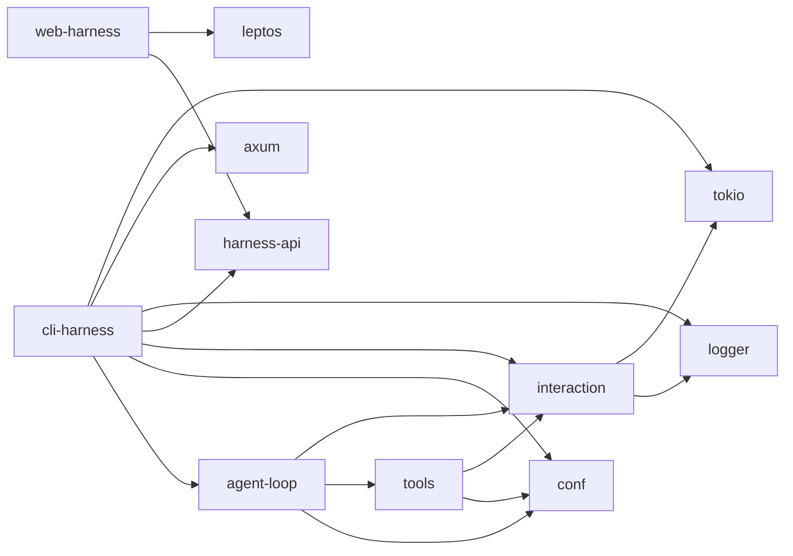
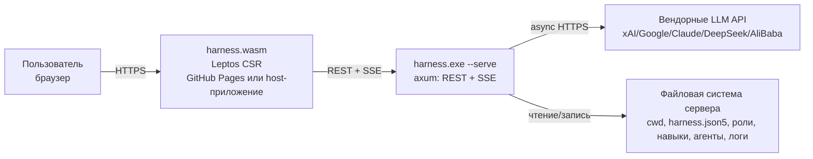
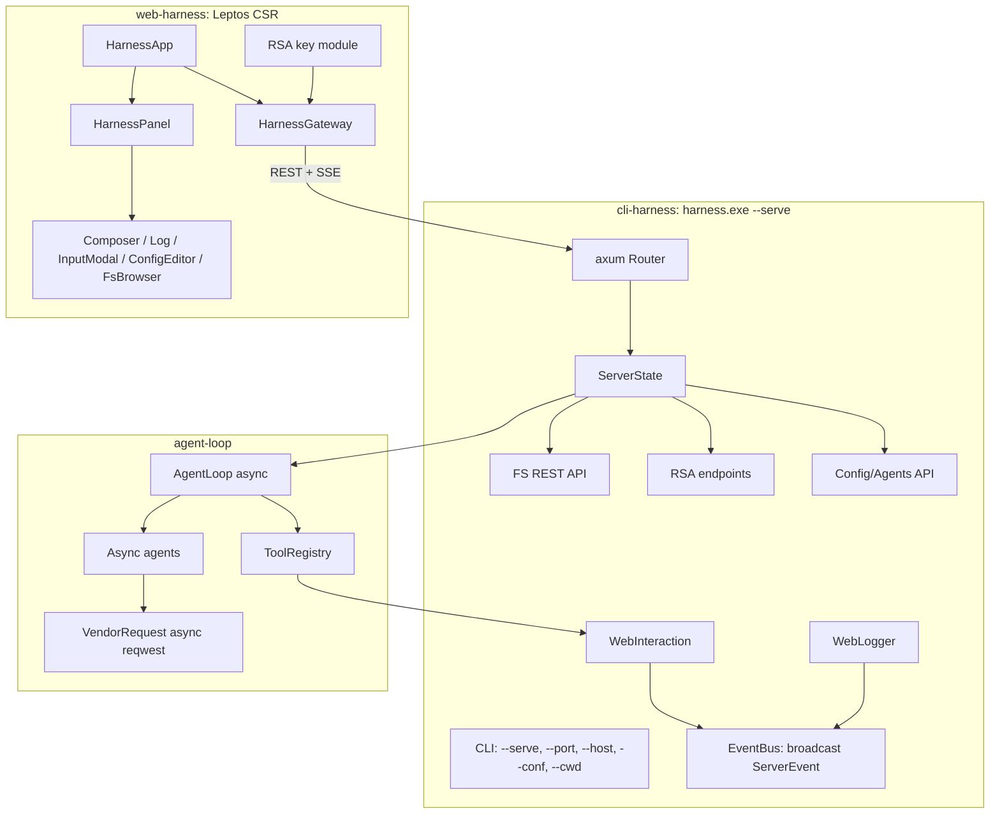
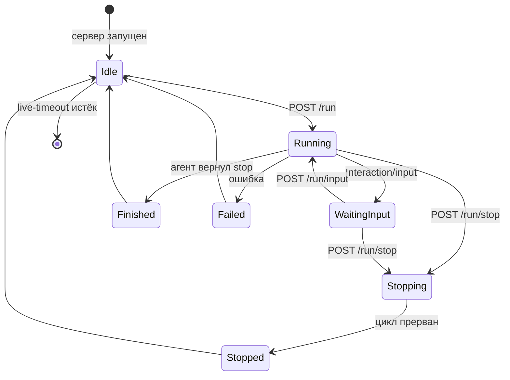
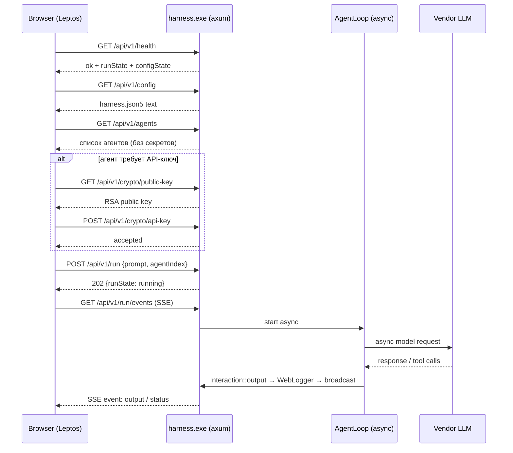
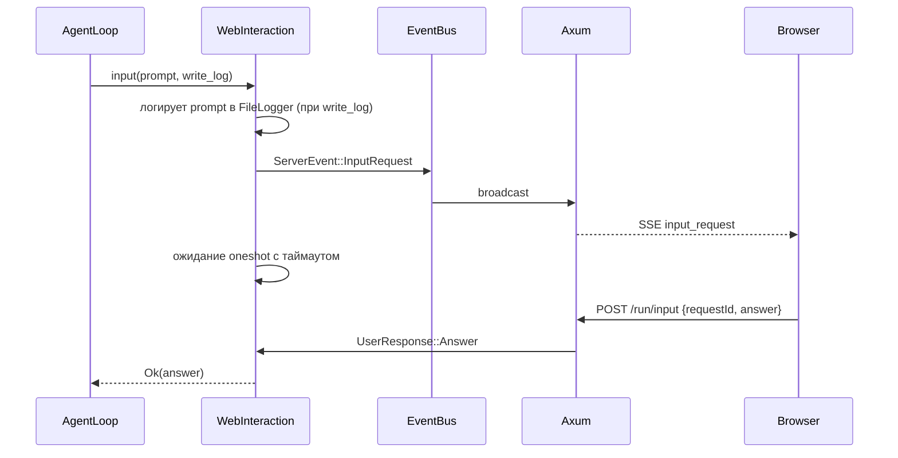
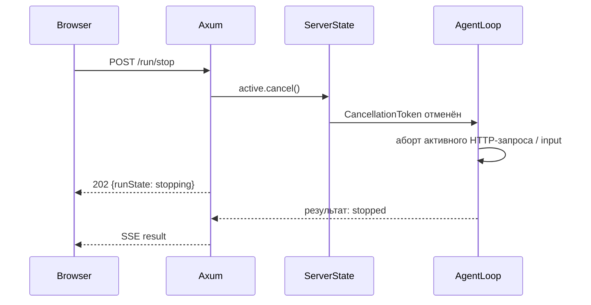
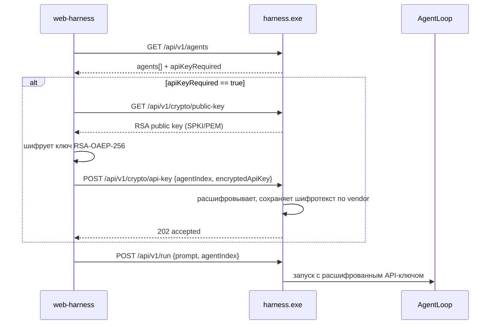

# Phase 6. Архитектура решения

> Документ описывает целевую архитектуру: декомпозицию на crate'ы, модули, связи, диаграммы и модель выполнения.
> Смежные документы: `base.md` (исходное/целевое состояние), `tech.md` (технологии), `api.md` (REST-API), `ui.md` (web-интерфейс).

---

## 1. Архитектурные принципы

1. **Единая зона ответственности ввода/вывода.** Все операции ввода/вывода и логирования проходят через два контракта: `Logger` и `Interaction`.
2. **Полностью асинхронный сервер.** HTTP-слой, агентский цикл и запросы к вендорам работают на `tokio`; блокирующие операции изолируются через `spawn_blocking`.
3. **Сервер ничего не знает о клиенте.** Сервер предоставляет REST + SSE; web-интерфейс — отдельное приложение.
4. **Одна активная сессия.** Сервер в каждый момент выполняет не более одного агентского цикла.
5. **Модульность для встраивания.** Клиент разделён на транспорт (`HarnessGateway`) и UI (`HarnessPanel`).
6. **YAGNI.** Runtime-плагины, WIT-компоненты, сложная аутентификация и удалённый запуск сервера исключены из первой версии.

---

## 2. Декомпозиция на crate'ы

### 2.1. Целевая структура

```
crates/
  conf/           # существующий: загрузка конфигурации, модели, список агентов
  logger/         # Logger, FileLogger, NullLogger
  interaction/    # Interaction, OutputType, CliInteraction, композиция приёмников
  harness-api/    # общие DTO REST/SSE (сервер и клиент)
  tools/          # реестр инструментов; использует Interaction вместо stdin/logger
  agent-loop/     # асинхронный агентский цикл, агенты, vendor-запросы
  cli-harness/    # CLI + режим сервера (axum); WebLogger и WebInteraction
  web-harness/    # Leptos CSR клиент + HarnessGateway + HarnessPanel
```

### 2.2. Ответственность crate'ов

| Crate | Тип | Ответственность |
|---|---|---|
| `logger` | lib | Контракт `Logger`, файловый и пустой приёмники |
| `interaction` | lib | Контракт `Interaction`, `OutputType`, CLI-реализация, группировка приёмников |
| `harness-api` | lib | DTO для REST и SSE: запросы, ответы, события |
| `conf` | lib | Загрузка/валидация `harness.json5` и моделей; публичный список агентов; `ServerSettings` |
| `tools` | lib | Реестр инструментов агента; `UserModule` и логирование работают через `Interaction` |
| `agent-loop` | lib | Асинхронный `AgentLoop`, вендорные агенты, `VendorRequest` |
| `cli-harness` | bin | CLI-режим (`--prompt`) и серверный режим (`--serve`/без параметров) |
| `web-harness` | lib + wasm | Leptos-клиент, `HarnessGateway`, RSA-модуль, `HarnessPanel` |

### 2.3. Граф зависимостей

В терминах Cargo (стрелка — «зависит от»):



Пояснение направления зависимостей:

- `interaction` **использует** `logger`, поэтому в Cargo-графе `interaction → logger`;
- обратное направление (`logger → interaction`) невозможно: `interaction` хранит `dyn Logger`, и зависимость `logger` от `interaction` создала бы цикл;
- все crate'ы, которым нужен ввод/вывод (`tools`, `agent-loop`, `cli-harness`), **зависят** от `interaction`;
- `tools` и `agent-loop` **не зависят** от `logger` напрямую: любое логирование и взаимодействие с пользователем они выполняют через `Interaction`; конкретные приёмники (`FileLogger`, `WebLogger`) подставляются снаружи;
- `cli-harness` дополнительно зависит от `logger`, потому что создаёт `FileLogger` и `WebLogger` и передаёт их в `InteractionLoggers`;
- `web-harness` не реализует `Interaction`; он потребляет `harness-api` и общается с сервером по REST/SSE;
- `harness-api` — тонкий контрактный crate без зависимостей от axum/leptos, поэтому его можно подключать и к серверу, и к WASM-клиенту.

---

## 3. Контекстная диаграмма (C4 Context)



Сервер не раздаёт frontend. `harness.wasm` доставляется пользователю либо с GitHub Pages, либо в составе родительского Leptos-приложения.

---

## 4. Компонентная диаграмма



---

## 5. Единая зона ответственности ввода/вывода

### 5.1. Контракт `Logger`

Трейт `Logger` упрощается до одного метода:

```rust
/// Контракт журнала сессии.
pub trait Logger: Send + Sync {
    /// Записать фрагмент `message`.
    ///
    /// `new_line = true`  — запись начинается с новой строки:
    ///                      если `message` не начинается с '\n', он добавляется.
    /// `new_line = false` — запись продолжает текущую позицию (как есть).
    fn log_str(&self, message: &str, new_line: bool);
}
```

Реализации:

| Реализация | Где живёт | Поведение |
|---|---|---|
| `FileLogger` | `crates/logger` | Дописывает данные в файл лога сессии |
| `NullLogger` | `crates/logger` | Пустой приёмник для тестов |
| `WebLogger` | `crates/cli-harness/src/server` | Реализует `Logger` и отправляет данные клиенту через SSE |

`WebLogger` находится в серверном слое `cli-harness`, потому что он зависит от серверной событийной шины. Контракт `Logger` при этом остаётся в `logger`.

### 5.2. Контракт `Interaction`

Контракт ввода/вывода живёт в crate `interaction`:

```rust
#[derive(Debug, Clone, Copy, PartialEq, Eq)]
pub enum OutputType {
    /// Продолжает запись с текущей позиции.
    ContinueLine,
    /// Начинает запись с новой строки.
    NewLine,
    /// Перезаписывает текущую строку (консоль/индикатор прогресса).
    RewriteLine,
}

#[derive(Debug)]
pub enum InteractionError {
    Cancelled,
    Timeout,
    Io(String),
}

#[async_trait::async_trait]
pub trait Interaction: Send + Sync {
    /// Запросить у пользователя текстовый ввод.
    async fn input(
        &self,
        prompt: &str,
        write_log: bool,
    ) -> Result<String, InteractionError>;

    /// Вывести пользователю информацию.
    async fn output(
        &self,
        message: &str,
        write_log: bool,
        new_line: OutputType,
    ) -> Result<(), InteractionError>;
}
```

**Обоснование сигнатуры.** Метод `input` обязан передавать агенту текст запроса и возвращать ответ пользователя, поэтому он принимает `prompt` и возвращает `Result<String, InteractionError>`. Методы объявлены `async`, так как в серверном режиме ожидание ответа пользователя может длиться минутами и не должно блокировать поток `tokio`; CLI-реализация при этом выносит чтение `stdin` в `spawn_blocking`.

### 5.3. Композиция приёмников

Плоский список `Vec<dyn Logger>` не позволяет выразить правило «при `write_log=false` файл не пишется, но клиенту событие всё равно уходит». Поэтому вводится явная группировка:

```rust
pub struct InteractionLoggers {
    /// Файловый приёмник. Пишется только при write_log = true.
    pub file: Option<Arc<dyn Logger>>,
    /// Прогресс-приёмники (SSE/клиент). Пишутся всегда.
    pub progress: Vec<Arc<dyn Logger>>,
}
```

Реализации:

| Реализация | Где живёт | Состав приёмников |
|---|---|---|
| `CliInteraction` | `crates/interaction` | `file = Some(FileLogger)`, `progress = []` |
| `WebInteraction` | `crates/cli-harness/src/server` | `file = Some(FileLogger)`, `progress = [WebLogger]` |

Правила логирования ввода/вывода:

| Флаг | Файловый приёмник | Прогресс-приёмники (SSE) |
|---|---|---|
| `write_log = true` | пишется | пишутся |
| `write_log = false` | **не пишется** | **пишутся** (таймеры, служебный прогресс) |

### 5.4. Отображение `OutputType` на приёмники

| OutputType | CLI (stdout) | FileLogger | Web/SSE |
|---|---|---|---|
| `ContinueLine` | `print!("{message}")` | `log_str(message, false)` | событие `output`, `mode: "continue_line"` |
| `NewLine` | запись с новой строки | `log_str(message, true)` | событие `output`, `mode: "new_line"` |
| `RewriteLine` | `\r{message}` (перезапись строки) | `log_str(message, false)` | событие `output`, `mode: "rewrite_line"`; UI заменяет последнюю строку |

Для `RewriteLine` web-клиент не добавляет новую строку лога, а обновляет последнюю строку-индикатор. Это нужно для отображения таймеров ожидания модели и другого служебного прогресса, который не попадает в файл лога.

---

## 6. Полностью асинхронный агентский цикл

### 6.1. Что меняется

| Компонент | Текущее состояние | Целевое состояние |
|---|---|---|
| `VendorRequest` | `reqwest::blocking`, `thread::sleep`, `mpsc` + поток для stopwatch | `reqwest` async, `tokio::time::sleep`, `tokio::select!` + `Interval` |
| `Agent` | синхронные методы | `async fn` методы |
| `AgentLoop::start` | блокирующий цикл | `async fn` с `CancellationToken` |
| `ToolRegistry::call` | синхронный | `async fn`; блокирующие модули (`fs`, `git`, `terminal`) через `spawn_blocking` |
| Ввод/вывод | stdin/stdout напрямую | `Interaction` (async) |
| Логирование в `tools`/`agent-loop` | `Arc<dyn Logger>` напрямую | `Arc<dyn Interaction>`; логи через `Interaction::output` |

### 6.2. Отмена

- В `ServerState` и в `ActiveRun` хранится `tokio_util::sync::CancellationToken`.
- `AgentLoop` перед каждой итерацией и перед каждым вендорным запросом проверяет отмену.
- Активный HTTP-запрос к вендору оборачивается в `tokio::select!`:
  - завершился запрос → обрабатываем ответ;
  - сработал `cancel` → future отменяется, запрос абортируется.
- `WebInteraction::input` при отмене завершает ожидающий `oneshot` с ошибкой `Cancelled`.

Это даёт мгновенную остановку активного запроса в отличие от кооперативной отмены между итерациями.

---

## 7. Серверная часть

### 7.1. CLI-режимы

```text
harness.exe                                # режим сервера, порт по умолчанию
harness.exe --serve --port 4067            # режим сервера, явный порт
harness.exe --serve --host 0.0.0.0         # удалённый доступ
harness.exe --prompt "..." --conf ...      # консольный режим (как раньше)
harness.exe --dump ...                     # возобновление из dump (консольный режим)
```

Приоритет порта:

1. `--port <n>` из CLI;
2. `server.port` из `harness.json5`;
3. встроенное значение по умолчанию — `4067`.

### 7.2. `ServerState`

```rust
struct ServerState {
    config: RwLock<LoadedServerConfig>,       // текущий conf + cwd + configState
    active: Mutex<Option<ActiveRun>>,          // единственный активный цикл
    events: broadcast::Sender<ServerEvent>,    // шина SSE
    rsa_private: RsaPrivateKey,                // только в памяти
    encrypted_keys: Mutex<HashMap<String, Vec<u8>>>, // vendor -> RSA-шифротекст
    live_timeout: Duration,
}
```

`LoadedServerConfig` хранит:

- путь к `harness.json5`;
- `config_state`: `ok` | `missing` | `invalid`;
- загруженные `Settings`, если конфигурация валидна;
- параметры `server` (host, port, live-timeout, cors-origin).

### 7.3. Модель выполнения (одна активная сессия)



- Повторный `POST /run` при активном цикле возвращает `409`.
- После завершения цикла сервер возвращается в `Idle`, и таймер `live-timeout` перезапускается.
- Обычные опросы (`GET /health`, `GET /agents`, `GET /config`) **не** продлевают `live-timeout`.

### 7.4. Запуск сервера без конфигурации

Сервер должен запускаться, даже если `harness.json5` отсутствует или повреждён, чтобы пользователь мог настроить его из web-интерфейса:

- `config_state = "missing"` — файла нет, `POST /run` возвращает `412` до сохранения валидной конфигурации;
- `config_state = "invalid"` — файл есть, но не прошёл валидацию; `GET /config` возвращает исходный текст, UI позволяет его исправить;
- `config_state = "ok"` — конфигурация загружена, запуск возможен.

---

## 8. Потоки данных

### 8.1. Запуск цикла



### 8.2. Вопрос пользователю



### 8.3. Остановка



---

## 9. Передача API-ключа

### 9.1. Схема



### 9.2. Правила хранения

- Сервер хранит **зашифрованный** API-ключ для конкретного вендора до остановки сервера.
- Расшифрованный API-ключ появляется только в момент запуска агентского цикла и живёт только в памяти этого цикла.
- Приватный RSA-ключ хранится только в памяти сервера.
- Если модель уже содержит ключ в конфигурации, RSA-обмен не требуется.

---

## 10. Встраивание в другие Leptos-приложения

### 10.1. Модель интеграции

Используется **source-level интеграция**: родительское приложение подключает `web-harness` как обычный Cargo-крейт через Git.

```toml
[dependencies]
web-harness = { git = "https://github.com/<org>/Harness.git", tag = "v1.5.0" }
```

`trunk build` родительского приложения компилирует `web-harness` непосредственно в его WASM-бандл.

### 10.2. Отображение UI модуля

`web-harness` экспортирует компоненту:

```rust
use web_harness::HarnessPanel;

#[component]
pub fn HostApp() -> impl IntoView {
    view! {
        <main>
            <h1>"Моя IDE"</h1>
            <aside class="side-panel">
                <HarnessPanel
                    base_url="http://localhost:4067".to_string()
                    compact=true
                />
            </aside>
        </main>
    }
}
```

### 10.3. Программное взаимодействие

Родительское приложение может не использовать готовую `HarnessPanel`, а работать с `HarnessGateway`/`HarnessClient`:

```rust
let gateway = HarnessGateway::new("http://localhost:4067");
let agents = gateway.list_agents().await?;
gateway.start_run(StartRunRequest { prompt, agent_index }).await?;
gateway.stop_run().await?;
gateway.send_input(request_id, answer).await?;
```

Для реактивной интеграции доступны props-колбэки `on_status`, `on_result`, `on_input_request`.

---

## 11. Риски и ограничения

| Риск | Влияние | Митигация |
|---|---|---|
| Миграция агентов на async может внести регрессии в retry/rate-limit | Высокое | Сохранить логику `VendorRequest`, заменив только транспортный слой; покрыть тестами |
| Блокирующие инструменты в async-цикле | Среднее | Всегда вызывать `fs`/`git`/`terminal` через `spawn_blocking` |
| Открытый сервер с доступом к `cwd` | Критичное | Bind `127.0.0.1` по умолчанию; предупреждения при `0.0.0.0`; FS API ограничен `cwd` |
| Рост логов при длинных циклах | Низкое | Кольцевой буфер SSE, `tail`/`offset` у log API |
| Web Crypto требует secure context | Среднее | `localhost` считается secure; для удалённого доступа — HTTPS или RustCrypto-fallback |
| Конкурентный доступ к файлам из UI и агентского цикла | Среднее | Во время активного цикла UI показывает предупреждение; запись в конфликтующие файлы ограничивается на уровне UX |
