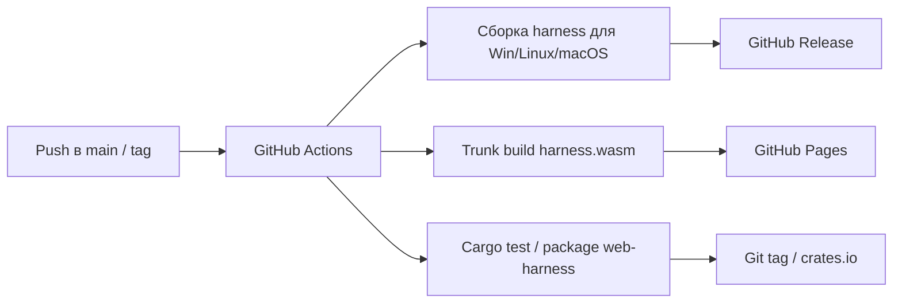

# Phase 6. Технологический стек

> Документ описывает используемые технологии, обоснование выбора и ключевые примеры применения.
> Смежные документы: `base.md`, `arch.md`, `api.md`, `ui.md`.

---

## 1. Сводный перечень

| Технология | Назначение | Обоснование |
|---|---|---|
| **axum** | HTTP-фреймворк сервера | Нативный tokio, зрелые REST/SSE, хорошая документация |
| **tokio** | Асинхронный runtime | Единый рантайм для HTTP, отмены, таймаутов, каналов |
| **async reqwest** | HTTP-клиент к вендорным LLM API | Полностью асинхронный стек, отменяемые запросы |
| **SSE** | Поток событий сервер → клиент | Нативно поддерживается браузером, простота и переподключение |
| **Leptos** | Реактивный UI-фреймворк | Зафиксирован задачей; CSR-режим подходит для WASM |
| **Trunk** | Сборка Leptos CSR | Стандарт для pure-Rust WASM без Node |
| **RSA-OAEP-256** | Шифрование API-ключа | Безопасная передача ключа из браузера |
| **Web Crypto API** | Клиентское RSA-шифрование | Нативно в браузере, не увеличивает WASM |
| **RustCrypto `rsa`** | Серверное RSA | Pure Rust, зрелая реализация |
| **serde/serde_json** | DTO и JSON | Стандарт Rust |
| **gloo-net/web-sys** | Сетевые вызовы из WASM | Лёгкий доступ к `fetch` и `EventSource` |

---

## 2. Сервер: axum + tokio

### 2.1. Почему axum

- Нативная интеграция с `tokio` и `tower`.
- Поддержка `Sse` из коробки.
- Простая модель роутинга: `Router`, `State`, `extractors`.
- Не приносит собственный акторный рантайм (в отличие от actix-web), что упрощает запуск асинхронного агентского цикла.

### 2.2. Пример роутера

```rust
use axum::{
    routing::{get, post},
    Router,
};

pub fn router(state: Arc<ServerState>) -> Router {
    Router::new()
        .route("/api/v1/health", get(handlers::health))
        .route("/api/v1/agents", get(handlers::agents))
        .route("/api/v1/config", get(handlers::get_config).put(handlers::put_config))
        .route("/api/v1/config/default", post(handlers::config_default))
        .route("/api/v1/crypto/public-key", get(handlers::public_key))
        .route("/api/v1/crypto/api-key", post(handlers::submit_api_key))
        .route("/api/v1/run", get(handlers::run_state).post(handlers::start_run))
        .route("/api/v1/run/stop", post(handlers::stop_run))
        .route("/api/v1/run/input", post(handlers::submit_input))
        .route("/api/v1/run/events", get(handlers::run_events))
        .route("/api/v1/run/log", get(handlers::run_log))
        .route("/api/v1/run/dump", get(handlers::run_dump))
        .route("/api/v1/fs/list", get(handlers::fs_list))
        .route("/api/v1/fs/read", get(handlers::fs_read))
        .route("/api/v1/fs/write", axum::routing::put(handlers::fs_write))
        .route("/api/v1/fs/mkdir", post(handlers::fs_mkdir))
        .route("/api/v1/fs/remove", axum::routing::delete(handlers::fs_remove))
        .route("/api/v1/fs/move", post(handlers::fs_move))
        .with_state(state)
}
```

### 2.3. Почему tokio

- Единый runtime для axum, async reqwest, каналов и таймеров.
- `tokio::select!` даёт отмену активного запроса.
- `spawn_blocking` изолирует блокирующие файловые/процессные вызовы.
- `broadcast` — готовая шина для SSE.
- `oneshot` — проброс ответа от REST-запроса к ожидающему `WebInteraction::input`.
- `CancellationToken` — штатная отмена цикла.

---

## 3. HTTP-клиент к вендорам: async reqwest

### 3.1. Что меняется относительно текущего кода

Текущий `VendorRequest` использует `reqwest::blocking`, `thread::sleep` и `mpsc`-поток для секундомера. В целевой архитектуре:

- `Client` — асинхронный `reqwest::Client`.
- rate-limit-ожидания — `tokio::time::sleep`.
- секундомер — `tokio::time::Interval`.
- retry-классификация (429/503/transport) сохраняется без изменений.
- активный запрос оборачивается в `tokio::select!` с `CancellationToken`.

### 3.2. Эскиз

```rust
pub async fn send_json(
    &mut self,
    url: &str,
    headers: &[(&str, &str)],
    body: &Value,
    cancel: CancellationToken,
) -> Result<String, String> {
    let mut last_err = String::new();
    for attempt in 1..=MAX_ATTEMPTS {
        self.limiter.wait(&mut self.clock).await;

        let req = self.client
            .post(url)
            .headers(headers)
            .json(body)
            .send();

        tokio::select! {
            _ = cancel.cancelled() => {
                return Err("request cancelled".into());
            }
            result = req => {
                let resp = result.map_err(transport_error)?;
                let status = resp.status().as_u16();
                let text = resp.text().await.map_err(transport_error)?;
                // ... прежняя retry-логика для 429/503/2xx ...
            }
        }
    }
    Err(last_err)
}
```

Отказоустойчивость к 429/503, скользящие окна RPM/TPM/RPD и повтор до 24 попыток сохраняются.

---

## 4. Транспорт: SSE

### 4.1. Почему SSE, а не WebSocket

| Критерий | SSE | WebSocket |
|---|---|---|
| Направление | сервер → клиент | двунаправленный |
| API браузера | `EventSource`, автоматический reconnect | `WebSocket`, ручной reconnect |
| Формат | текстовые события с `id`/`event`/`data` | произвольные фреймы |
| Прокси/HTTP | обычный HTTP, совместим | требует upgrade |
| Наша задача | поток логов и событий; команды идут через REST | избыточен |

Для MVP команды клиента (запуск, остановка, ответ) передаются обычным REST, поэтому WebSocket не нужен.

### 4.2. Формат события

```text
id: 42
event: output
data: {"line":"## Iteration №2","mode":"new_line"}

```

События описаны в `api.md`. Сервер использует `axum::response::Sse` с `keep_alive`.

### 4.3. Пример серверного SSE-хендлера

```rust
use axum::response::sse::{Event, KeepAlive, Sse};
use futures::stream::Stream;

async fn run_events(
    State(state): State<Arc<ServerState>>,
) -> Sse<impl Stream<Item = Result<Event, Infallible>>> {
    let mut rx = state.events.subscribe();
    let stream = async_stream::stream! {
        while let Ok(evt) = rx.recv().await {
            let data = serde_json::to_string(&evt).unwrap_or_else(|_| "{}".into());
            yield Ok(Event::default()
                .event(evt.event_name())
                .data(data));
        }
    };
    Sse::new(stream).keep_alive(KeepAlive::new().interval(Duration::from_secs(15)))
}
```

### 4.4. Переподключение

- События получают монотонный `id`.
- Клиент использует `Last-Event-ID`.
- На сервере — `tokio::sync::broadcast` с ёмкостью 512 событий.
- Если клиент отстал (broadcast `Lagged`) или долго был офлайн, состояние восстанавливается через `GET /run` и `GET /run/log`.

---

## 5. Клиент: Leptos + Trunk

### 5.1. Режим

Используется **CSR** (client-side rendering): весь рендеринг происходит в браузере после загрузки WASM. SSR/hydration не требуется, так как `harness.wasm` — pure-Rust WASM-приложение без серверного рендеринга.

### 5.2. Структура клиента

```
crates/web-harness/
  src/
    lib.rs
    gateway.rs        # REST + SSE
    crypto.rs         # RSA-шифрование API-ключа
    state.rs          # HarnessClient: реактивное состояние
    components/
      harness_panel.rs
      composer.rs
      log_view.rs
      input_modal.rs
      config_editor.rs
      fs_browser.rs
      connect_dialog.rs
  Cargo.toml
  Trunk.toml
  index.html
```

### 5.3. Почему Trunk

- Стандартный инструмент для Leptos CSR.
- Не требует Node.js: собирает WASM, JS-обвязку и статику.
- Простая команда: `trunk build --release`.
- Артефакт `dist/` пригоден для публикации на GitHub Pages.

---

## 6. RSA-шифрование API-ключа

### 6.1. Параметры

- Алгоритм: **RSA-OAEP** с SHA-256 (метка пустая).
- Размер ключа: **2048 бит** (при необходимости можно увеличить до 3072).
- Сервер: RustCrypto `rsa` + `sha2`.
- Клиент: Web Crypto API (`SubtleCrypto`).

### 6.2. Серверная генерация пары

```rust
use rsa::{Oaep, RsaPrivateKey, RsaPublicKey};
use rsa::pkcs8::EncodePublicKey;

let mut rng = rand::thread_rng();
let private = RsaPrivateKey::new(&mut rng, 2048)?;
let public = RsaPublicKey::from(&private);
let spki_pem = public.to_public_key_pem(Default::default())?;
```

### 6.3. Серверное расшифрование

```rust
use rsa::Oaep;
use sha2::Sha256;

let padding = Oaep::new::<Sha256>();
let plain = private.decrypt(padding, &ciphertext)
    .map_err(|_| "cannot decrypt api key")?;
let api_key = String::from_utf8(plain)
    .map_err(|_| "api key is not valid utf-8")?;
```

### 6.4. Клиентское шифрование (Web Crypto API)

```js
const pem = await fetch(`${base}/api/v1/crypto/public-key`).then(r => r.json());
const der = pemToDer(pem.publicKey);

const key = await crypto.subtle.importKey(
    "spki",
    der,
    { name: "RSA-OAEP", hash: "SHA-256" },
    false,
    ["encrypt"]
);

const cipher = await crypto.subtle.encrypt(
    { name: "RSA-OAEP" },
    key,
    new TextEncoder().encode(apiKey)
);

const encrypted = btoa(String.fromCharCode(...new Uint8Array(cipher)));
```

### 6.5. Почему Web Crypto, а не RustCrypto в WASM

| Критерий | Web Crypto API | RustCrypto `rsa` в WASM |
|---|---|---|
| Скорость | Нативная | Медленнее |
| Размер WASM | Без изменений | Увеличивается |
| Требования | Secure context (HTTPS или localhost) | Нет |
| Статус | **Основной путь** | Fallback |

`localhost` считается secure context, поэтому локальный сценарий работает без HTTPS.

---

## 7. Конфигурация сервера

### 7.1. Блок `server` в `harness.json5`

```json5
{
    "cwd": "C:/MyLife/Harness",
    "server": {
        "host": "127.0.0.1",
        "port": 4067,
        "live-timeout": 5,
        "cors-origin": "*",
    },
    "agent": {},
    "tools": {},
}
```

| Поле | Тип | По умолчанию | Назначение |
|---|---|---|---|
| `server.host` | string | `127.0.0.1` | Адрес bind |
| `server.port` | number | `4067` | Порт (если не задан `--port`) |
| `server.live-timeout` | number (минут) | `5` | Время простоя до завершения сервера |
| `server.cors-origin` | string | `"*"` | Разрешённый CORS-origin |

### 7.2. `live-timeout`

- Таймер стартует при запуске сервера.
- На время активного цикла таймер останавливается.
- После завершения цикла таймер перезапускается.
- Polling-запросы не продлевают жизнь сервера.
- По истечении сервер отправляет SSE-событие `server_stopping`, закрывает соединения и завершает процесс с кодом 0.

---

## 8. Безопасность

1. **Bind по умолчанию `127.0.0.1`.** Удалённый доступ — только явным `--host 0.0.0.0` или конкретным интерфейсом.
2. **Секреты не покидают сервер.** `GET /agents` и `GET /config` не возвращают API-ключи. Приватный RSA-ключ не передаётся и не логируется.
3. **API-ключ передаётся только в шифрованном виде.** Хранение на сервере — тоже в шифрованном виде.
4. **FS API ограничен `cwd`.** Запрещены `..`, абсолютные пути и переходы по symlink за пределы `cwd`.
5. **CORS.** Для GitHub Pages задаётся конкретный origin; для локальной разработки допускается `*`.
6. **Аутентификация не вводится в первой версии.** Это осознанное решение; безопасность обеспечивается bind на loopback и предупреждениями при удалённом доступе.
7. **TLS не внедряется в сервер.** Для удалённого доступа — обратный прокси (Caddy/nginx) или SSH-туннель.

---

## 9. Сборка и CI/CD

| Артефакт | Сборка | Публикация |
|---|---|---|
| `harness.exe` (Windows) | `cargo build --release -p cli-harness` на `windows-latest` | GitHub Release |
| `harness` (Linux) | `cargo build --release -p cli-harness` на `ubuntu-latest` | GitHub Release |
| `harness` (macOS) | `cargo build --release -p cli-harness` на `macos-latest` | GitHub Release |
| `harness.wasm` + `dist` | `trunk build --release` | GitHub Pages |
| Крейт `web-harness` | `cargo package`/git tag | Git-тег (source-level плагин) |



---

## 10. Итоговый стек

- **Сервер:** axum + tokio + async reqwest + RustCrypto `rsa`.
- **Клиент:** Leptos CSR + Trunk + gloo-net/web-sys + Web Crypto API.
- **Транспорт:** REST + SSE.
- **Контракты:** общий crate `harness-api`.
- **Ввод/вывод:** `logger` + `interaction` (единая зона ответственности).
