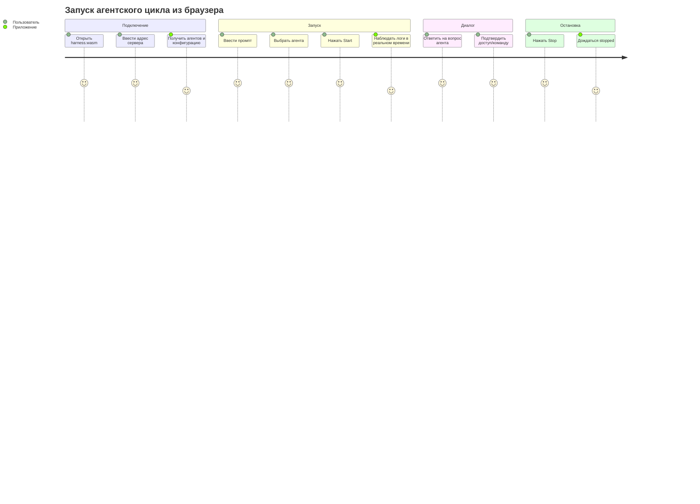

# Phase 6. Web-интерфейс (`harness.wasm`)

> Документ описывает пользовательский интерфейс клиента, экраны, сценарии и требования к адаптивности.
> Смежные документы: `base.md`, `arch.md`, `tech.md`, `api.md`.

---

## 1. Роли интерфейса

`harness.wasm` работает в двух режимах:

1. **Самостоятельное приложение** — открывается с GitHub Pages, пользователь вводит адрес сервера.
2. **Встраиваемая панель** — компонента `HarnessPanel` внутри родительского Leptos-приложения.

В обоих случаях UI решает одни и те же задачи:

- подключение к серверу;
- настройка `harness.json5` и файлов в `cwd`;
- формирование промпта и выбор агента;
- запуск и остановка агентского цикла;
- наблюдение за логами в реальном времени;
- ответы на вопросы агента и подтверждение доступов/команд.

---

## 2. Компонентная модель

```
HarnessApp
├── ConnectDialog          # подключение к серверу + инструкция, если сервер недоступен
├── HarnessPanel
│   ├── StatusBar          # runState, итерация, токены, USD, время ожидания
│   ├── AgentSelector      # выбор агента из GET /agents
│   ├── PromptComposer     # textarea промпта, кнопки Start/Stop
│   ├── LogView            # вывод SSE-событий output
│   ├── InputModal         # модальный ответ на input_request
│   ├── ConfigEditor       # редактирование harness.json5
│   └── FsBrowser          # файловый браузер внутри cwd
└── HarnessGateway         # транспорт REST + SSE (не UI)
```

`HarnessPanel` — экспортируемая компонента для встраивания:

```rust
#[component]
pub fn HarnessPanel(
    base_url: String,
    compact: bool,
    #[prop(optional)] theme: Option<HarnessTheme>,
) -> impl IntoView
```

---

## 3. Экраны

### 3.1. Подключение

Пользователь указывает адрес сервера, например `http://localhost:4067`.

- При успешном `GET /health` приложение переходит к основному экрану.
- Если сервер недоступен, показывается модальное окно с инструкцией.

### 3.2. Модальное окно «Сервер не найден»

Если `harness.exe` не запущен или отсутствует в системе, клиент **ничего не скачивает и не запускает удалённо**. Пользователю показывается инструкция из двух шагов:

1. **Скачать** исполняемый файл с GitHub Releases (ссылка).
2. **Запустить** его без параметров: `harness.exe`.

Пояснение:

- запуск без параметров стартует сервер на порту по умолчанию;
- дальнейшая настройка выполняется из web-интерфейса.

В окне есть кнопки «Повторить подключение» и «Скопировать команду запуска».

### 3.3. Основной экран

Раскладка:

```
┌──────────────────────────────────────────────────────────┐
│ StatusBar: idle · DeepSeek-V3 · iter 3 · 12 345 tok · $0.12 │
├────────────────────────────┬─────────────────────────────┤
│ PromptComposer             │ LogView                     │
│                            │                             │
│ [Агент: DeepSeek-V3 ▾]     │ ## Iteration №1             │
│ ┌────────────────────────┐ │ Usage: ...                  │
│ │ промпт...              │ │ ...                         │
│ └────────────────────────┘ │                             │
│ [Start]  [Stop]           │                             │
├────────────────────────────┴─────────────────────────────┤
│ Вкладки: Конфигурация | Файлы                              │
└──────────────────────────────────────────────────────────┘
```

### 3.4. Композер промпта

- textarea для промпта;
- выпадающий список агентов (из `GET /agents`);
- кнопка **Start** — отправляет `POST /run`;
- кнопка **Stop** — отправляет `POST /run/stop`;
- во время активного цикла Start недоступна, Stop доступна.

### 3.5. Лог

- Подписка на `GET /run/events`.
- События `output` добавляются в прокручиваемый список.
- Поддержка режимов:
  - `new_line` — новая строка;
  - `continue_line` — дополнение строки;
  - `rewrite_line` — замена последней строки (таймер ожидания).
- Автопрокрутка вниз; если пользователь прокрутил вверх, автопрокрутка приостанавливается.
- При переподключении лог восстанавливается из `GET /run/log`.

### 3.6. Модальный ввод

При получении SSE-события `input_request` открывается модальное окно:

- текст запроса (`prompt`);
- textarea для ответа;
- если в тексте есть маркер `[y/n]` — дополнительные кнопки **Yes**/**No** (Allow/Deny);
- кнопка **Ответить** отправляет `POST /run/input`.

После ответа модальное окно закрывается, цикл продолжается.

### 3.7. Редактор конфигурации

- Загружает `GET /config`.
- Показывает `harness.json5` в текстовом редакторе (textarea с моноширинным шрифтом).
- Кнопка **Сохранить** отправляет `PUT /config`.
- При ошибке валидации показывает сообщение и не даёт запустить цикл, пока конфигурация не исправлена.
- Если файл отсутствует, предлагает **Создать по умолчанию** (`POST /config/default`).

### 3.8. Браузер файлов

- Работает через FS API.
- Отображает дерево/список каталогов и файлов внутри `cwd`.
- Операции:
  - открыть файл (чтение);
  - создать/изменить файл;
  - создать каталог;
  - удалить файл/пустой каталог;
  - переименовать/переместить.
- Основные сценарии:
  - добавить файл роли;
  - добавить файл умения;
  - добавить файл агента;
  - изменить любой другой файл внутри `cwd`.

---

## 4. Пользовательские сценарии

### 4.1. Первый запуск (нет конфигурации)

1. Пользователь открывает `harness.wasm`.
2. Вводит адрес сервера.
3. Сервер отвечает: `configState = missing`.
4. UI предлагает создать конфигурацию по умолчанию.
5. Пользователь редактирует `harness.json5` и сохраняет.
6. При необходимости через браузер файлов добавляет роли/навыки/агентов.
7. Пользователь выбирает агента и запускает цикл.

### 4.2. Запуск цикла



### 4.3. Ответ на вопрос агента

1. Агент вызывает `tools.user`.
2. Сервер отправляет SSE `input_request`.
3. UI открывает модальное окно.
4. Пользователь вводит ответ/нажимает Yes/No.
5. UI отправляет `POST /run/input`.
6. Агент продолжает цикл.

---

## 5. Адаптивность и компактный режим

### 5.1. Полный режим (`compact = false`)

- Трёхколоночная/двухколоночная раскладка: композер, лог, вкладки конфигурации/файлов.
- Подходит для полноэкранного использования.

### 5.2. Компактный режим (`compact = true`)

Для встраивания в боковые панели родительских приложений:

- ширина ~320–420 px;
- одна колонка;
- композер и лог располагаются вертикально;
- конфигурация и файлы открываются как overlay/вкладки;
- модальные окна поверх панели;
- уменьшенные отступы и шрифты.

### 5.3. Стили

- CSS Grid/Flexbox.
- Plain CSS с префиксом `hw-` для изоляции стилей в родительском приложении.
- Tailwind не используется в первой версии, чтобы не увеличивать размер WASM.

---

## 6. Состояния и индикация

| Состояние | UI |
|---|---|
| `idle` | Start доступна, Stop недоступна |
| `running` | Start недоступна, Stop доступна, лог обновляется |
| `waiting_input` | Открыто модальное окно ввода, Stop доступна |
| `stopping` | Индикатор остановки, Start недоступна |
| `finished`/`failed`/`stopped` | Итоговое событие в логе, Start снова доступна |
| Сервер недоступен | Модальное окно с инструкцией |

StatusBar показывает:

- состояние цикла;
- выбранного агента;
- номер итерации;
- потреблённые токены;
- USD (приблизительно и real, если доступно);
- время ожидания ответа модели.

---

## 7. Поведение при обрыве соединения

1. `EventSource` автоматически переподключается с `Last-Event-ID`.
2. UI показывает индикатор «переподключение...».
3. После восстановления:
   - состояние цикла обновляется через `GET /run`;
   - лог дополняется через `GET /run/log`;
   - если есть `pendingInput`, модальное окно открывается снова.
4. Если сервер завершился по `live-timeout`, показывается модальное окно «Сервер не найден».

---

## 8. Требования к доступности

- Все кнопки и поля имеют текстовые подписи.
- Цвета статусов не являются единственным способом индикации.
- Модальные окна закрываются по `Escape` (кроме окна ввода с несохранённым ответом — с подтверждением).
- Лог поддерживает прокрутку и выделение текста.
