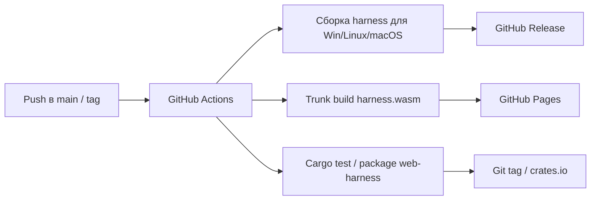

# Phase 6. Технологический стек

> Документ описывает используемые технологии, обоснование выбора и ключевые примеры применения.
> Смежные документы: `base.md`, `arch.md`, `api.md`, `ui.md`, `auth.md`.

---

## 1. Сводный перечень

| Технология | Назначение | Обоснование |
|---|---|---|
| **axum** | HTTP-фреймворк сервера | Нативный tokio, зрелые REST/SSE, хорошая документация |
| **axum-server + rustls** | HTTPS/TLS-терминация | Поддержка TLS без внешнего reverse-proxy |
| **rcgen** | Генерация самоподписанного сертификата | Pure Rust, автоматический первый запуск |
| **tokio** | Асинхронный runtime | Единый рантайм для HTTP, отмены, таймаутов, каналов |
| **async reqwest** | HTTP-клиент к вендорным LLM API | Полностью асинхронный стек, отменяемые запросы |
| **SSE** | Поток событий сервер → клиент | Нативно поддерживается браузером, простота и переподключение |
| **Leptos** | Реактивный UI-фреймворк | Зафиксирован задачей; CSR-режим подходит для WASM |
| **Trunk** | Сборка Leptos CSR | Стандарт для pure-Rust WASM без Node |
| **RSA-OAEP-256** | Шифрование API-ключа | Безопасная передача ключа из браузера |
| **Web Crypto API** | Клиентское RSA-шифрование | Нативно в браузере, не увеличивает WASM |
| **RustCrypto `rsa`** | Серверное RSA | Pure Rust, зрелая реализация |
| **serde/serde_json** | DTO и JSON | Стандарт Rust |
| **gloo-net/web-sys** | Сетевые вызовы из WASM | Лёгкий доступ к `fetch` и `EventSource` |
| **crate `auth`** | Bearer-аутентификация | Отдельный слой защиты API |

---

## 2. Сервер: axum + tokio + TLS

### 2.1. Почему axum

- Нативная интеграция с `tokio` и `tower`.
- Поддержка `Sse` из коробки.
- Простая модель роутинга: `Router`, `State`, `extractors`.
- Не приносит собственный акторный рантайм (в отличие от actix-web), что упрощает запуск асинхронного агентского цикла.

### 2.2. Почему TLS встроен в сервер

- Требование HTTPS закрывает проблему mixed-content для `harness.wasm` на GitHub Pages.
- Для локального режима используется самоподписанный сертификат; для удалённого — пользовательский сертификат.
- TLS-терминация выполняется через **axum-server** с фичей `tls-rustls`; сертификат и ключ загружаются из конфигурации или генерируются через **rcgen**.

### 2.3. Пример запуска TLS

```rust
use axum_server::tls_rustls::RustlsConfig;

let config = RustlsConfig::from_pem(
    cert_path.as_ref(),
    key_path.as_ref(),
).await?;

axum_server::bind_rustls(addr, config)
    .serve(router.into_make_service())
    .await?;
```

Автогенерация сертификата:

```rust
use rcgen::{generate_simple_self_signed, CertifiedKey};

let subject_alt_names = vec![
    "localhost".to_string(),
    "127.0.0.1".to_string(),
];

let CertifiedKey { cert, signing_key } =
    generate_simple_self_signed(subject_alt_names)?;

// cert.pem() / signing_key.serialize_pem() сохраняются в cwd/.harness/certs/
```

### 2.4. Пример роутера

```rust
let public = Router::new()
    .route("/api/v1/health", get(handlers::health))
    .with_state(state.clone());

let protected = Router::new()
    .route("/api/v1/agents", get(handlers::agents))
    .route("/api/v1/config", get(handlers::get_config).put(handlers::put_config))
    .route("/api/v1/config/default", post(handlers::config_default))
    .route("/api/v1/crypto/public-key", get(handlers::public_key))
    .route("/api/v1/crypto/api-key", post(handlers::submit_api_key))
    .route("/api/v1/run", get(handlers::run_state).post(handlers::start_run))
    .route("/api/v1/run/stop", post(handlers::stop_run))
    .route("/api/v1/run/input", post(handlers::submit_input))
    .route("/api/v1/run/events", get(handlers::run_events))
    .route("/api/v1/run/log", get(handlers::run_log))
    .route("/api/v1/run/dump", get(handlers::run_dump))
    .route("/api/v1/fs/list", get(handlers::fs_list))
    .route("/api/v1/fs/read", get(handlers::fs_read))
    .route("/api/v1/fs/write", axum::routing::put(handlers::fs_write))
    .route("/api/v1/fs/mkdir", post(handlers::fs_mkdir))
    .route("/api/v1/fs/remove", axum::routing::delete(handlers::fs_remove))
    .route("/api/v1/fs/move", post(handlers::fs_move))
    .layer(middleware::from_fn_with_state(state.clone(), auth::require_auth))
    .with_state(state);

Router::new().merge(public).merge(protected)
```

---

## 3. HTTP-клиент к вендорам: async reqwest + `RequestPipeline`

### 3.1. Что меняется относительно текущего кода

Текущий `VendorRequest` использует `reqwest::blocking`, `thread::sleep` и `mpsc`-поток для секундомера. В целевой архитектуре:

- `Client` — асинхронный `reqwest::Client`.
- rate-limit-ожидания — `tokio::time::sleep`.
- секундомер — `tokio::time::Interval`.
- retry-классификация (429/503/transport) сохраняется без изменений.
- активный запрос и чтение тела ответа оборачиваются в `tokio::select!` с `CancellationToken`.

### 3.2. `RequestPipeline`

Контракт описан в `arch.md` §6. Ниже — конкретная JSON-реализация.

```rust
pub struct JsonPipeline<T>
where
    T: Serialize + Send + Sync,
{
    url: String,
    extra_headers: Vec<(String, String)>,
    pre: Vec<Arc<dyn PreAction>>,
    dur: Vec<Arc<dyn DurAction>>,
    post: Vec<Arc<dyn PostAction>>,
    _marker: std::marker::PhantomData<T>,
}

impl<T> JsonPipeline<T>
where
    T: Serialize + Send + Sync,
{
    pub fn new(url: impl Into<String>) -> Self { /* ... */ }

    pub fn header(mut self, key: &str, value: &str) -> Self {
        self.extra_headers.push((key.into(), value.into()));
        self
    }
}

#[async_trait::async_trait]
impl<T> RequestPipeline<T> for JsonPipeline<T>
where
    T: Serialize + Send + Sync,
{
    fn build(&self, client: &Client, payload: &T) -> RequestBuilder {
        let mut req = client.post(&self.url).json(payload);
        for (key, value) in &self.extra_headers {
            req = req.header(key, value);
        }
        req
    }

    fn pre_actions(&self)  -> &[Arc<dyn PreAction>]  { &self.pre }
    fn dur_actions(&self)  -> &[Arc<dyn DurAction>]  { &self.dur }
    fn post_actions(&self) -> &[Arc<dyn PostAction>] { &self.post }

    fn add_pre(&mut self, action: Arc<dyn PreAction>)   { self.pre.push(action); }
    fn add_dur(&mut self, action: Arc<dyn DurAction>)   { self.dur.push(action); }
    fn add_post(&mut self, action: Arc<dyn PostAction>) { self.post.push(action); }
}
```

Пример встраивания в `VendorRequest`:

```rust
let mut pipeline = JsonPipeline::<Value>::new(url)
    .header("Authorization", &auth_header)
    .header("Content-Type", "application/json");

pipeline.add_pre(Arc::new(LogPreAction { interaction: self.interaction.clone() }));
pipeline.add_dur(Arc::new(TickProgressAction { interaction: self.interaction.clone() }));
pipeline.add_post(Arc::new(LogPostAction { interaction: self.interaction.clone() }));

let ctx = PipelineContext {
    attempt,
    url: url.to_string(),
    started_at: Instant::now(),
    tick: Duration::from_secs(1),
    cancel: cancel.clone(),
};

let response = pipeline.execute(&client, &body, ctx).await?;
let read_body = async { response.text().await };

tokio::select! {
    _ = cancel.cancelled() => return Err("request cancelled".into()),
    text = read_body => {
        // прежняя retry-логика для 429/503/2xx
    }
}
```

---

## 4. Транспорт: SSE

### 4.1. Почему SSE, а не WebSocket

| Критерий | SSE | WebSocket |
|---|---|---|
| Направление | сервер → клиент | двунаправленный |
| API браузера | `EventSource`, автоматический reconnect | `WebSocket`, ручной reconnect |
| Формат | текстовые события с `id`/`event`/`data` | произвольные фреймы |
| Прокси/HTTP | обычный HTTP, совместим | требует upgrade |
| Наша задача | поток логов и событий; команды идут через REST | избыточен |

### 4.2. Формат события

```text
id: 42
event: output
data: {"line":"## Iteration №2","mode":"new_line"}

```

События описаны в `api.md`. Сервер использует `axum::response::Sse` с `keep_alive`.

### 4.3. Кольцевой буфер и replay

- Каждое событие получает монотонный `id` из `AtomicU64`.
- Событие записывается в `EventRingBuffer` (`VecDeque<(u64, ServerEvent)>`) ёмкостью `server.sse-buffer-size` (по умолчанию 512) и одновременно публикуется в `tokio::sync::broadcast`.
- `broadcast` используется только для live-подписки; replay выполняется из кольцевого буфера.

### 4.4. Пример серверного SSE-хендлера

```rust
use axum::response::sse::{Event, KeepAlive, Sse};
use futures::stream::Stream;

async fn run_events(
    State(state): State<Arc<ServerState>>,
    headers: HeaderMap,
) -> Sse<impl Stream<Item = Result<Event, Infallible>>> {
    let last_event_id = parse_last_event_id(&headers);
    let replay = {
        let ring = state.event_log.lock().await;
        ring.events_after(last_event_id)
    };

    let live_rx = state.events_tx.subscribe();
    let stream = async_stream::stream! {
        for (id, event) in replay {
            yield Ok(to_sse_event(id, &event));
        }

        loop {
            match live_rx.recv().await {
                Ok((id, event)) => {
                    yield Ok(to_sse_event(id, &event));
                }
                Err(broadcast::error::RecvError::Lagged(_)) => {
                    // клиент отстал от live-канала; просим переподключиться
                    // и добрать события из кольцевого буфера по Last-Event-ID
                    yield Ok(Event::default()
                        .event("status")
                        .data("{\"reconnect\":true}"));
                    break;
                }
                Err(broadcast::error::RecvError::Closed) => break,
            }
        }
    };

    Sse::new(stream).keep_alive(KeepAlive::new().interval(Duration::from_secs(15)))
}

fn to_sse_event(id: u64, event: &ServerEvent) -> Result<Event, Infallible> {
    let data = serde_json::to_string(event).unwrap_or_else(|_| "{}".into());
    Ok(Event::default()
        .id(id.to_string())
        .event(event.event_name())
        .data(data))
}
```

Поведение при отсутствии активного цикла описано в `api.md` §7: сервер немедленно отправляет терминальное `status`-событие и закрывает поток.

---

## 5. Клиент: Leptos + Trunk

### 5.1. Режим

Используется **CSR**: весь рендеринг происходит в браузере после загрузки WASM. SSR/hydration не требуется.

### 5.2. Структура клиента

```
crates/web-harness/
  src/
    lib.rs            # экспорт HarnessGateway, HarnessClient, HarnessPanel
    main.rs           # тонкая standalone-точка входа: mount HarnessApp
    gateway.rs        # REST + SSE
    events.rs         # EventSource -> Stream<Item = ServerEvent>
    crypto.rs         # RSA-шифрование API-ключа
    state.rs          # HarnessClient: реактивное состояние
    components/
      harness_app.rs
      harness_panel.rs
      connect_dialog.rs
      status_bar.rs
      agent_selector.rs
      prompt_composer.rs
      log_view.rs
      input_modal.rs
      api_key_modal.rs
      config_editor.rs   # только feature fs-panel
      fs_browser.rs      # только feature fs-panel
  Cargo.toml
  Trunk.toml
  index.html
```

Правила dual-layout:

- `lib.rs` экспортирует библиотечный API: `HarnessGateway`, `HarnessClient`, `HarnessPanel`, компоненты.
- `main.rs` — тонкий бинарный таргет, который монтирует `HarnessApp` в DOM для standalone-сборки Trunk:

```rust
fn main() {
    mount_to_body(|| view! { <HarnessApp/> });
}
```

- `Cargo.toml` объявляет и `[lib]`, и `[[bin]]`; `trunk build --release` собирает `main.rs`.
- Родительское приложение использует только библиотечную часть.

### 5.3. Cargo-фичи

```toml
[features]
default = []
fs-panel = []
```

| Фича | Назначение |
|---|---|
| отсутствует (standalone) | ConnectDialog, StatusBar, AgentSelector, PromptComposer, LogView, InputModal, ApiKeyModal |
| `fs-panel` | дополнительно ConfigEditor и FsBrowser для встраиваемых приложений |

### 5.4. EventSource → `Stream`

`EventSource` — callback-based API. Для получения Rust-совместимого `Stream` используется канал:

```rust
use futures::channel::mpsc;
use wasm_bindgen::JsCast;
use web_sys::{EventSource, MessageEvent};

pub fn events(url: &str) -> impl Stream<Item = ServerEvent> {
    let (tx, rx) = mpsc::unbounded();
    let source = EventSource::new(url).expect("EventSource");

    let on_message = {
        let tx = tx.clone();
        Closure::<dyn FnMut(MessageEvent)>::new(move |event| {
            if let Some(data) = event.data().as_string() {
                if let Ok(server_event) = serde_json::from_str(&data) {
                    let _ = tx.unbounded_send(server_event);
                }
            }
        })
    };

    source.set_onmessage(Some(on_message.as_ref().unchecked_ref()));
    on_message.forget();

    rx
}
```

Браузерный `EventSource` автоматически подставляет `Last-Event-ID` при переподключении, поэтому клиентский код не управляет им вручную.

### 5.5. Почему Trunk

- Стандартный инструмент для Leptos CSR.
- Не требует Node.js: собирает WASM, JS-обвязку и статику.
- Простая команда: `trunk build --release`.
- Артефакт `dist/` пригоден для публикации на GitHub Pages.

---

## 6. RSA-шифрование API-ключа

### 6.1. Параметры

- Алгоритм: **RSA-OAEP** с SHA-256 (метка пустая).
- Размер ключа: **2048 бит**.
- **Максимальная длина открытого API-ключа — 128 байт.**
- Сервер: RustCrypto `rsa` + `sha2`.
- Клиент: Web Crypto API (`SubtleCrypto`).

### 6.2. Серверная генерация пары

```rust
use rsa::{Oaep, RsaPrivateKey, RsaPublicKey};
use rsa::pkcs8::EncodePublicKey;

let mut rng = rand::thread_rng();
let private = RsaPrivateKey::new(&mut rng, 2048)?;
let public = RsaPublicKey::from(&private);
let spki_pem = public.to_public_key_pem(Default::default())?;
```

### 6.3. Серверное расшифрование

```rust
let padding = Oaep::new::<Sha256>();
let plain = private.decrypt(padding, &ciphertext)
    .map_err(|_| "cannot decrypt api key")?;

if plain.len() > 128 {
    return Err("api key exceeds 128 bytes");
}

let api_key = String::from_utf8(plain)
    .map_err(|_| "api key is not valid utf-8")?;
```

### 6.4. Клиентское шифрование (Web Crypto API)

```js
const pem = await fetch(`${base}/api/v1/crypto/public-key`, {
    headers: { Authorization: `Bearer ${token}` }
}).then(r => r.json());

const der = pemToDer(pem.publicKey);

const key = await crypto.subtle.importKey(
    "spki",
    der,
    { name: "RSA-OAEP", hash: "SHA-256" },
    false,
    ["encrypt"]
);

const plain = new TextEncoder().encode(apiKey);
if (plain.length > 128) {
    throw new Error("API key must be at most 128 bytes");
}

const cipher = await crypto.subtle.encrypt(
    { name: "RSA-OAEP" },
    key,
    plain
);

const encrypted = btoa(String.fromCharCode(...new Uint8Array(cipher)));
```

---

## 7. Конфигурация сервера

### 7.1. Блок `server` в `harness.json5`

```json5
{
    "cwd": "C:/MyLife/Harness",
    "server": {
        "host": "127.0.0.1",
        "port": 4067,
        "live-timeout": 5,
        "interaction-timeout": 10,
        "sse-buffer-size": 512,
        "cors-allowed-origins": [],
        "tls-cert": null,
        "tls-key": null,
    },
    "agent": {},
    "tools": {},
}
```

| Поле | Тип | По умолчанию | Назначение |
|---|---|---|---|
| `server.host` | string | `127.0.0.1` | Адрес bind |
| `server.port` | number | `4067` | Порт (если не задан `--port`) |
| `server.live-timeout` | number (минут) | `5` | Время простоя до завершения сервера |
| `server.interaction-timeout` | number (минут) | `10` | Таймаут ожидания ответа пользователя на `input_request` |
| `server.sse-buffer-size` | number | `512` | Ёмкость кольцевого буфера SSE |
| `server.cors-allowed-origins` | string[] | `[]` | Разрешённые CORS-origin; `[]` = CORS запрещён; `"*"` не поддерживается |
| `server.tls-cert` | string/null | `null` | Путь к PEM-сертификату; `null` = автогенерация |
| `server.tls-key` | string/null | `null` | Путь к PEM-ключу; `null` = автогенерация |

### 7.2. `live-timeout`

- Таймер стартует при запуске сервера.
- На время активного цикла таймер останавливается.
- После завершения цикла таймер перезапускается.
- Polling-запросы не продлевают жизнь сервера.
- По истечении сервер отправляет SSE-событие `server_stopping`, закрывает соединения и завершает процесс с кодом 0.

### 7.3. `interaction-timeout`

- Отсчитывается от момента отправки `input_request` клиенту.
- По истечении ожидающий `oneshot` завершается с ошибкой `Timeout`.
- Агентский цикл обрабатывает `InteractionError::Timeout` как ошибку сессии: `runState = failed`, клиенту отправляется `result`.
- Значение по умолчанию — 10 минут.

---

## 8. Безопасность

1. **HTTPS обязателен.** Сервер не принимает plain-HTTP. Самоподписанный сертификат генерируется автоматически; пользователь может задать собственный.
2. **Bind по умолчанию `127.0.0.1`.** Удалённый доступ — только явным `--host 0.0.0.0` или конкретным интерфейсом.
3. **Bearer-аутентификация.** Все `/api/v1/*`, кроме `health`, требуют токен.
4. **CORS по умолчанию запрещён.** Допускается только явный allowlist конкретных origin.
5. **Секреты не покидают сервер.** `GET /agents`, `GET /config`, `GET /fs/read` возвращают `api-key` только как `"***"`.
6. **API-ключ передаётся только в шифрованном виде.** Хранение на сервере — в шифрованном виде; длина ключа ограничена 128 байтами.
7. **FS API ограничен `cwd`.** Запрещены `..`, абсолютные пути и переходы по symlink за пределы `cwd`.
8. **Аутентификация и CORS — разные слои защиты.** Даже при явно разрешённом origin доступ без токена невозможен.

---

## 9. Сборка и CI/CD

| Артефакт | Сборка | Публикация |
|---|---|---|
| `harness.exe` (Windows) | `cargo build --release -p cli-harness` на `windows-latest` | GitHub Release |
| `harness` (Linux) | `cargo build --release -p cli-harness` на `ubuntu-latest` | GitHub Release |
| `harness` (macOS) | `cargo build --release -p cli-harness` на `macos-latest` | GitHub Release |
| `harness.wasm` + `dist` | `trunk build --release` | GitHub Pages |
| Крейт `web-harness` | `cargo package`/git tag | Git-тег (source-level плагин) |



---

## 10. Тесты контрактов и безопасности

1. **`harness-api`**: сериализация/десериализация всех DTO и событий SSE.
2. **FS API**: нормализация путей, отклонение `..`, absolute path, symlink-выходов за `cwd`.
3. **Redaction**: `GET /fs/read` файла агента не содержит `api-key`; `PUT` с `"***"` сохраняет старое значение.
4. **RSA**: ограничение длины 128 байт; round-trip шифрование/расшифрование.
5. **SSE replay**: событие с `Last-Event-ID` возвращает только события с `id > Last-Event-ID`; кольцевой буфер вытесняет старые события при переполнении.
6. **Auth**: корректные/некорректные токены, отсутствие заголовка, constant-time сравнение.
7. **CORS**: при пустом `cors-allowed-origins` ответ не содержит `Access-Control-Allow-Origin`.
