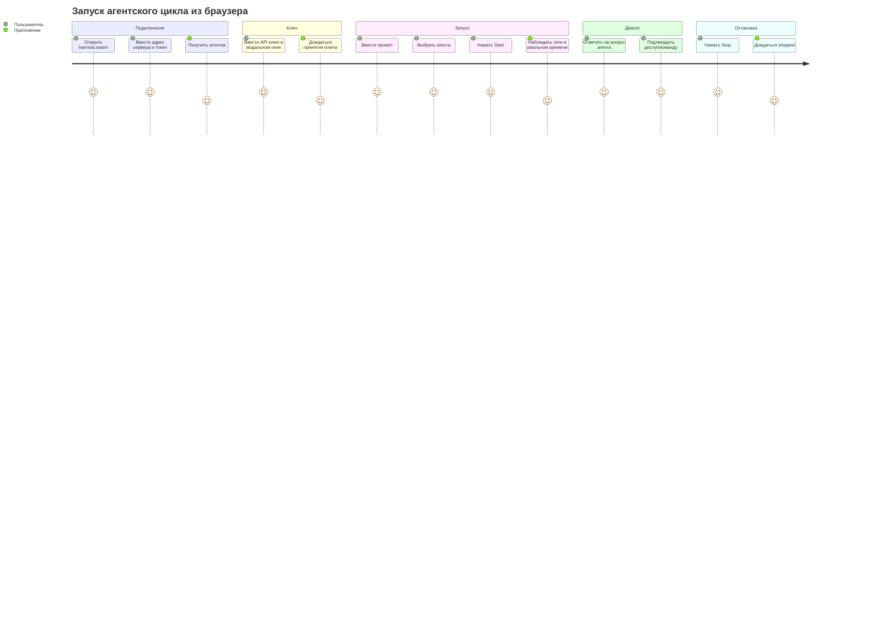

# Phase 6. Web-интерфейс (`harness.wasm`)

> Документ описывает пользовательский интерфейс клиента, экраны, сценарии и требования к адаптивности.
> Смежные документы: `base.md`, `arch.md`, `tech.md`, `api.md`, `auth.md`.

---

## 1. Роли интерфейса

`harness.wasm` работает в двух режимах:

1. **Самостоятельное приложение** — открывается с GitHub Pages, пользователь вводит адрес сервера и токен.
2. **Встраиваемая панель** — компонента `HarnessPanel` внутри родительского Leptos-приложения.

Общие задачи:

- подключение к HTTPS-серверу;
- аутентификация по Bearer-токену;
- формирование промпта и выбор агента;
- ввод зашифрованного API-ключа;
- запуск и остановка агентского цикла;
- наблюдение за логами в реальном времени;
- ответы на вопросы агента и подтверждение доступов/команд.

Standalone-клиент **не** работает с файловой системой и **не** редактирует `harness.json5`. Эти возможности доступны только встраиваемым приложениям при включении Cargo-фичи `fs-panel`.

---

## 2. Компонентная модель

```
HarnessApp (main.rs)
└── HarnessPanel
    ├── ConnectDialog          # адрес сервера + токен + инструкция
    ├── StatusBar              # runState, итерация, токены, USD, время ожидания
    ├── AgentSelector          # выбор агента из GET /agents
    ├── PromptComposer         # textarea промпта, кнопки Start/Stop
    ├── LogView                # вывод SSE-событий output
    ├── InputModal             # модальный ответ на input_request
    ├── ApiKeyModal            # ввод API-ключа перед запуском
    ├── ConfigEditor           # только feature fs-panel
    └── FsBrowser              # только feature fs-panel
```

Транспортный слой `HarnessGateway` не является UI-компонентом; он инкапсулирует REST + SSE и используется `HarnessPanel`.

`HarnessPanel` — экспортируемая компонента для встраивания:

```rust
#[component]
pub fn HarnessPanel(
    base_url: String,
    #[prop(optional)] auth_token: Option<String>,
    #[prop(optional)] compact: bool,
    #[prop(optional)] theme: Option<HarnessTheme>,
) -> impl IntoView
```

---

## 3. Экраны

### 3.1. Подключение

`ConnectDialog` запрашивает:

1. адрес сервера, например `https://localhost:4067`;
2. Bearer-токен, напечатанный в stdout сервера.

Поведение:

- клиент выполняет `GET /health` без токена;
- при успехе и `authRequired: true` открывает поле ввода токена;
- после ввода токена выполняет `GET /agents` с токеном;
- при успехе переходит к основному экрану;
- при `401` показывает сообщение «неверный токен».

Адрес сервера можно задать query-параметром:

```text
https://<pages-origin>/?server=https://localhost:4067
```

Токен через query-параметры не передаётся.

### 3.2. Модальное окно «Сервер не найден / CORS запрещён»

Если сервер недоступен, TLS-сертификат не принят браузером или запрос заблокирован CORS, показывается модальное окно с инструкцией:

1. **Скачать** исполняемый файл с GitHub Releases (ссылка).
2. **Запустить** его без параметров: `harness.exe`.
3. **Принять самоподписанный сертификат** в браузере (открыть `https://localhost:4067/api/v1/health` и подтвердить исключение).
4. **Убедиться**, что клиентский origin добавлен в `server.cors-allowed-origins` в `harness.json5`, если сервер запущен не из-под того же origin.

В окне есть кнопки «Повторить подключение» и «Скопировать команду запуска».

### 3.3. Основной экран

Раскладка standalone-режима:

```
┌──────────────────────────────────────────────────────────┐
│ StatusBar: idle · DeepSeek-V3 · iter 3 · 12 345 tok · $0.12 │
├────────────────────────────┬─────────────────────────────┤
│ PromptComposer             │ LogView                     │
│                            │                             │
│ [Агент: DeepSeek-V3 ▾]     │ ## Iteration №1             │
│ ┌────────────────────────┐ │ Usage: ...                  │
│ │ промпт...              │ │ ...                         │
│ └────────────────────────┘ │                             │
│ [Start]  [Stop]           │                             │
└──────────────────────────┴──────────────────────────────┘
```

При сборке с фичей `fs-panel` в `HarnessPanel` добавляются вкладки «Конфигурация» и «Файлы».

### 3.4. Композер промпта

- textarea для промпта;
- выпадающий список агентов (из `GET /agents`);
- кнопка **Start** — запускает сценарий запуска;
- кнопка **Stop** — отправляет `POST /run/stop`;
- во время активного цикла Start недоступна, Stop доступна.

### 3.5. Лог

- Подписка на `GET /run/events`.
- События `output` добавляются в прокручиваемый список.
- Поддержка режимов:
  - `new_line` — новая строка;
  - `continue_line` — дополнение строки;
  - `rewrite_line` — замена последней строки (таймер ожидания).
- Автопрокрутка вниз; если пользователь прокрутил вверх, автопрокрутка приостанавливается.
- При переподключении лог восстанавливается из `GET /run/log`.

### 3.6. Модальный ввод

При получении SSE-события `input_request` открывается модальное окно:

- текст запроса (`prompt`);
- textarea для ответа;
- если в тексте есть маркер `[y/n]` — дополнительные кнопки **Yes**/**No** (Allow/Deny);
- кнопка **Ответить** отправляет `POST /run/input`.

После ответа модальное окно закрывается, цикл продолжается.

### 3.7. Модальное окно ввода API-ключа

Компонент `ApiKeyModal` открывается при нажатии **Start**, если у выбранного агента `apiKeyRequired: true`.

Сценарий:

1. Клиент проверяет выбранного агента в `GET /agents`.
2. Если `apiKeyRequired: true`, открывается `ApiKeyModal`.
3. Пользователь вводит API-ключ.
4. Клиент проверяет длину ключа (не более 128 байт в UTF-8).
5. Клиент запрашивает `GET /crypto/public-key`.
6. Клиент шифрует ключ через Web Crypto API (RSA-OAEP-256).
7. Клиент отправляет `POST /crypto/api-key`.
8. При `202` модальное окно закрывается, и клиент продолжает запуск (`POST /run`).
9. При `400`/ошибке расшифрования показывается сообщение и предлагается повторить ввод.

Состояния `ApiKeyModal`:

| Состояние | UI |
|---|---|
| Ввод | Поле пароля, кнопки «Отмена»/«Запустить» |
| Шифрование/отправка | Индикатор «Передача ключа...» |
| Успех | Краткий статус «Ключ принят», затем автозакрытие |
| Ошибка | Сообщение об ошибке, поле доступно для повторного ввода |

### 3.8. Редактор конфигурации (только `fs-panel`)

- Загружает `GET /config`.
- Показывает `harness.json5` в textarea с моноширинным шрифтом.
- Кнопка **Сохранить** отправляет `PUT /config`.
- При ошибке валидации показывает сообщение и не даёт запустить цикл, пока конфигурация не исправлена.
- Если файл отсутствует, предлагает **Создать по умолчанию** (`POST /config/default`).
- Значения секретных полей отображаются как `"***"`; сохранение `"***"` не затирает реальное значение.

### 3.9. Браузер файлов (только `fs-panel`)

- Работает через FS API.
- Отображает дерево/список каталогов и файлов внутри `cwd`.
- Операции:
  - открыть файл (чтение);
  - создать/изменить файл;
  - создать каталог;
  - удалить файл/пустой каталог;
  - переименовать/переместить.
- Основные сценарии:
  - добавить файл роли;
  - добавить файл умения;
  - добавить файл агента;
  - изменить любой другой файл внутри `cwd`.
- Перед удалением/перезаписью показывается подтверждение.
- Файлы агентов отображаются с редкацией секретов; запись `"***"` сохраняет прежнее значение ключа.

---

## 4. Пользовательские сценарии

### 4.1. Первый запуск

1. Пользователь скачивает `harness.exe` с GitHub Releases.
2. Запускает его без параметров.
3. Сервер генерирует TLS-сертификат и Bearer-токен, печатает токен в stdout.
4. Пользователь открывает `harness.wasm` на GitHub Pages.
5. Вводит адрес `https://localhost:4067` и токен.
6. Если `configState = missing` или `invalid`, UI показывает инструкцию: настроить `harness.json5` локально на машине сервера.
7. Пользователь выбирает агента, вводит промпт и запускает цикл.

### 4.2. Запуск цикла



### 4.3. Ответ на вопрос агента

1. Агент вызывает `tools.user`.
2. Сервер отправляет SSE `output` (текст вопроса) и `input_request`.
3. UI открывает модальное окно.
4. Пользователь вводит ответ/нажимает Yes/No.
5. UI отправляет `POST /run/input`.
6. Агент продолжает цикл.

### 4.4. Таймаут ожидания ввода

1. Агент ожидает ответ пользователя.
2. Если ответ не получен за `server.interaction-timeout` (по умолчанию 10 минут), сервер завершает сессию с ошибкой.
3. UI получает SSE `result` с `runState: failed`, закрывает модальное окно и показывает ошибку.

---

## 5. Адаптивность и компактный режим

### 5.1. Полный режим (`compact = false`)

- Двухколоночная раскладка: композер, лог.
- При `fs-panel` добавляются вкладки конфигурации/файлов.

### 5.2. Компактный режим (`compact = true`)

Для встраивания в боковые панели родительских приложений:

- ширина ~320–420 px;
- одна колонка;
- композер и лог располагаются вертикально;
- конфигурация и файлы (при `fs-panel`) открываются как overlay/вкладки;
- модальные окна поверх панели;
- уменьшенные отступы и шрифты.

### 5.3. Стили

- CSS Grid/Flexbox.
- Plain CSS с префиксом `hw-` для изоляции стилей в родительском приложении.
- Tailwind не используется в первой версии, чтобы не увеличивать размер WASM.

---

## 6. Состояния и индикация

| Состояние | UI |
|---|---|
| `idle` | Start доступна, Stop недоступна |
| `running` | Start недоступна, Stop доступна, лог обновляется |
| `waiting_input` | Открыто модальное окно ввода, Stop доступна |
| `stopping` | Индикатор остановки, Start недоступна |
| `finished`/`failed`/`stopped` | Итоговое событие в логе, Start снова доступна |
| Сервер недоступен | Модальное окно с инструкцией |
| `401 Unauthorized` | ConnectDialog с сообщением «неверный токен» |

StatusBar показывает:

- состояние цикла;
- выбранного агента;
- номер итерации;
- потреблённые токены;
- USD (приблизительно и real, если доступно);
- время ожидания ответа модели.

---

## 7. Поведение при обрыве соединения

### 7.1. Передача токена в `EventSource`

Браузерный `EventSource` не поддерживает произвольные заголовки. Для SSE используются два варианта:

1. **Рекомендуемый:** передача токена в query-параметре `?auth_token=<token>` для `GET /run/events`; сервер принимает этот параметр только для SSE-эндпоинта.
2. Запасной: короткоживущий `sse_ticket`, который клиент получает по REST и передаёт в query-параметре `?ticket=<ticket>`.

Токен/тикет не логируется сервером и не включается в URL в UI.

### 7.2. Восстановление после reconnect

1. `EventSource` автоматически переподключается с `Last-Event-ID`.
2. UI показывает индикатор «переподключение...».
3. После восстановления UI выполняет `GET /run` и сверяет состояние:

| `runState` из `GET /run` | Действия UI |
|---|---|
| `running` / `stopping` | Продолжить live-лог; при необходимости `GET /run/log?tail=200` |
| `waiting_input` | Открыть `InputModal` с `pendingInput`; дополнить лог через `GET /run/log` |
| `finished` / `failed` / `stopped` / `idle` | Показать итоговое состояние; при наличии лога — догрузить `GET /run/log` |
| запрос не удался | Показать «Сервер не найден» |

4. Если SSE-поток закрылся с `status {"reconnect":true}`, UI переподключается автоматически.
5. Если сервер завершился по `live-timeout`, показывается модальное окно «Сервер не найден».

---

## 8. Требования к доступности

- Все кнопки и поля имеют текстовые подписи.
- Цвета статусов не являются единственным способом индикации.
- Модальные окна закрываются по `Escape` (кроме окна ввода с несохранённым ответом — с подтверждением).
- Лог поддерживает прокрутку и выделение текста.
- Ошибки TLS/CORS/mixed-content показываются пользователю отдельными понятными сообщениями.
