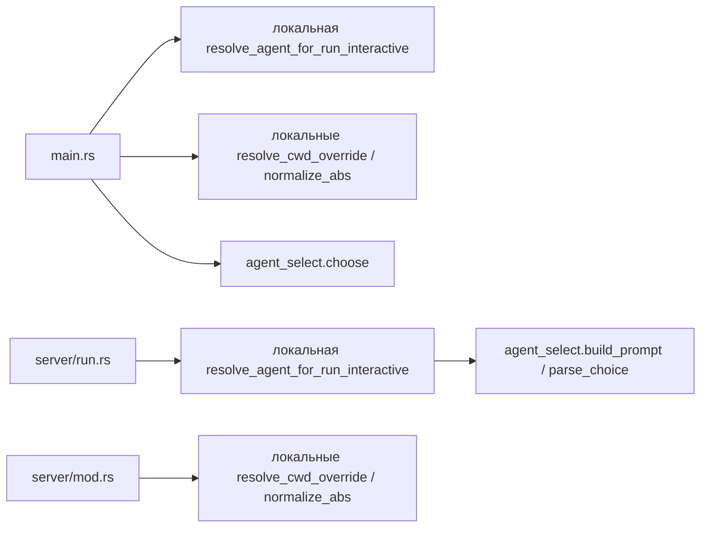
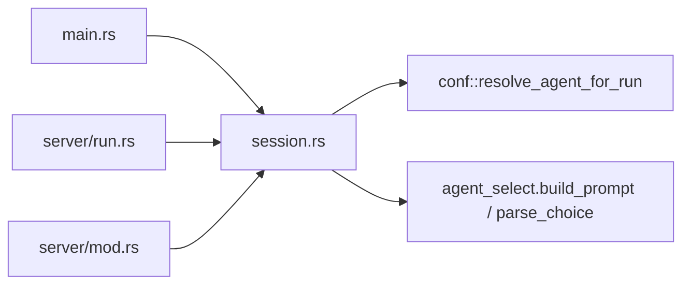

# Отчёт: дедупликация кода запуска сессии в `cli-harness`

## Итог

Дублирующиеся реализации запуска сессии вынесены в общий модуль
`crates/cli-harness/src/session.rs`. Консольный (`main.rs`) и серверный
(`server/run.rs`) режимы теперь используют один и тот же код резолюции
агента, запроса API-ключа и подготовки `source`. Функция
`agent_loop::agent_select::choose` удалена как мёртвый публичный API.

Проверка:

- `cargo build --workspace` — успех, без warnings.
- `cargo test -p cli-harness -p agent-loop` — успех: 32 + 7 тестов.

---

## Архитектура

### До

### После

### Почему

Один источник истины для предсессионной резолюции и path-хелперов; консоль и
сервер не могут разойтись в поведении.

---

## Изменение №1 и №2: общий модуль `session`

### Было

- `main.rs` содержал приватные `resolve_agent_for_run_interactive`,
  `prompt_api_key`, `source_with_agent_config`, `resolve_api_key_override`,
  `resolve_cwd_override`, `normalize_abs` и использовал
  `agent_loop::agent_select::choose`.
- `server/run.rs` содержал собственные `resolve_agent_for_run_interactive`,
  `ResolveAgentError`, `source_with_agent_config`.
- Резолюция выбора агента отличалась: консоль использовала `choose`,
  сервер — ручной цикл `build_prompt` / `parse_choice`.

### Стало

Создан `crates/cli-harness/src/session.rs`:

- `ResolveAgentError { Cancelled, Failed(String) }` с `Display`;
- `resolve_agent_for_run_interactive(settings, interaction, api_key_override)` —
  единый цикл:
  - при `ConfErrorKind::AgentChoiceRequired` — до `MAX_ATTEMPTS` попыток
    через `agent_select::build_prompt` / `parse_choice`;
  - при пустом `api-key` — `session::prompt_api_key`;
  - `InteractionError::Cancelled` → `ResolveAgentError::Cancelled`;
  - после 3 неудачных выборов — `ResolveAgentError::Failed("agent was not selected")`;
- `prompt_api_key`;
- `source_with_agent_config`;
- `resolve_api_key_override`;
- `resolve_cwd_override`;
- `normalize_abs`.

`main.rs` и `server/run.rs` удаляют локальные копии и импортируют `session`.

### Почему лучше

Один цикл резолюции исключает расхождения между режимами. Консольный режим
маппит `ResolveAgentError` в строку, серверный различает `Cancelled` (stopped)
и `Failed` (failed).

### Отступление от текста задачи

В todo.md сигнатура `resolve_agent_for_run_interactive` указана без третьего
параметра. Однако консольный `--api-key` передаёт распарсенный override именно
в эту функцию, чтобы при пустом ключе модели не запрашивать ключ повторно.
По согласованию с пользователем в общую функцию добавлен параметр
`api_key_override: Option<String>`: консоль передаёт CLI-значение, сервер —
`None`. Это сохраняет текущее поведение `--api-key`.

---

## Изменение №3: удаление `agent_select::choose`

### Было

`crates/agent-loop/src/agent_select.rs` экспортировал `choose`, который сам
зацикливал `build_prompt` / `parse_choice`, имел отдельную ветку для одного
кандидата и отдельный retry-цикл.

### Стало

В `agent_select.rs` остались `MAX_ATTEMPTS`, `build_prompt`, `parse_choice`.
`choose`, вспомогательная `file_name` и тест `choose_exhausts_attempts` удалены.
Модульная документация обновлена: модуль теперь отвечает только за рендер
промпта и парсинг ответа, а цикл взаимодействия живёт в `cli-harness`.

### Почему лучше

Убран мёртвый публичный API и расхождение в обработке выбора между консолью
и сервером.

---

## Изменение №4: общие path-хелперы

### Было

`resolve_cwd_override` и `normalize_abs` дублировались в `main.rs` и
`server/mod.rs` с небольшими отличиями в тексте ошибок.

### Стало

Обе точки используют `session::resolve_cwd_override` и `session::normalize_abs`:

- `normalize_abs` — общий помощник с текстами `path must be an absolute path`
  и `path must be set explicitly`;
- `resolve_cwd_override` — обёртка над `normalize_abs`, переписывающая ошибки
  в контекст `'cwd' must be ...`.

Поведение при успешном разрешении путей сохранено. Тексты ошибок унифицированы
(см. примечание ниже).

### Почему лучше

Одна реализация нормализации путей вместо двух копий.

### Примечание

Полная побайтовая совместимость текстов ошибок для обоих режимов невозможна,
потому что `normalize_abs` используется ещё и для `--conf` в серверном режиме.
Поэтому `normalize_abs` отдаёт универсальные сообщения `path must be ...`, а
`resolve_cwd_override` приводит их к контексту cwd. Для серверного `--cwd`
сообщение стало точнее (`'cwd' must be ...`), для `--conf` текст остался прежним
(`path must be ...`).
