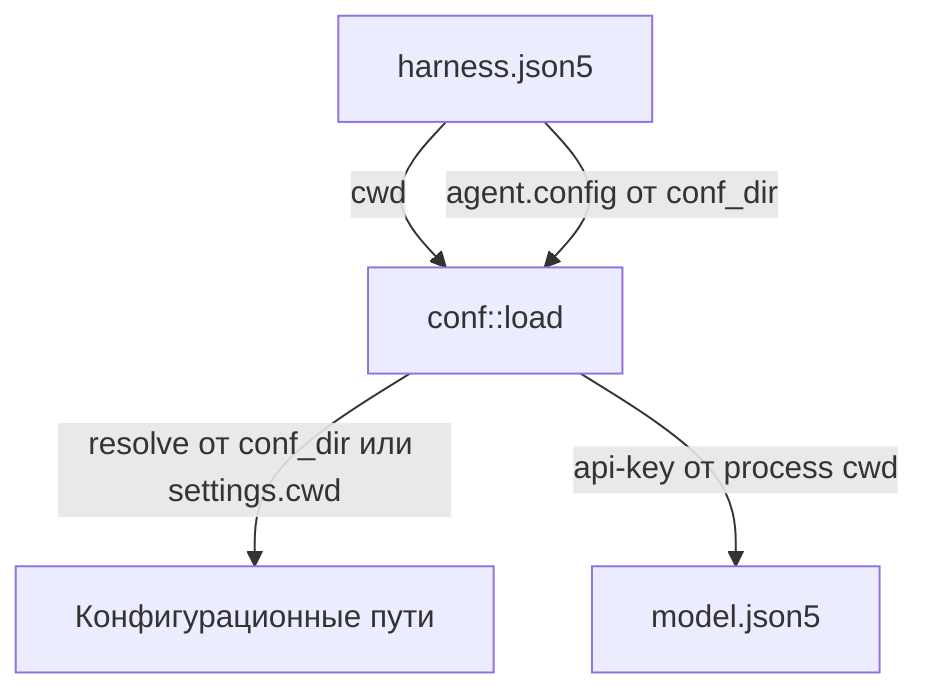
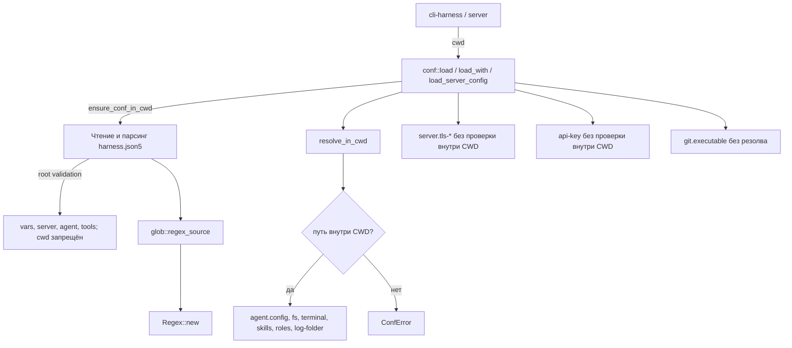

# Phase-7, задача 1: CWD first + deprecated-dir-patterns — архитектура

## До

- Источник CWD — файл конфига.
- Разные правила резолва для разных групп путей.
- Нет корневой валидации и нет glob-паттернов.

## После

- CWD приходит только из вызывающего кода.
- Единый помощник `resolve_in_cwd` для всех рабочих путей конфига.
- Осознанные исключения вынесены из общего правила.
- `deprecated-dir-patterns` валидируются и компилируются в `conf`.

## Почему

- Единственный источник истины CWD — процесс запуска, а не файл.
- Один помощник резолва упрощает проверку «внутри CWD» и делает поведение предсказуемым.
- Отдельный модуль `glob` владеет трансляцией glob → regex, а `load_fs` только валидирует и компилирует.
