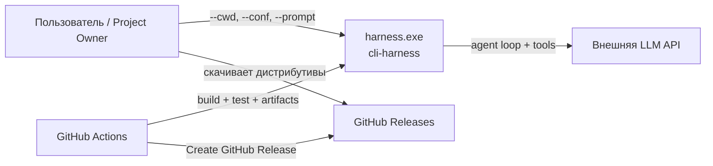
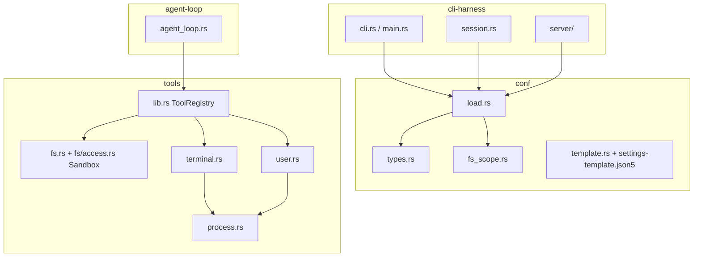
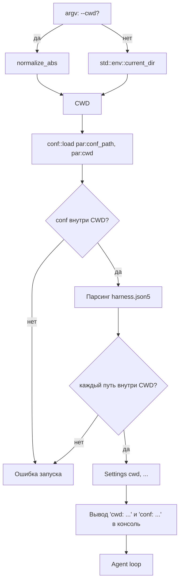
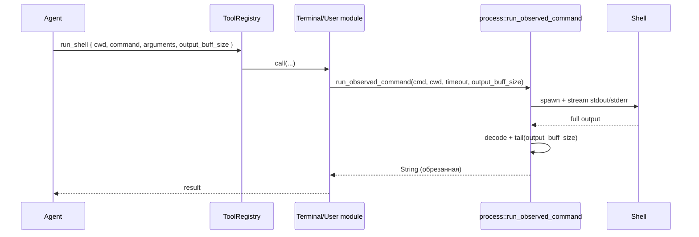
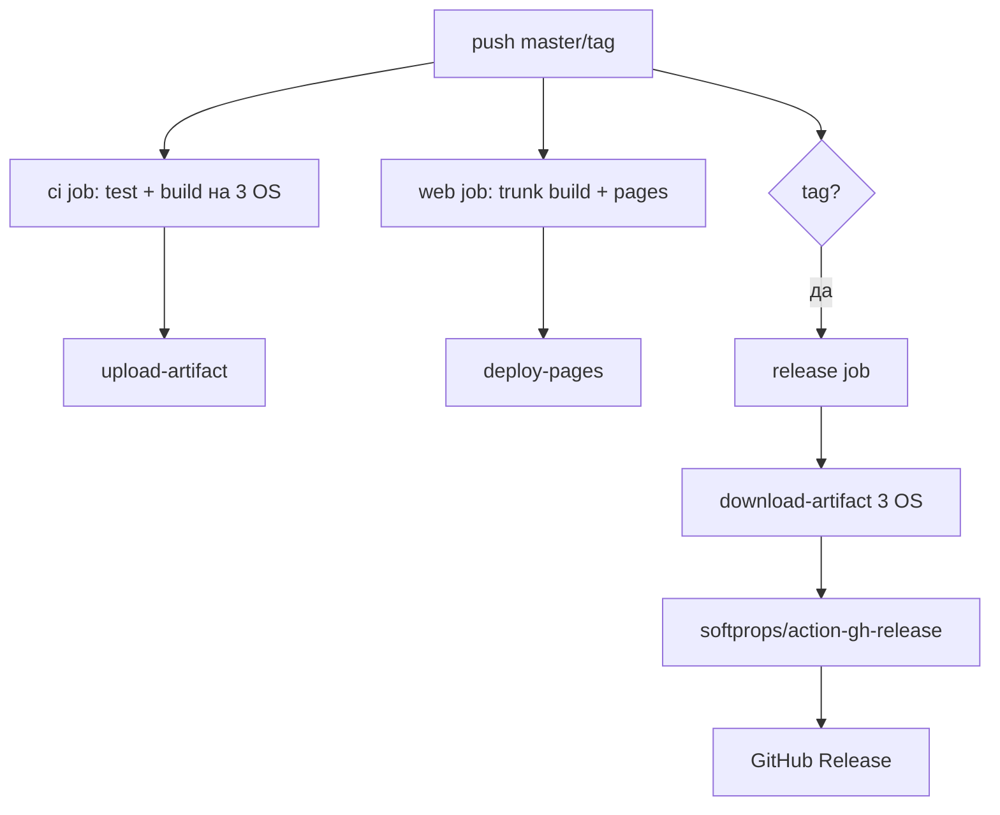

# Consulting 1 — Phase 7. Архитектура решения

## 1. Контекстная схема (C4 Context)



## 2. Контейнерная схема workspace



## 3. CWD first

### 3.1. Новая модель владения CWD



### 3.2. Изменения по крейтам

#### `crates/conf`
- `types.rs`
  - `ServerSettings` / `Settings` **сохраняют** поле `cwd` как рантайм-значение,
    но оно больше не читается из json5.
  - Убрать/перестать требовать ключ `cwd` в корне конфига.
  - `conf_dir` оставить только как информационный путь конфига (для вывода
    и API); он больше не используется для резолва относительных путей.
- `load.rs`
  - Изменить сигнатуры:
    - `load(conf_path, cwd) -> Result<Settings, ConfError>`
    - `load_server_config(conf_path, cwd) -> Result<ServerConfigState, ConfError>`
    - `load_from_value(root, cwd, chooser) -> Result<Settings, ConfError>`
  - Добавить общий помощник `resolve_in_cwd(raw, cwd) -> Result<PathBuf, ConfError>`:
    - относительный путь → `cwd.join(raw)`;
    - абсолютный путь → оставить;
    - нормализовать `.` / `..`;
    - проверить, что результат внутри `cwd` (по компонентам, Windows
      case-insensitive); иначе — `ConfError`.
  - Все относительные пути конфига проводить через `resolve_in_cwd`:
    - `agent.config`;
    - `tools.fs.available-dirs` / `available-files` / `deprecated-dirs` /
      `deprecated-files`;
    - `tools.terminal.cwd-list`;
    - `tools.skills.<name>.file` и `tools.roles.<name>.file`.
  - `log-folder` продолжает проверяться через `tools::fs::resolve_in_root`
    при создании session dir; дополнительно его можно проверить на уровне
    `conf` как относительный путь внутри CWD.
- `fs_scope.rs`
  - `check_conflicts` уже получает `cwd`; после изменения модели он продолжает
    работать, но дополнительно должен:
    - для каждого элемента allow/deny-списка проверить, что после
      нормализации путь находится внутри `cwd`;
    - конфликты считать так же (пересечение allow/deny по компонентам).
- `template.rs` + `settings-template.json5`
  - Убрать поле `cwd` и `vars.workspace`.
  - Обновить комментарии: «относительные пути вычисляются относительно CWD
    и не могут выходить за его пределы».
- `vars.rs`
  - Без изменений: подстановка выполняется до json5-парсинга.

#### `crates/cli-harness`
- `cli.rs`
  - `--cwd` теперь задаёт сам CWD, а не override json5-поля.
  - `default_conf_path()` остаётся `<process-cwd>/harness.json5`; с учётом
    `--cwd` это будет `<CWD>/harness.json5`.
  - Для `--conf` оставить путь как есть; проверка «conf внутри CWD»
    выполняется после вычисления CWD.
  - Обновить `help.txt`.
- `main.rs`
  - Перед `conf::load_*` вычислить CWD:
    ```rust
    let cwd = match cwd_override {
        Some(raw) => session::resolve_cwd(raw)?,
        None => std::env::current_dir().map_err(...)?
    };
    ```
  - Передавать `cwd` в `conf::load_server_config` / `conf::load`.
  - В `start_new_session` и `start_resume_session` до интерактивного выбора
    агента вывести в консоль:
    - `cwd: <absolute path>`
    - `conf: <absolute path>` (для resume — `settings: from dump`).
  - Для `--dump` CWD берётся из `--cwd` или process cwd; `load_from_value`
    использует его, а не `conf_dir_of(dump)`.
- `session.rs`
  - `resolve_cwd_override(raw, conf_dir)` заменить на `resolve_cwd(raw)` —
    нормализация `--cwd` без привязки к каталогу конфига.
  - `resolve_api_key_override` оставить с базой `settings.cwd`.
- `server/mod.rs`
  - В `serve` вычислить CWD из `options.cwd` или process cwd.
  - Передавать CWD в `conf::load_server_config`.
  - Вывод `cwd:` уже есть в startup info; привести формат к единому виду.

### 3.3. Возобновление из dump
- `dump_settings.rs` больше не должен вычислять `conf_dir_of`.
- В `start_resume_session`:
  ```rust
  let cwd = session::resolve_cwd(cwd_override)?;
  let settings = conf::load_from_value(settings_value, &cwd, chooser)?;
  ```
- `source` в dump хранит конфиг без `cwd`; относительные пути в нём
  пересчитываются от нового CWD. Это ожидаемое поведение: dump возобновляется
  в той директории, из которой запущен процесс (или в явно заданном `--cwd`).

## 4. Output buffer for shell commands

### 4.1. Поток выполнения



### 4.2. Изменения
- `tools/src/process.rs`
  - `run_observed_command(cmd, cwd, timeout_secs, output_buff_size)`.
  - После `decode_command_output` применить `tail_chars(s, output_buff_size)`.
  - Стриминг в stdout оставить полным (для человека).
- `tools/src/terminal.rs`
  - `run_shell` читает `output_buff_size` из args.
  - Schema `run_shell`:
    ```json
    {
      "type": "object",
      "properties": {
        "cwd": {"type": "string"},
        "command": {"type": "string"},
        "arguments": {"type": "string"},
        "output_buff_size": {"type": "integer", "description": "N символов с конца; -1 = весь вывод"}
      },
      "required": ["cwd", "command"]
    }
    ```
  - Рекомендация: `output_buff_size` **опциональный**, default `-1`
    (обратная совместимость и мягкая деградация).
- `tools/src/user.rs`
  - `request_command_shell_execution` читает `output_buff_size` последним
    аргументом; schema и вызов обновляются аналогично.
- `tools/src/lib.rs`
  - Добавить помощник `arg_i64(args, key, default)` для числового аргумента
    (не полагаться только на `arg_str`).
- Семантика `output_buff_size`:
  - `-1` — полный вывод;
  - `0` — пустая строка-результат;
  - `N > 0` — последние `N` **Unicode-символов** вывода.
- Решение по маркеру обрезки: возвращать только хвост без маркера, так как
  агент сам задал размер и знает правило. (Trade-off: без маркера агент не
  узнает факт обрезки, но точный размер не нарушается.)

## 5. RegExp / patterns for Deprecated-Dirs

### 5.1. Рекомендуемая модель
- Ввести в `tools.fs` новый ключ `deprecated-dir-patterns` (массив строк).
- Синтаксис — glob-подобный, как в примерах PO:
  - `**/log` — любой компонент пути с именем `log` на любом уровне;
  - `**/done` — аналогично для `done`;
  - `**/note-*` — любой компонент, начинающийся с `note-`.
- Паттерн применяется к полному нормализованному относительному пути
  (относительно CWD, слэши `/`, без ведущего слэша).
- Для пути-файла паттерн вида `**/log` сработает, если какой-либо компонент
  пути равен `log` (например, `WiKi/todo/log/file.md`).

### 5.2. Трансляция glob → regex (концепт)
| Glob | Regex (упрощённо) |
|------|-------------------|
| `**/log` | `(?:^|/)log(?:/|$)` |
| `**/done` | `(?:^|/)done(?:/|$)` |
| `**/note-*` | `(?:^|/)note-[^/]*(?:/|$)` |

Точная функция трансляции должна:
- экранировать regex-метасимволы в литералах;
- заменять `**/` на `(?:^|.*/)?` либо использовать компонентную форму;
- заменять `*` внутри компонента на `[^/]*`;
- быть покрытой unit-тестами на Windows/Linux.

### 5.3. Изменения
- `conf`
  - `FsSettings` получает `deprecated_dir_patterns: Vec<String>`.
  - `load_fs` валидирует список: непустые строки, без `r:`/`w:` префиксов,
    каждая строка компилируется в regex (через ту же трансляцию) для ранней
    ошибки конфигурации.
  - `fs_scope::check_conflicts` для regex-паттернов не выполняет лексический
    conflict-анализ (слишком дорого и неточно). Конфликт с `available-*`
    проявится в рантайме как отказ доступа.
  - В `conf` добавляется зависимость `regex = "1"` только для валидации
    паттернов (если решено компилировать при загрузке).
- `tools`
  - `Sandbox` хранит `Vec<Regex>` для паттернов.
  - `Sandbox::from_fs` принимает `deprecated_dir_patterns` и компилирует их.
  - `is_deprecated_abs` дополнительно проверяет путь и его ancestors:
    для файла `a/log/x.md` проверяются `a`, `a/log`, `a/log/x.md`;
    для директории `a/log` — `a`, `a/log`.
  - `walk_folder` продолжает пропускать deprecated-узлы, в том числе по
    паттернам.
- `help-user.txt` — описать новый ключ и примеры.

### 5.4. Альтернативы
- **A (рекомендуется): glob-паттерны** — соответствуют примерам PO, просты
  для пользователя, трансляция локальна.
- **B: «чистый» regex** — более гибко, но примеры `**/log` невалидны как
  regex, а пользователю придётся писать сложные выражения.
- **C: поддержать и glob, и regex** (например, префиксы `re:` / `glob:`) —
  избыточно для phase-7 (YAGNI).

## 6. GitHub release action

### 6.1. Текущая схема workflow



### 6.2. Доработки
1. **Сверка версии тега и Cargo.toml** в `release` job:
   - вычислить `cargo_version` из `[workspace.package].version`;
   - вычислить `tag_version = github.ref_name` с отрезанным `v` /
     `harness-` префиксом по правилу;
   - при несовпадении падать с понятным сообщением.
2. **Release notes**:
   - `softprops/action-gh-release@v2` с `generate_release_notes: true`
     (GitHub сгенерирует список merged PR);
   - либо `body` из `CHANGELOG.md` при его появлении.
3. **Контрольные суммы**:
   - после подготовки `release/*` посчитать `sha256sum` в `release/*.sha256`;
   - прикладывать файлы контрольных сумм к релизу.
4. **Именование ассетов** (привести к единому стилю):
   - `harness-<version>-windows.exe`
   - `harness-<version>-linux`
   - `harness-<version>-macos`
   - `harness-<version>-<os>.sha256`
5. **Права и условия запуска**:
   - `release` job уже имеет `permissions: contents: write`; оставить.
   - Ограничить создание релиза только тегами `v*` (или оставить `harness-*`,
     если такие теги действительно релизные).
6. **Устойчивость**:
   - шаг `Prepare release assets` должен проверять, что все три файла
     существуют, до вызова action-gh-release (`if-no-files-found: error`
     уже стоит на upload).
   - При отсутствии артефакта нужного имени job должен падать явно.

### 6.3. Варианты реализации
- **Вариант 1 (MVP, рекомендуется):** доработать существующий `ci.yml`.
  Дёшево, всё уже почти есть.
- **Вариант 2:** выделить отдельный `release.yml`. Чище разделение CI/CD,
  но дублирует чтение версии и настройку триггеров.
- **Вариант 3:** перейти на `gh release create` через `gh` CLI. Гибко, но
  требует больше shell-кода; менее декларативно, чем action-gh-release.

Рекомендуется **Вариант 1**: оставить `ci.yml`, доработать существующий
`release` job до требований выше.

## 7. Сводная таблица изменений по крейтам

| Крейт / файл | CWD first | Output buffer | RegExp dirs | Release |
|---|---|---|---|---|
| `conf/src/types.rs` | + | | + | |
| `conf/src/load.rs` | + | | + | |
| `conf/src/fs_scope.rs` | + | | + | |
| `conf/src/template.rs` | + | | | |
| `conf/settings-template.json5` | + | | + | |
| `conf/Cargo.toml` | | | + (`regex`) | |
| `cli-harness/src/cli.rs` | + | | | |
| `cli-harness/src/main.rs` | + | | | |
| `cli-harness/src/session.rs` | + | | | |
| `cli-harness/src/server/mod.rs` | + | | | |
| `cli-harness/help.txt` | + | | | |
| `agent-loop/src/dump_settings.rs` | + | | | |
| `tools/src/process.rs` | | + | | |
| `tools/src/terminal.rs` | | + | | |
| `tools/src/user.rs` | | + | | |
| `tools/src/lib.rs` | | + | | |
| `tools/src/fs/access.rs` | | | + | |
| `tools/help-user.txt` | + | + | + | |
| `.github/workflows/ci.yml` | | | | + |
