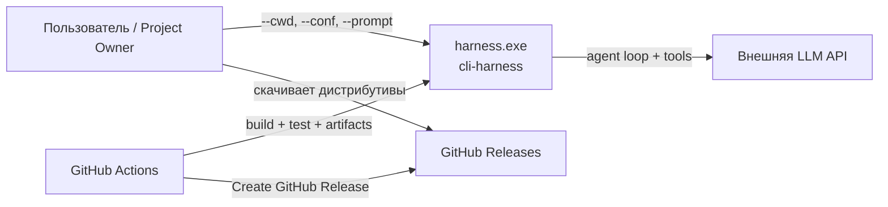
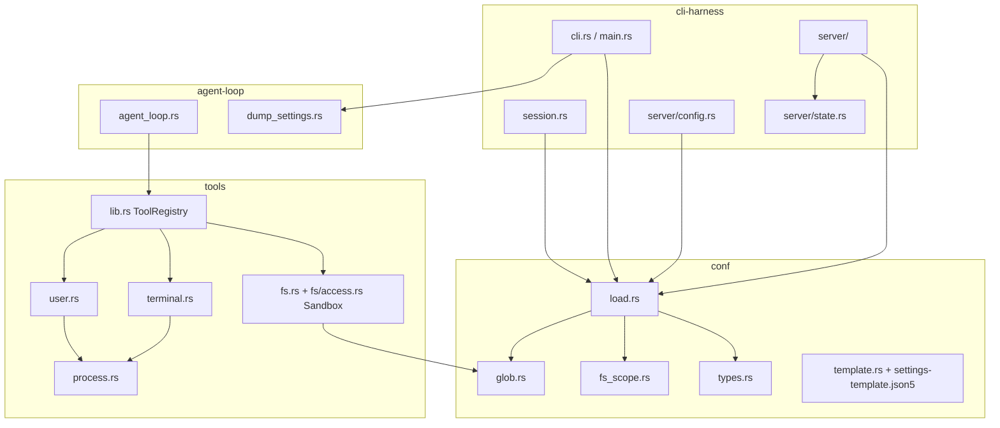
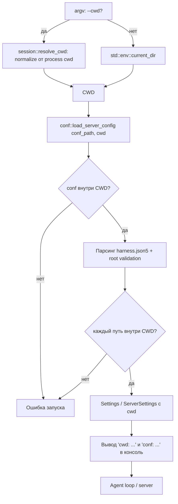
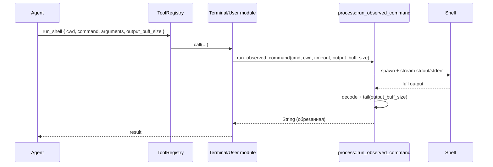
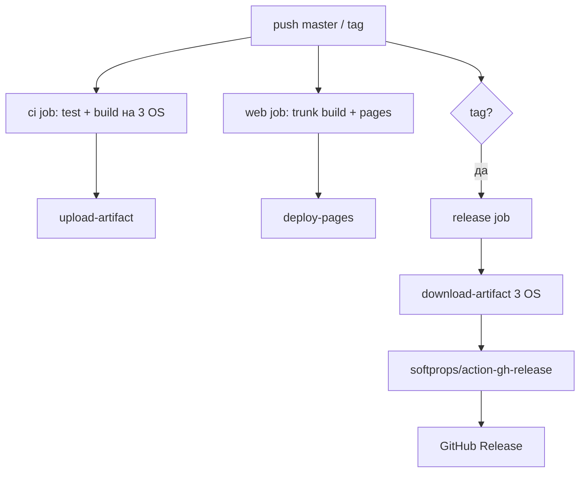

# Consulting 2 — Phase 7. Архитектура решения

## 1. Контекстная схема (C4 Context)



## 2. Контейнерная схема workspace



## 3. CWD first

### 3.1. Новая модель владения CWD



Единственный источник истины для CWD — процесс запуска:
- `--cwd <path>` — нормализуется от process cwd (абсолютный оставляется);
- нет `--cwd` — `std::env::current_dir()`.

Конфиг больше не управляет CWD. Наличие ключа `cwd` в `harness.json5` —
ошибка загрузки с отдельным сообщением.

### 3.2. Изменения по крейтам

#### `crates/conf`

- `types.rs`
  - `Settings.cwd` и `ServerSettings.cwd` остаются рантайм-полями, но больше
    не читаются из json5; их заполняет вызывающий код.
  - `Settings.conf_dir` / `ServerSettings.conf_dir` остаются только как
    информационный путь конфига; для резолва относительных путей они больше
    не используются.
  - `FsSettings` получает `deprecated_dir_patterns: Vec<String>`.
- `load.rs`
  - Новые сигнатуры:
    - `load(conf_path, cwd) -> Result<Settings, ConfError>`
    - `load_with(conf_path, cwd, chooser) -> Result<Settings, ConfError>`
    - `load_from_value(root, cwd, chooser) -> Result<Settings, ConfError>`
    - `load_server_config(conf_path, cwd) -> Result<ServerConfigState, ConfError>`
  - `cwd` — всегда переданное извне значение; `cwd_override` и чтение `cwd`
    из json5 удаляются.
  - `load` / `load_with` / `load_server_config` первым делом:
    - приводят `conf_path` к абсолютному виду;
    - проверяют, что conf находится внутри `cwd` (`ensure_conf_in_cwd`);
    - при выходе за пределы возвращают `Err(ConfError)`, а не
      `ServerConfigState::Invalid` (сервер/консоль не стартуют).
  - Добавляется общий помощник `resolve_in_cwd(raw, cwd) -> Result<PathBuf, ConfError>`:
    - относительный путь → `cwd.join(raw)`;
    - абсолютный путь → оставить;
    - нормализовать `.` / `..`;
    - проверить, что результат внутри `cwd` по компонентам (Windows
      case-insensitive); иначе — `ConfError`.
  - Все относительные пути конфига проводятся через `resolve_in_cwd`:
    - `agent.config`;
    - `tools.fs.available-dirs` / `available-files` /
      `deprecated-dirs` / `deprecated-files`
      (для allow/deny строк — после снятия `r:`/`w:` префикса);
    - `tools.terminal.cwd-list`;
    - `tools.skills.<name>.file` и `tools.roles.<name>.file`;
    - `agent.log-folder`.
  - `deprecated-dir-patterns` — это не пути, а glob-строки; они
    валидируются через `glob::regex_source` и `Regex::new` (см. раздел 5).
  - Корневая валидация `harness.json5`: допустимы только `vars`, `server`,
    `agent`, `tools`. Неизвестный корневой ключ — ошибка; для `cwd` даётся
    отдельное сообщение «задайте CWD через `--cwd` или запустите процесс из
    целевой директории».
  - `server_settings_from_value(root, cwd)` использует переданный `cwd` и
    вызывает `resolve_in_cwd` для `agent.config` и `tools`.
  - `load_tools(obj, cwd)` больше не принимает `conf_dir`; `load_skills`,
    `load_roles` и `load_named_files` резолвят файлы от `cwd`.
  - `log_folder_from_agent` остаётся строкой, но её значение дополнительно
    проверяется через `resolve_in_cwd(cwd, log_folder)`.
  - `parse_tls_path` (см. исключение ниже): относительный TLS-путь резолвится
    от `cwd`, но **не** проверяется на «внутри CWD».
- `fs_scope.rs`
  - `check_conflicts` получает `cwd` и перед сравнением проверяет, что каждый
    allow/deny-элемент после нормализации находится внутри `cwd`; выход за
    пределы — ошибка загрузки.
  - Для `deprecated-dir-patterns` лексический conflict-анализ не выполняется:
    конфликт с `available-*` проявится в рантайме как отказ доступа.
- `glob.rs` (новый модуль)
  - Единственный владелец трансляции `deprecated-dir-patterns` glob → regex.
  - Публичная функция `regex_source(pattern) -> Result<String, ConfError>`;
    `tools` использует её для компиляции, `conf` — для валидации при загрузке.
- `template.rs` + `settings-template.json5`
  - Убрать поле `cwd` и `vars.workspace`.
  - Обновить комментарии: «относительные пути вычисляются относительно CWD
    и не могут выходить за его пределы».
  - Добавить `deprecated-dir-patterns: []` с примерами `**/log`, `**/done`,
    `**/note-*`.

#### `crates/cli-harness`

- `cli.rs`
  - `--cwd` задаёт сам CWD, а не override json5-поля.
  - `default_conf_path()` заменяется на `default_conf_path(cwd: Option<&Path>)`:
    - нет `--cwd` → `<process-cwd>/harness.json5`;
    - есть `--cwd` → `<CWD>/harness.json5`.
  - Один и тот же `default_conf_path(cwd)` используется и для консольного
    `Start`, и для `Serve`; `default_conf_path_for_serve` удаляется.
  - Обновить `help.txt`: `--cwd` — «workspace root», `--conf` — default
    `<cwd>/harness.json5` в обоих режимах.
- `session.rs`
  - `resolve_cwd_override(raw, conf_dir)` заменяется на `resolve_cwd(raw)`:
    - абсолютный → `normalize_abs`;
    - относительный → `current_dir()?.join(raw)` → `normalize_abs`.
  - Добавляется `resolve_abs_path(raw)` для приведения `--conf`/`--dump` путей
    к абсолютному нормализованному виду перед выводом в консоль.
  - `resolve_api_key_override(cwd, raw)` остаётся: относительный путь
    резолвится от CWD, абсолютный используется как есть.
- `main.rs`
  - В `start_new_session` и `start_resume_session`:
    ```rust
    let cwd = session::resolve_cwd(cwd_override.as_deref())?;
    ```
  - Для `Start` без `--dump`: `conf::load_server_config(&conf_path, &cwd)`.
  - Для `--dump`: `conf::load_from_value(settings_value, &cwd, chooser)`;
    вызов `agent_loop::dump_settings::conf_dir_of` удаляется.
  - До интерактивного выбора агента вывести:
    - `cwd: <absolute path>`;
    - `conf: <absolute path>` / для resume — `settings: from dump`.
- `server/mod.rs`
  - В `serve` сначала вычислить `cwd = session::resolve_cwd(options.cwd.as_deref())?`,
    затем `conf::load_server_config(&conf_path, &cwd)`.
  - Удалить блок, который после загрузки переопределял `settings.cwd` через
    `resolve_cwd_override`.
  - Передавать `cwd` в `LoadedServerConfig`.
  - Startup info печатает `cwd` из `LoadedServerConfig.cwd`, даже если
    конфиг `Missing` / `Invalid`.
- `server/state.rs`
  - В `LoadedServerConfig` добавляется `pub cwd: PathBuf` — эффективный CWD
    сервера, доступный REST-слою при любом `config_state`.
- `server/config.rs`
  - Все вызовы `conf::load_server_config` получают вторым аргументом `cwd`:
    - `get_config`;
    - `config_default`;
    - `validate_config_text(text, conf_dir, target_path, cwd)`;
    - `read_existing_parsed(path, cwd)`;
    - `reload_server_config(state, path, cwd)`;
    - `refresh_server_config(state, path, cwd)`.
  - `validate_config_text` прокидывает CWD сервера в загрузку временного файла,
    а не полагается на process cwd.
  - `PUT /api/v1/config` берёт CWD из `state.config.cwd` и передаёт его в
    валидацию и перезагрузку.

#### `crates/agent-loop`

- `dump_settings.rs`
  - Удалить `conf_dir_of` и все его использования.
  - `extract` / `embed` остаются без изменений; `settings.source` больше не
    содержит `cwd`.

### 3.3. Возобновление из dump
- `start_resume_session` больше не вычисляет `conf_dir_of`.
- CWD берётся из `--cwd` или process cwd; `load_from_value` пересчитывает все
  относительные пути от нового CWD.
- `Settings.conf_dir` для dump-загрузки заполняется значением CWD
  (информационное поле).

### 3.4. Осознанные исключения из правила «все пути внутри CWD»

1. **`server.tls-cert` / `server.tls-key`**
   - Относительный путь резолвится от CWD.
   - Абсолютный путь используется как есть.
   - Проверка «внутри CWD» **не применяется**: сертификаты и ключи часто
     лежат в системных/пользовательских каталогах вне рабочей директории.
   - Исключение фиксируется в `settings-template.json5`, `help-user.txt`
     и тестах.
2. **`api-key` в model-файлах**
   - Относительный путь к файлу ключа резолвится от CWD.
   - Абсолютный путь используется как есть и может лежать вне CWD.
   - Проверка «внутри CWD» **не применяется**; это секрет, а не рабочий файл.
   - Поведение «если по пути есть файл — читаем его, иначе считаем значение
     литеральным ключом» сохраняется.

## 4. Output buffer for shell commands

### 4.1. Поток выполнения



### 4.2. Изменения
- `tools/src/process.rs`
  - `run_observed_command(cmd, cwd, timeout_secs, output_buff_size)`.
  - После `decode_command_output` применить `tail_chars(s, output_buff_size)`.
  - `tail_chars` реализуется без полного `Vec<char>`:
    `s.chars().rev().take(n).collect::<Vec<_>>().into_iter().rev().collect()`.
  - Стриминг в stdout остаётся полным (для человека).
- `tools/src/lib.rs`
  - Добавить `arg_i64(args, key, default) -> Result<i64, String>`:
    принимает JSON-число или числовую строку, отклоняет bool/null/object/
    array/дробные/выход за `i64`.
  - Вызывающие модули дополнительно проверяют `-1` или `>= 0`.
- `tools/src/terminal.rs`
  - `run_shell` читает `output_buff_size` через `arg_i64(args, "output_buff_size", -1)?`,
    валидирует диапазон и передаёт в `run_observed_command`.
  - Schema `run_shell`:
    ```json
    {
      "type": "object",
      "properties": {
        "cwd": {"type": "string"},
        "command": {"type": "string"},
        "arguments": {"type": "string"},
        "output_buff_size": {
          "type": "integer",
          "description": "N символов с конца; -1 = весь вывод"
        }
      },
      "required": ["cwd", "command"]
    }
    ```
- `tools/src/user.rs`
  - `request_command_shell_execution` читает `output_buff_size` последним
    аргументом (default `-1`), валидирует и передаёт в `run_observed_command`.
  - Schema обновляется аналогично.
- Семантика `output_buff_size`:
  - `-1` — полный вывод;
  - `0` — пустая строка-результат;
  - `N > 0` — последние `N` Unicode-символов вывода;
  - `< -1` или нецелое — ошибка tool call.
- Маркер обрезки не возвращаем: агент сам задал размер и знает правило.

## 5. Deprecated-dir-patterns (glob)

### 5.1. Модель
- В `tools.fs` добавляется ключ `deprecated-dir-patterns` (массив строк,
  опциональный, default `[]`).
- Поддерживаемое подмножество glob:
  - паттерн обязан иметь вид `**/<component>`;
  - `<component>` — один компонент пути без `/` и без вложенного `**`;
  - внутри компонента допускается `*` (ноль и более символов, кроме `/`).
- Примеры допустимых: `**/log`, `**/done`, `**/note-*`, `**/build-*`.
- Недопустимые: `log/**`, `**/log/**`, `foo/**/bar`, `**`, `**/log/**/x`,
  `**/log/`.
- Паттерн применяется к нормализованному относительному пути
  (относительно CWD, слэши `/`, без ведущего слэша).
- Для проверяемого пути дополнительно проверяются все ancestor-пути:
  - для файла `a/log/x.md` → `a`, `a/log`, `a/log/x.md`;
  - для директории `a/log` → `a`, `a/log`.

### 5.2. Трансляция glob → regex
- Единственная функция `conf::glob::regex_source(pattern)`:
  - нормализует слэши (`\` → `/`);
  - на Windows приводит паттерн к нижнему регистру;
  - требует префикс `**/` и ровно один компонент после него;
  - в компоненте `*` → `[^/]*`, литералы экранируются `regex::escape`;
  - итог: `(?:^|/)` + компонентный regex + `(?:/|$)`.
- Примеры:
  - `**/log` → `(?:^|/)log(?:/|$)`;
  - `**/done` → `(?:^|/)done(?:/|$)`;
  - `**/note-*` → `(?:^|/)note-[^/]*(?:/|$)`.
- Матчинг идёт по относительному пути, также нормализованному
  (слэши `/`, на Windows — lowercase). На Unix матчинг регистрозависимый.

### 5.3. Изменения
- `conf`
  - `FsSettings.deprecated_dir_patterns: Vec<String>`.
  - `load_fs` читает новый ключ, для каждой строки вызывает
    `glob::regex_source` и компилирует `Regex` (ранняя ошибка конфигурации).
  - В `conf/Cargo.toml` добавляется `regex = "1"`.
- `tools`
  - `Sandbox` хранит `Vec<Regex>` для паттернов.
  - `Sandbox::from_fs` принимает `deprecated_dir_patterns` и компилирует их
    через `conf::glob::regex_source` (одинаковая трансляция с `conf`).
  - `is_deprecated_abs` дополнительно проверяет относительный путь и его
    ancestors по скомпилированным паттернам.
  - `walk_folder` продолжает пропускать deprecated-узлы, в том числе по
    паттернам (через `is_deprecated`).
- `tools/help-user.txt` — описать новый ключ, допустимый синтаксис и примеры.

## 6. GitHub release action

### 6.1. Текущая схема workflow



### 6.2. Целевая схема release job

```mermaid
flowchart TD
    PUSH[push master / tag] --> CI[ci job: test + build на 3 OS]
    CI --> ART[upload-artifact windows/linux/macos]
    PUSH --> REL{tag v*?}
    REL -->|да| VER[verify tag == Cargo.toml version]
    VER --> DL[download-artifact 3 OS]
    DL --> ASSETS[prepare release/* + sha256]
    ASSETS --> GHRELEASE[softprops/action-gh-release@v2 generate_release_notes: true]
    GHRELEASE --> RELOUT[GitHub Release]
```

### 6.3. Доработки `ci.yml`
1. **Именование артефактов (upload и download синхронно):**
   - Windows: `harness-<version>-windows.exe`;
   - Linux: `harness-<version>-linux`;
   - macOS: `harness-<version>-macos`.
   - В `ci` job меняется шаг `Artifact name and path` (Windows-имя).
   - Валидационный regex шага «Delete previous artifacts with the same name»
     расширяется: `^harness-[0-9]+\.[0-9]+\.[0-9]+(-linux|-macos|-windows)?(\.exe)?$`.
2. **Триггер релиза:**
   - `if: startsWith(github.ref, 'refs/tags/v')` — релиз только для тегов `v*`.
   - Теги `harness-*` остаются CI-сборкой без создания релиза.
3. **Сверка версии:**
   - В `release` job после чтения `[workspace.package].version`:
     ```bash
     tag_version="${GITHUB_REF_NAME#v}"
     if [ "$tag_version" != "$version" ]; then
       echo "Tag '$GITHUB_REF_NAME' does not match Cargo.toml version '$version'" >&2
       exit 1
     fi
     ```
4. **Скачивание артефактов:**
   - `Download Windows artifact`: name `harness-<version>-windows.exe`.
   - Linux/macOS — имена без изменений.
5. **Подготовка ассетов:**
   - `release/harness-<version>-windows.exe`
   - `release/harness-<version>-linux`
   - `release/harness-<version>-macos`
   - Проверить существование всех трёх файлов до вызова action.
   - Посчитать `sha256sum` в `release/*.sha256`.
6. **Создание релиза:**
   - `softprops/action-gh-release@v2` с `generate_release_notes: true`
     и `files: release/*`.
   - `permissions: contents: write` сохраняется.
7. **Вариант реализации:** дорабатываем существующий `ci.yml`
   (MVP, дёшево, всё уже почти есть). Отдельный `release.yml` и `gh` CLI
   не вводятся.

## 7. Сводная таблица изменений по крейтам

| Крейт / файл | CWD first | Output buffer | Deprecated-dir-patterns | Release |
|---|---|---|---|---|
| `conf/src/types.rs` | + | | + | |
| `conf/src/load.rs` | + | | + (root validation, glob validation) | |
| `conf/src/fs_scope.rs` | + | | + | |
| `conf/src/glob.rs` (новый) | | | + | |
| `conf/src/lib.rs` | | | + (`pub mod glob`) | |
| `conf/src/template.rs` | + | | | |
| `conf/settings-template.json5` | + | | + | |
| `conf/Cargo.toml` | | | + (`regex`) | |
| `Cargo.lock` (workspace) | | | + (при необходимости) | |
| `cli-harness/src/cli.rs` | + (default conf path для консоли) | | | |
| `cli-harness/src/main.rs` | + | | | |
| `cli-harness/src/session.rs` | + | | | |
| `cli-harness/src/server/mod.rs` | + | | | |
| `cli-harness/src/server/state.rs` | + (`LoadedServerConfig.cwd`) | | | |
| `cli-harness/src/server/config.rs` | + (5 call-site'ов `load_server_config`) | | | |
| `cli-harness/help.txt` | + | | | |
| `agent-loop/src/dump_settings.rs` | + (удалить `conf_dir_of`) | | | |
| `tools/src/process.rs` | | + | | |
| `tools/src/terminal.rs` | | + | | |
| `tools/src/user.rs` | | + | | |
| `tools/src/lib.rs` | | + (`arg_i64`) | | |
| `tools/src/fs/access.rs` | | | + | |
| `tools/src/fs.rs` | | | + | |
| `tools/help-user.txt` | + | + | + | |
| `harness.json5` (корень проекта) | + | | + | |
| `.github/workflows/ci.yml` | | | | + |
| Unit-тесты `conf` | + | | + | |
| Unit-тесты `tools` | | + | + | |
