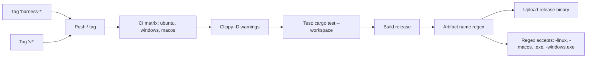
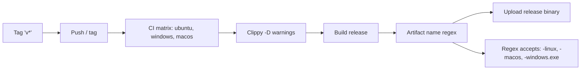

# Code cleanup before final merge — pipeline

## До

## После

## Почему

- Unit-тесты native-крейтов удалены перед финальным merge, поэтому шаг `Test` (`cargo test --workspace`) больше не проверяет ничего полезного и удалён из CI.
- Legacy-триггер `'harness-*'` удалён: релизы запускаются только по тегам `v*`.
- Regex имени артефакта ужесточён: legacy-вариант `harness-<version>.exe` больше не принимается; целевые имена `harness-<version>-windows.exe`, `harness-<version>-linux`, `harness-<version>-macos` остаются.
