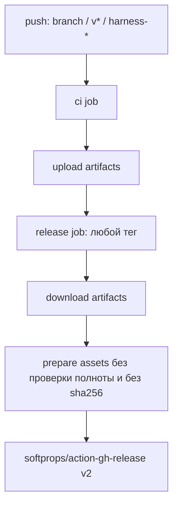
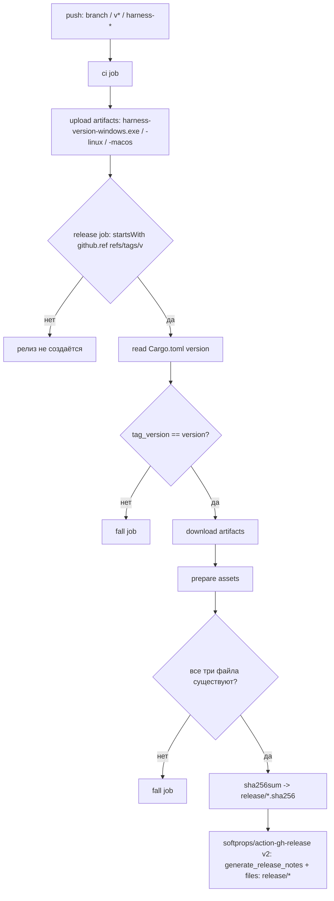

# Изменение pipeline: GitHub release action

## До

## После

## Почему

- `release` job больше не срабатывает на любой тег: теги `harness-*` остаются
  только CI-сборкой, а релиз создаётся исключительно для версионных тегов `v*`.
- Версия тега сверяется с `[workspace.package].version`, чтобы в релиз нельзя
  было опубликовать дистрибутивы с несовпадающей версией.
- Перед вызовом action проверяется полнота ассетов и считаются контрольные
  суммы — релиз не создаётся, если любой из трёх бинарников отсутствует.
- `generate_release_notes: true` использует нативный механизм GitHub вместо
  ручной подготовки release notes.
