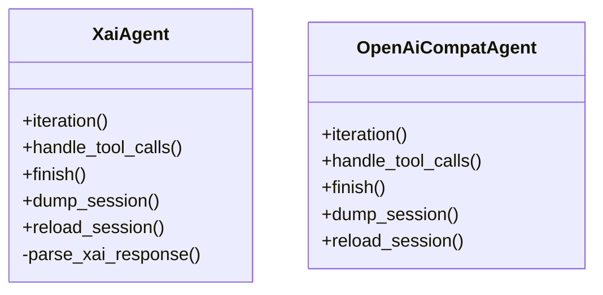
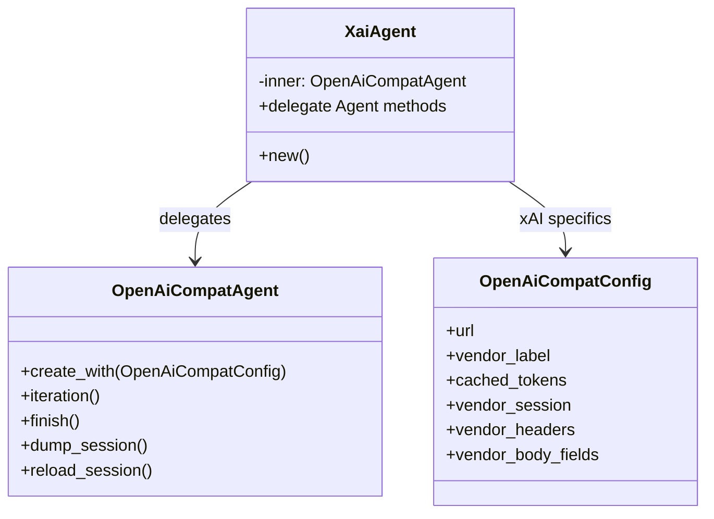

# Архитектура: XaiAgent как обёртка

## До

`XaiAgent` дублировал реализацию `OpenAiCompatAgent`, включая парсер и учёт usage.

## После

`XaiAgent` стала тонкой обёрткой; xAI-отличия передаются в `OpenAiCompatAgent`
через `OpenAiCompatConfig`. Парсер xAI удалён, `cached_prompt_text_tokens`
обрабатывается vendor-маппингом в общем парсере.

## Почему

- Устранено главное DRY-нарушение в `agent-loop`.
- xAI-специфика изолирована в данных конфигурации, а не в копии протокола.
- Публичное API агентов не изменилось.
